# Session 01 & 02 - Linux Fundamentals

Environment: Ubuntu 24.04 (`devops-lab`), user `snehangshu`.

---

## Task 1 - Soft Link vs Hard Link

| | Hard link | Soft (symbolic) link |
|---|---|---|
| Command | `ln target linkname` | `ln -s target linkname` |
| Inode | Same inode as the original file | Its own inode, stores the *path* of the target |
| If original is deleted | Data is still accessible (link count just drops by 1) | Link breaks (dangling link) |
| Directories | Not allowed | Allowed |
| Across filesystems | No | Yes |
| `ls -l` shows | Normal file, link count > 1 | `l` type and `link -> target` |

### Hard link

A hard link is just another name for the same inode. Both names point to the same data, so editing one changes the other, and deleting the "original" does not delete the data until the link count reaches 0.

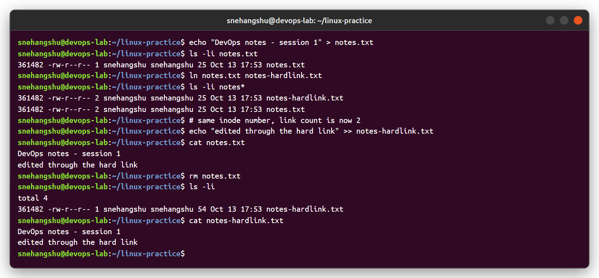

### Soft link

A soft link is a small file that only stores the path to the target. When the target is removed, the link still exists but points to nothing. Soft links can point to directories; hard links to directories are not allowed.

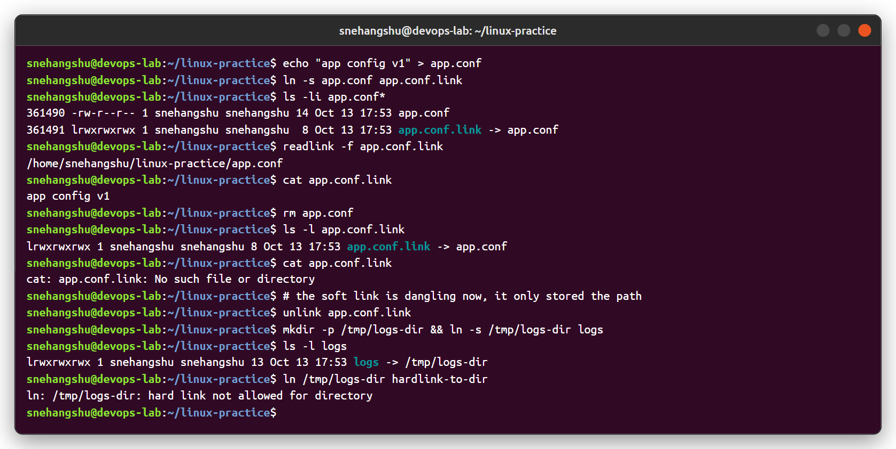

**Delete a link:** `rm linkname` or `unlink linkname` (deleting a soft link never touches the target).

**Interview answer in one line:** a hard link is another directory entry for the same inode, a soft link is a separate file that points to a path.

---

## Task 2 - `adduser` vs `useradd`

| | `useradd` | `adduser` |
|---|---|---|
| Type | Low-level binary (from `passwd` package) | Perl script, friendly front-end that calls `useradd` |
| Home directory | Not created unless `-m` is passed | Created automatically and `/etc/skel` copied |
| Password | Not set (account locked until `passwd`) | Prompts for password |
| Shell | `/bin/sh` from `/etc/default/useradd` unless `-s` | `/bin/bash` |
| Extra info (GECOS) | Only with `-c` | Prompts for full name etc. |
| Use case | Scripts / automation where you pass every flag | Manual user creation on Ubuntu/Debian |

**Which one is recommended on Ubuntu?** `adduser`. It applies the distro defaults (home dir, skel files, bash shell, own group, password) in one step. `useradd` is better for scripts because it is non-interactive and available on every distro.

### `useradd`

`testuser1` was created without a home directory, without a password (`L` = locked) and with `/bin/sh`. With `-m -s -c` it behaves closer to adduser.

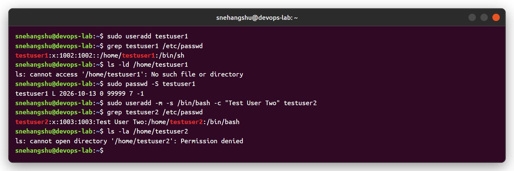

### `adduser` (recommended) - created test user `devuser`

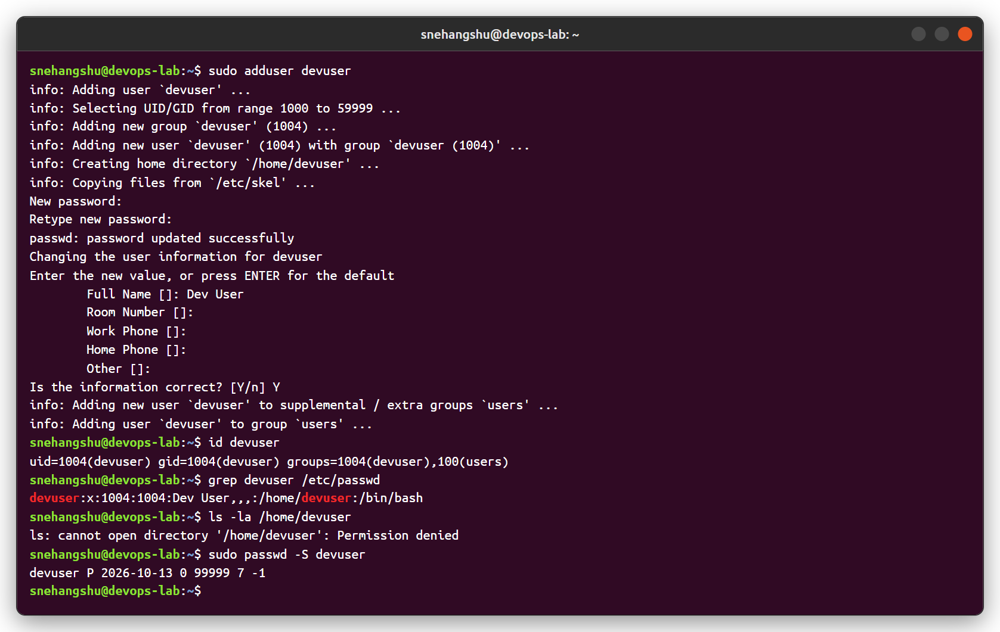

### Comparing the defaults and cleaning up

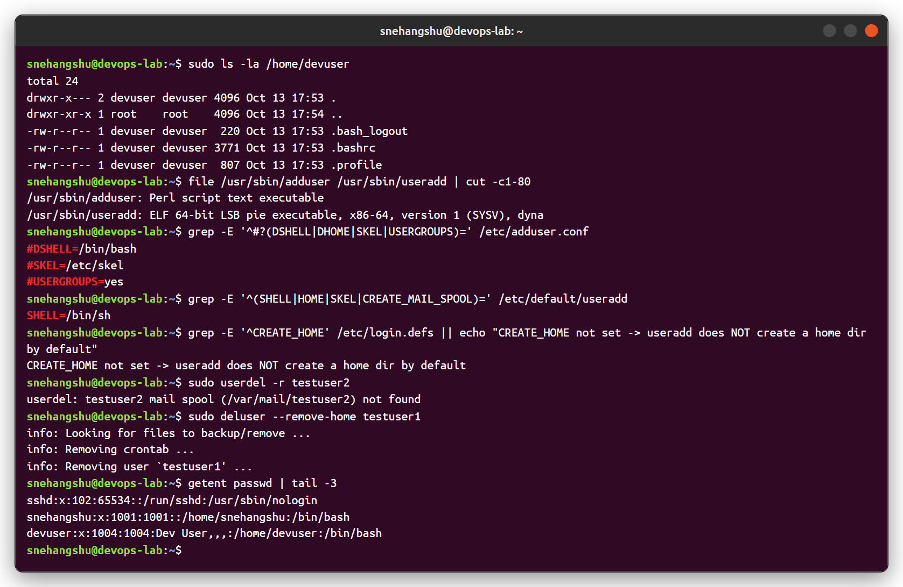

---

## Task 3 - `journalctl`

`journalctl` reads logs collected by **systemd-journald** (kernel, services, `logger`, sudo, etc.). The logs are stored in binary format so they can be filtered by unit, priority, time, boot and so on.

| Command | What it does |
|---|---|
| `journalctl` | All logs, oldest first |
| `journalctl -n 20` | Last 20 lines |
| `journalctl -f` | Follow live (like `tail -f`) |
| `journalctl -u nginx` | Logs of one service |
| `journalctl -u nginx -u ssh` | Multiple services |
| `journalctl -p err` | Only priority err and above |
| `journalctl --since "15 min ago"` / `--since today` | Time filter |
| `journalctl -t backup-job` | Filter by syslog identifier |
| `journalctl -b` / `--list-boots` | Current boot / list boots |
| `journalctl -o json-pretty` | Output as JSON with all fields |
| `journalctl --disk-usage` | Space used by journal files |

### System logs

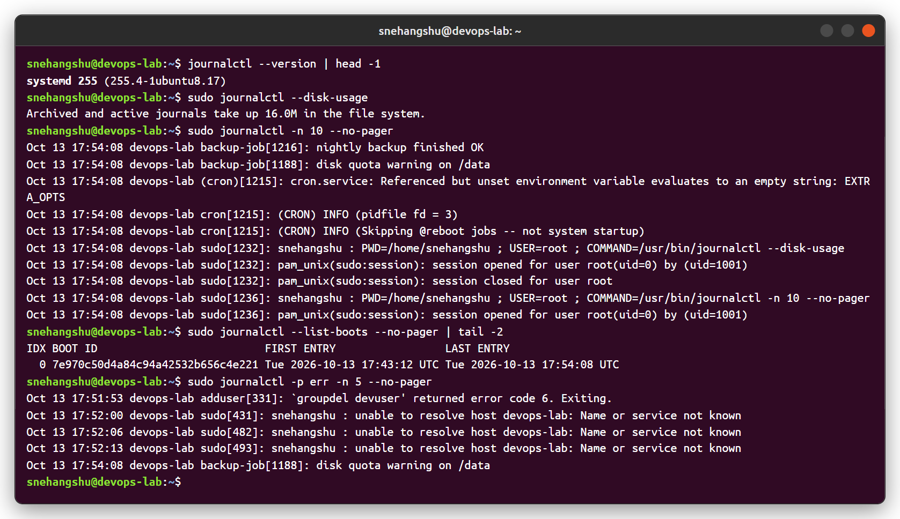

### Logs for a specific service (nginx, cron) and custom tag

I restarted/reloaded nginx and wrote two test messages with `logger -t backup-job` so there was something to look for.

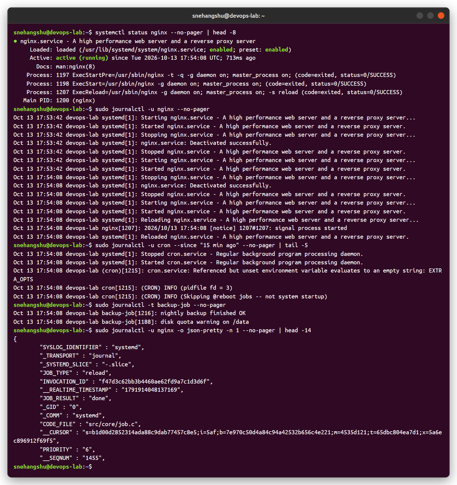

### Following logs live

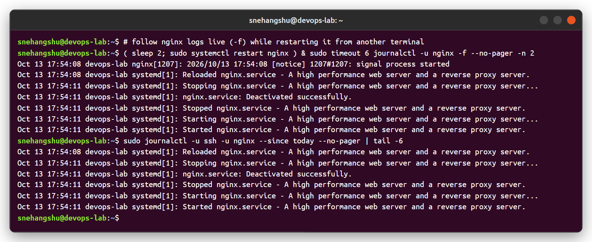

---

## Task 4 - Linux Command Cheat Sheet practice

Practised the commands from the cheat sheet in the course repo (disk usage, users, groups, processes, CPU, logs).

### Files and directories
`pwd, mkdir -p, touch, cp, mv, rm, cat, wc, find, grep, head, tail, chmod, tar, tree`

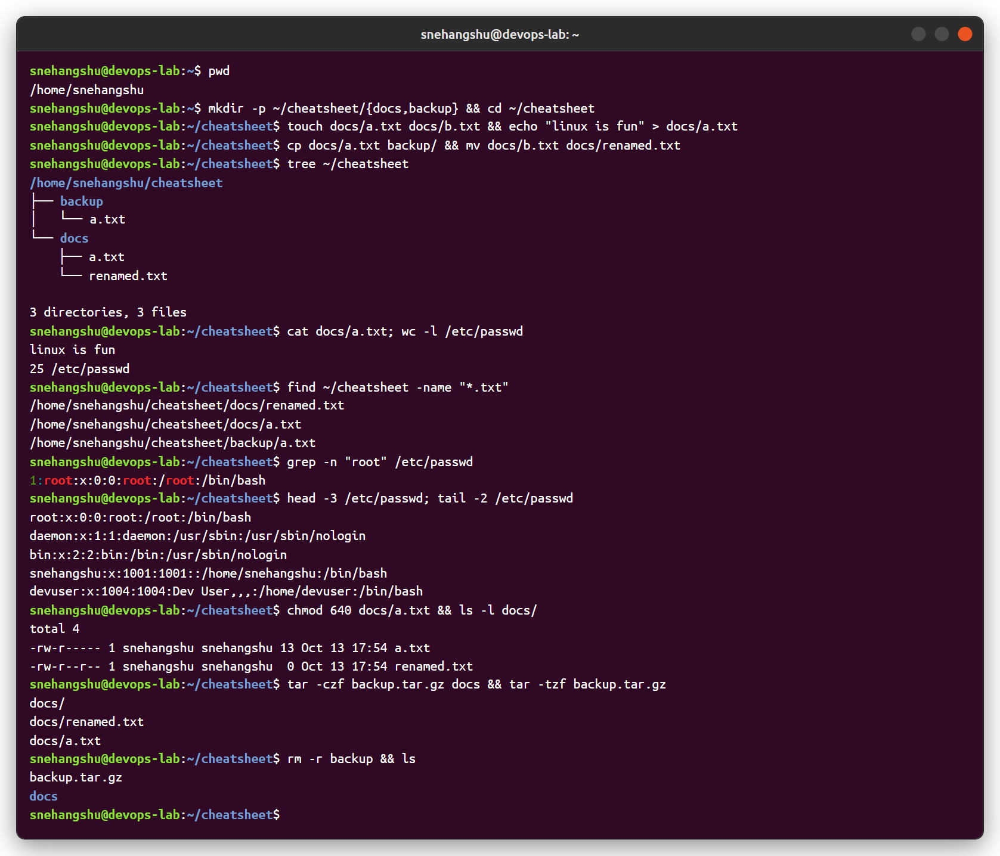

### Disk and memory
`df -h` (filesystem usage), `du -sh` (directory size), `/proc/partitions`, `free -h / -m`, `uname -a`, `nproc`, `uptime`

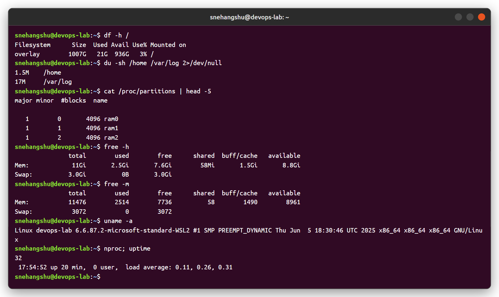

### Users and groups
`whoami, id, compgen -u, lslogins -u, groupadd, usermod -aG, groups, getent group`

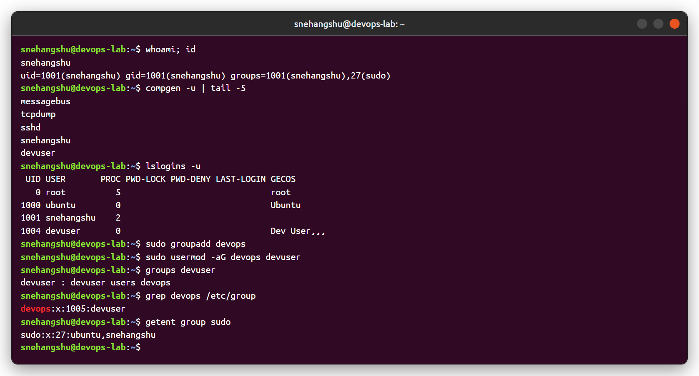

### Processes and CPU
`ps -e`, `ps -eo ... --sort`, `pgrep -a`, `top -bn1`, `vmstat`, `sar -u` (sysstat), `ss -tulnp`, `systemctl status`

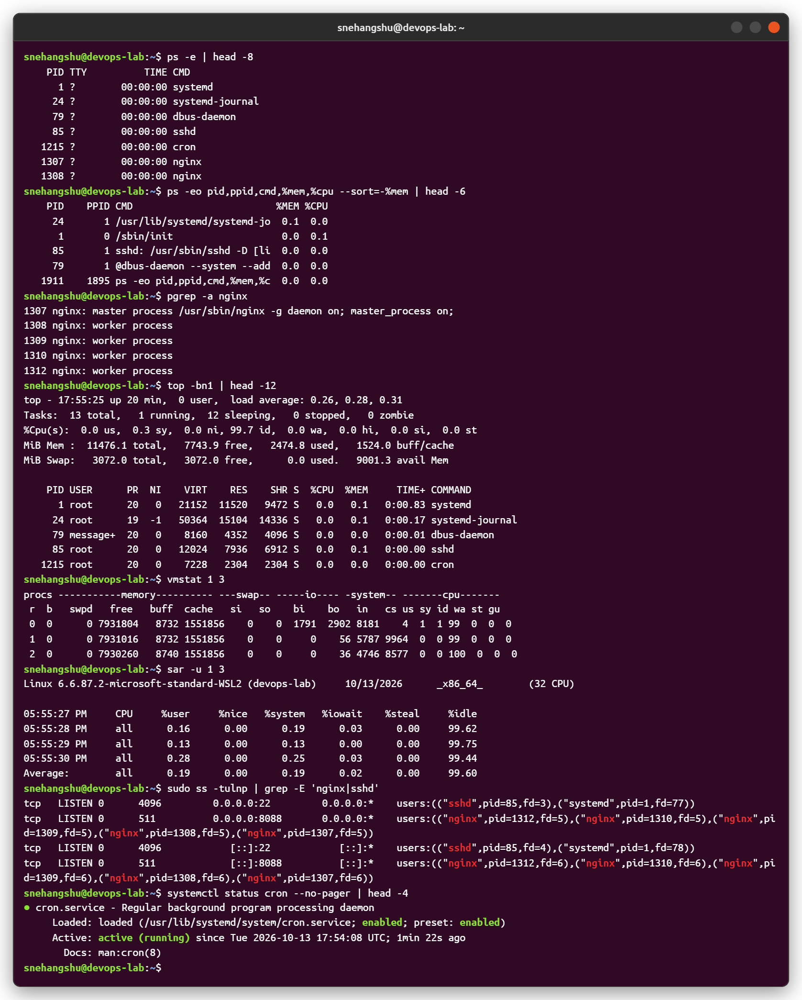

| Command | Purpose |
|---|---|
| `df -h` | Free/used space per filesystem |
| `du -sh <dir>` | Size of a directory |
| `free -h` | RAM and swap usage |
| `ps aux` / `ps -ef` | Snapshot of running processes |
| `top` / `htop` | Live process and CPU view |
| `vmstat 1 5` | CPU, memory, IO every second |
| `sar -u 1 3` | CPU utilisation samples |
| `ss -tulnp` / `netstat -tulnp` | Listening ports and owning process |
| `getent passwd` / `compgen -u` | List users |
| `groupadd`, `usermod -aG` | Create group, add user to group |
| `systemctl status <svc>` | Service state |
| `journalctl -u <svc>` | Service logs |
| `sudo reboot` / `sudo poweroff` | Restart / shutdown |
