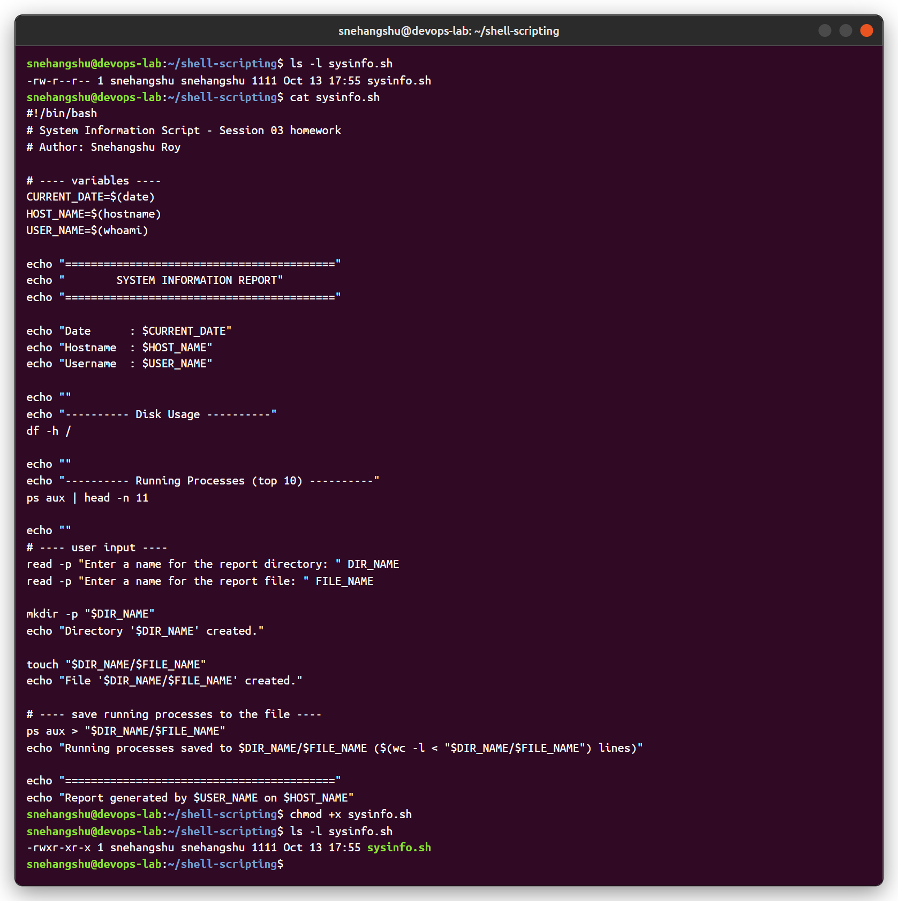
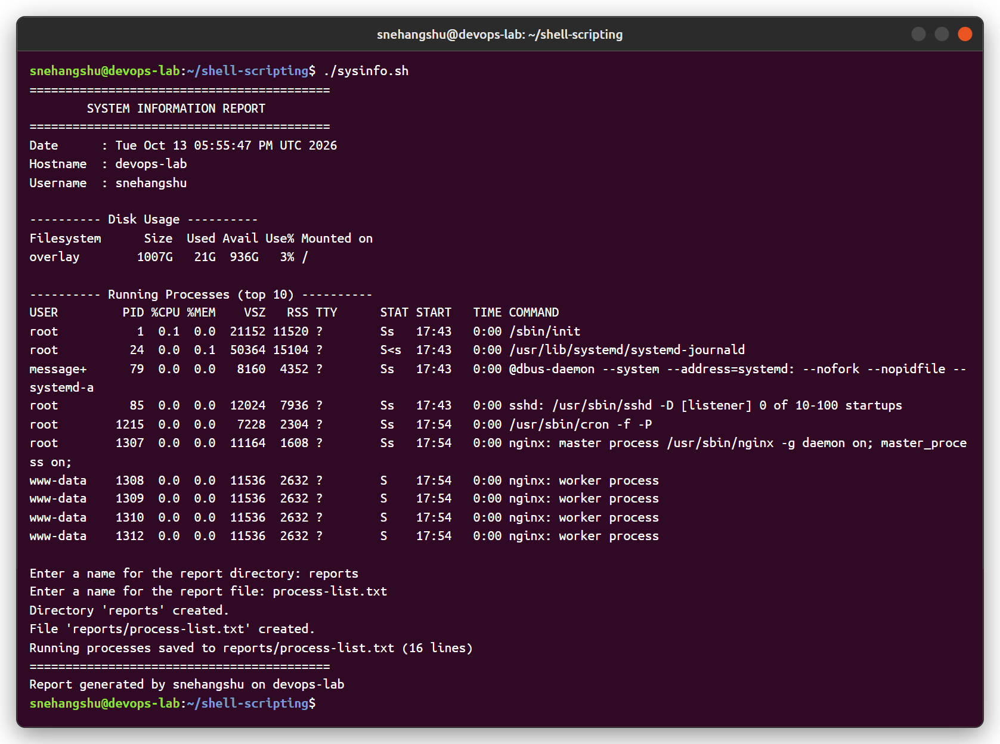
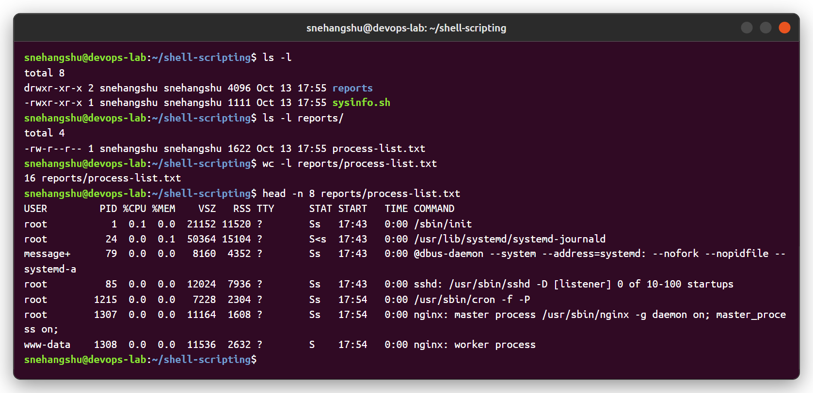

# Session 03 - Shell Scripting

## Task: System Information Script

Script: [`sysinfo.sh`](sysinfo.sh)

What the script does:

| Requirement | How it is done |
|---|---|
| Prints current date | `CURRENT_DATE=$(date)` |
| Prints hostname | `HOST_NAME=$(hostname)` |
| Prints username | `USER_NAME=$(whoami)` |
| Prints disk usage | `df -h /` |
| Prints running processes | `ps aux \| head -n 11` |
| Uses variables | `CURRENT_DATE`, `HOST_NAME`, `USER_NAME`, `DIR_NAME`, `FILE_NAME` |
| Takes user input | `read -p "Enter a name for the report directory: " DIR_NAME` |
| Creates a directory | `mkdir -p "$DIR_NAME"` |
| Creates a file | `touch "$DIR_NAME/$FILE_NAME"` |
| Stores processes in the file | `ps aux > "$DIR_NAME/$FILE_NAME"` |

```bash
#!/bin/bash
# System Information Script - Session 03 homework

CURRENT_DATE=$(date)
HOST_NAME=$(hostname)
USER_NAME=$(whoami)

echo "Date      : $CURRENT_DATE"
echo "Hostname  : $HOST_NAME"
echo "Username  : $USER_NAME"

df -h /
ps aux | head -n 11

read -p "Enter a name for the report directory: " DIR_NAME
read -p "Enter a name for the report file: " FILE_NAME

mkdir -p "$DIR_NAME"
touch "$DIR_NAME/$FILE_NAME"
ps aux > "$DIR_NAME/$FILE_NAME"
```

(full version with headings is in `sysinfo.sh`)

---

## 1. Script file and execute permission



```
snehangshu@devops-lab:~/shell-scripting$ ls -l
total 4
-rw-r--r-- 1 snehangshu snehangshu 1111 Oct 13 17:55 sysinfo.sh
snehangshu@devops-lab:~/shell-scripting$ chmod +x sysinfo.sh
snehangshu@devops-lab:~/shell-scripting$ ls -l sysinfo.sh
-rwxr-xr-x 1 snehangshu snehangshu 1111 Oct 13 17:55 sysinfo.sh
```

## 2. Running the script

Input given: directory = `reports`, file = `process-list.txt`



```
snehangshu@devops-lab:~/shell-scripting$ ./sysinfo.sh
==========================================
        SYSTEM INFORMATION REPORT
==========================================
Date      : Tue Oct 13 05:55:47 PM UTC 2026
Hostname  : devops-lab
Username  : snehangshu

---------- Disk Usage ----------
Filesystem      Size  Used Avail Use% Mounted on
overlay        1007G   21G  936G   3% /

---------- Running Processes (top 10) ----------
USER         PID %CPU %MEM    VSZ   RSS TTY      STAT START   TIME COMMAND
root           1  0.1  0.0  21152 11520 ?        Ss   17:43   0:00 /sbin/init
root          24  0.0  0.1  50364 15104 ?        S<s  17:43   0:00 /usr/lib/systemd/systemd-journald
message+      79  0.0  0.0   8160  4352 ?        Ss   17:43   0:00 @dbus-daemon --system --address=systemd: --nofork --nopidfile
root          85  0.0  0.0  12024  7936 ?        Ss   17:43   0:00 sshd: /usr/sbin/sshd -D [listener] 0 of 10-100 startups
root        1215  0.0  0.0   7228  2304 ?        Ss   17:54   0:00 /usr/sbin/cron -f -P
root        1307  0.0  0.0  11164  1608 ?        Ss   17:54   0:00 nginx: master process /usr/sbin/nginx -g daemon on; master_process on;
www-data    1308  0.0  0.0  11536  2632 ?        S    17:54   0:00 nginx: worker process
www-data    1309  0.0  0.0  11536  2632 ?        S    17:54   0:00 nginx: worker process
www-data    1310  0.0  0.0  11536  2632 ?        S    17:54   0:00 nginx: worker process
www-data    1312  0.0  0.0  11536  2632 ?        S    17:54   0:00 nginx: worker process

Enter a name for the report directory: reports
Enter a name for the report file: process-list.txt
Directory 'reports' created.
File 'reports/process-list.txt' created.
Running processes saved to reports/process-list.txt (16 lines)
==========================================
Report generated by snehangshu on devops-lab
```

## 3. Verifying the directory, file and redirected output



```
snehangshu@devops-lab:~/shell-scripting$ ls -l reports/
total 4
-rw-r--r-- 1 snehangshu snehangshu 1622 Oct 13 17:55 process-list.txt
snehangshu@devops-lab:~/shell-scripting$ wc -l reports/process-list.txt
16 reports/process-list.txt
snehangshu@devops-lab:~/shell-scripting$ head -n 8 reports/process-list.txt
USER         PID %CPU %MEM    VSZ   RSS TTY      STAT START   TIME COMMAND
root           1  0.1  0.0  21152 11520 ?        Ss   17:43   0:00 /sbin/init
root          24  0.0  0.1  50364 15104 ?        S<s  17:43   0:00 /usr/lib/systemd/systemd-journald
...
```

The generated file is committed here as well: [`reports/process-list.txt`](reports/process-list.txt)

## Notes

- `$(command)` runs a command and stores its output in a variable.
- `read -p "text" VAR` prints a prompt and saves what the user types in `VAR`.
- `>` overwrites the file with the command output, `>>` appends.
- `mkdir -p` does not fail if the directory already exists.
- Run with `./sysinfo.sh` (needs `chmod +x`) or `bash sysinfo.sh`.
