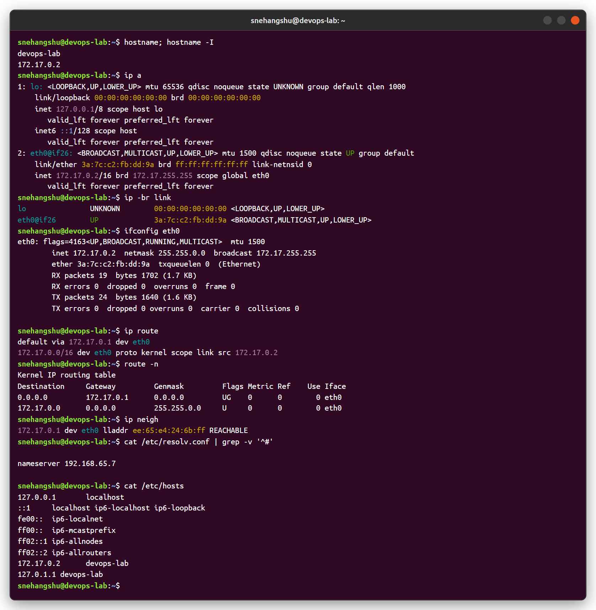
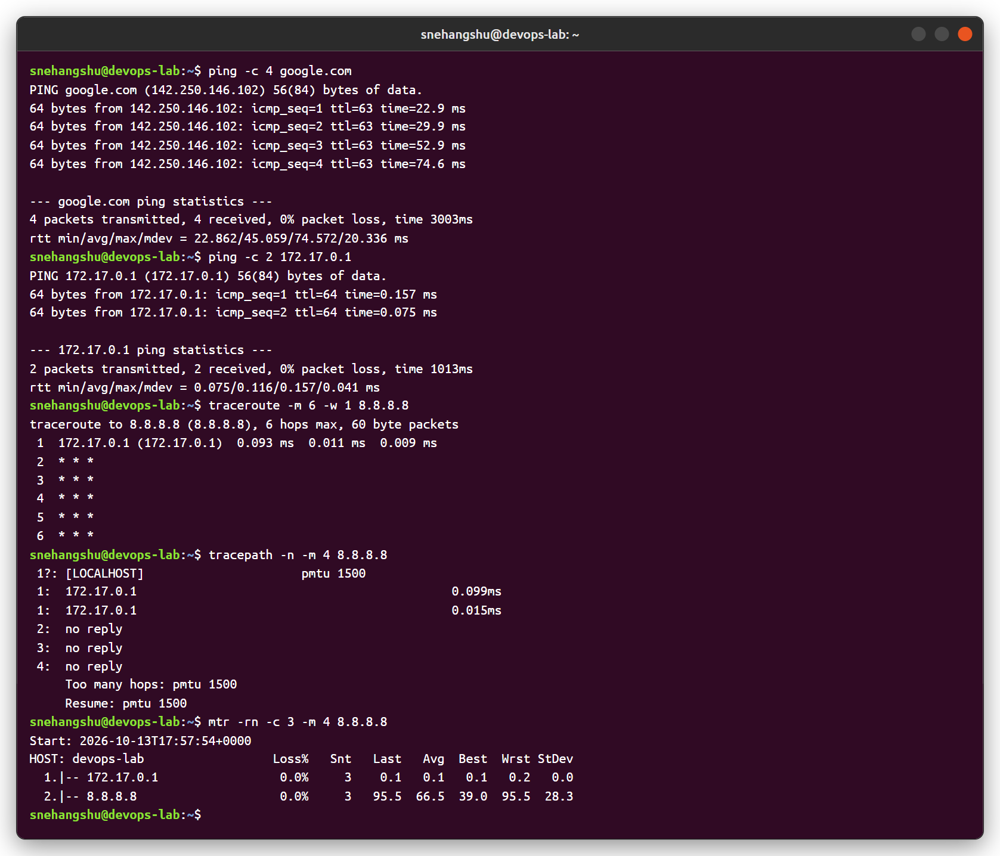
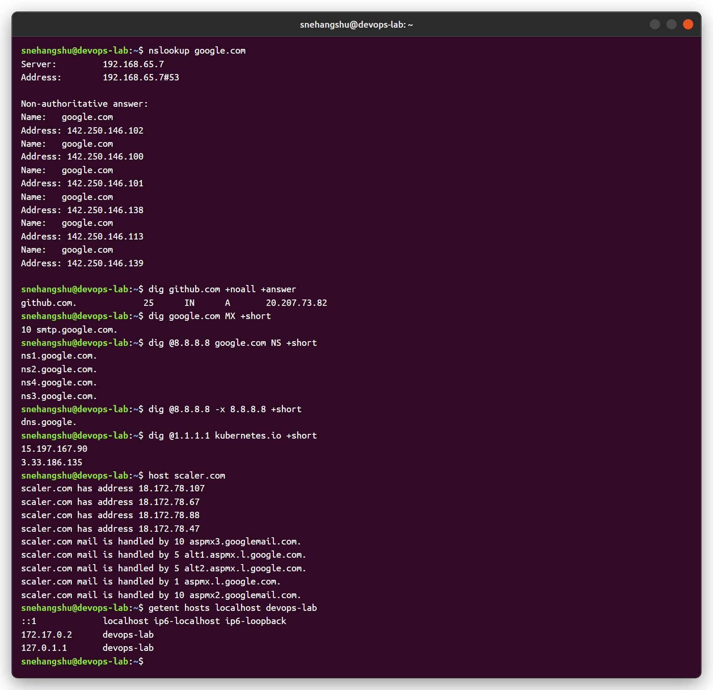
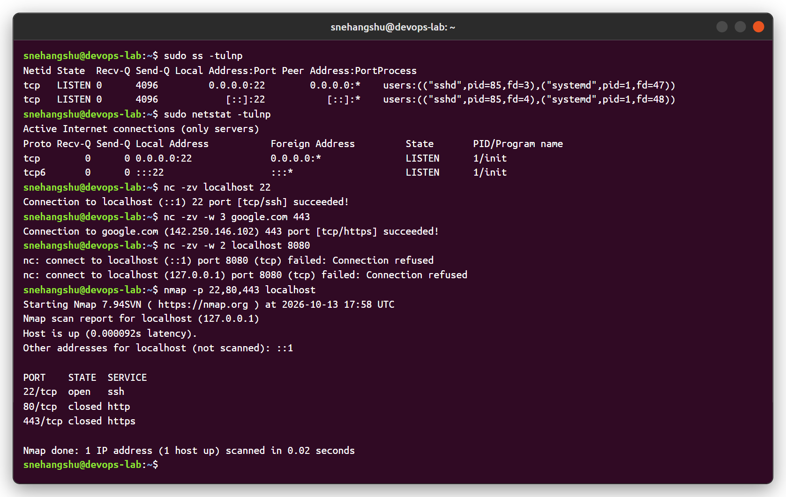
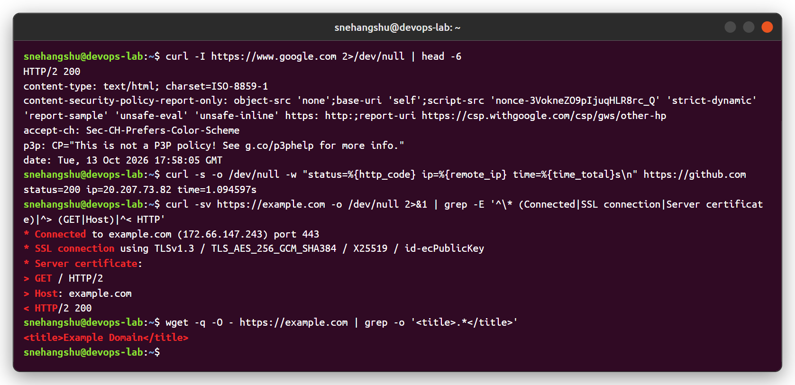
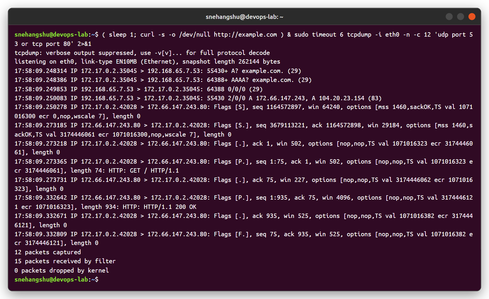

# Session 04 - Networking Fundamentals

Practised the commands from the course networking notes (DHCP / IP, routing, DNS, TCP/UDP ports, HTTP) on an Ubuntu 24.04 box (`devops-lab`).

How a request to google.com flows, mapped to the commands I used:

```
my machine ── gets IP + gateway + DNS (DHCP)        -> ip a, ip route, /etc/resolv.conf
   │
   ├─ "where is google.com?"  (DNS, UDP 53)          -> nslookup, dig, host
   ├─ next hop = default gateway (ARP for its MAC)   -> ip neigh, route -n
   ├─ packets go hop by hop through routers          -> ping, traceroute, tracepath, mtr
   ├─ TCP 3-way handshake to port 443/80             -> nc -zv, ss, netstat, nmap, tcpdump
   └─ HTTP request / response                        -> curl, wget
```

---

## 1. IP address, interfaces and routes



| Command | What I understood |
|---|---|
| `hostname -I` | Prints only the IP addresses of the machine. |
| `ip a` | Shows every interface with MAC (`link/ether`), IPv4/IPv6 address and subnet (`/16`). `lo` is loopback (127.0.0.1). |
| `ip -br link` | Short one-line view of interfaces and their state (UP/DOWN). |
| `ifconfig eth0` | Old (net-tools) way to see IP, netmask, broadcast and RX/TX packet counters. |
| `ip route` / `route -n` | Routing table. `default via 172.17.0.1` = default gateway; anything not in my subnet goes there. Flag `UG` = route is up and uses a gateway. |
| `ip neigh` | ARP table: IP → MAC of devices on the same LAN (here the gateway). |
| `/etc/resolv.conf` | Which DNS server the machine uses (`nameserver`). |
| `/etc/hosts` | Local name → IP mapping, checked before DNS. |

## 2. Connectivity - ping, traceroute, tracepath, mtr



| Command | What I understood |
|---|---|
| `ping -c 4 google.com` | Sends ICMP echo requests. Shows the resolved IP, round-trip time (rtt) and packet loss. `ttl` decreases at every router. |
| `ping 172.17.0.1` | Pinging the gateway gives a very small rtt (< 1 ms) because it is on the same network. |
| `traceroute` | Sends packets with TTL 1, 2, 3... and prints each router that replies. `* * *` means that hop did not reply - my machine is behind a NAT/firewall that drops the "TTL exceeded" replies, which is very common. |
| `tracepath` | Like traceroute but no root needed and also discovers path MTU (`pmtu 1500`). |
| `mtr -r` | traceroute + ping combined, gives loss % and latency per hop. |

## 3. DNS - nslookup, dig, host



| Command | What I understood |
|---|---|
| `nslookup google.com` | Asks the configured DNS server. "Non-authoritative answer" = answer came from a resolver cache, not google's own name server. google.com has many A records (load balancing). |
| `dig github.com +noall +answer` | Shows only the answer section: name, TTL (seconds it can be cached), class `IN`, type `A`, IP. |
| `dig google.com MX +short` | Mail server records with priority. |
| `dig @8.8.8.8 google.com NS` | Query a specific DNS server (`@8.8.8.8`) for the name servers of the domain. |
| `dig -x 8.8.8.8` | Reverse lookup (PTR): IP → name (`dns.google`). |
| `host scaler.com` | Simple output - A records and MX records together. |
| `getent hosts` | Resolves using the system order (`/etc/hosts` first, then DNS). |

## 4. Ports and sockets - ss, netstat, nc, nmap



| Command | What I understood |
|---|---|
| `ss -tulnp` | **t**cp, **u**dp, **l**istening, **n**umeric, **p**rocess. Shows sshd listening on 0.0.0.0:22 (all interfaces). |
| `netstat -tulnp` | Same thing with the older net-tools command. |
| `nc -zv host port` | Checks if a TCP port is open without sending data (`-z`). "succeeded" = open, "Connection refused" = nothing listening. Very useful for checking firewalls / security groups. |
| `nmap -p 22,80,443 localhost` | Port scanner. `open` = service listening, `closed` = host reachable but no service. |

## 5. HTTP - curl and wget



| Command | What I understood |
|---|---|
| `curl -I URL` | Only response headers (HEAD). `HTTP/2 200` = OK. |
| `curl -w "%{http_code} ..."` | Print status code, remote IP and total time - handy for health checks in scripts. |
| `curl -v` | Verbose: shows TCP connect, TLS version/cipher, request headers (`>`) and response headers (`<`). |
| `wget -O -` | Downloads a page/file; `-O -` prints it to stdout. |

## 6. Packet capture - tcpdump

Captured the traffic while running `curl http://example.com`. You can see the full flow: DNS query (A and AAAA) to UDP 53 → DNS reply with IP → TCP 3-way handshake `[S]`, `[S.]`, `[.]` → HTTP request `[P.]` → response → connection close `[F.]`.



---

## Summary - which command for which problem

| Problem | Command |
|---|---|
| What is my IP / gateway? | `ip a`, `ip route` |
| Is the host reachable? | `ping` |
| Where does the path break? | `traceroute`, `mtr` |
| Is DNS working? | `nslookup`, `dig`, `cat /etc/resolv.conf` |
| Is the port open / is my service listening? | `nc -zv`, `ss -tulnp`, `nmap` |
| Is the web app responding? | `curl -I`, `curl -v` |
| What is actually on the wire? | `tcpdump` |
