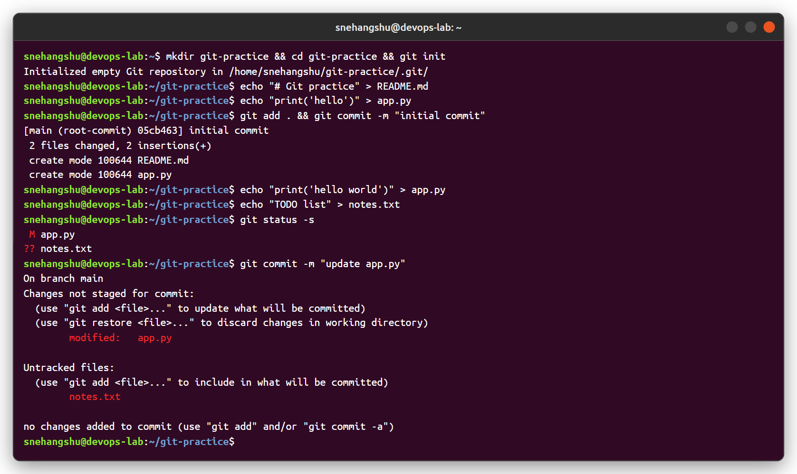
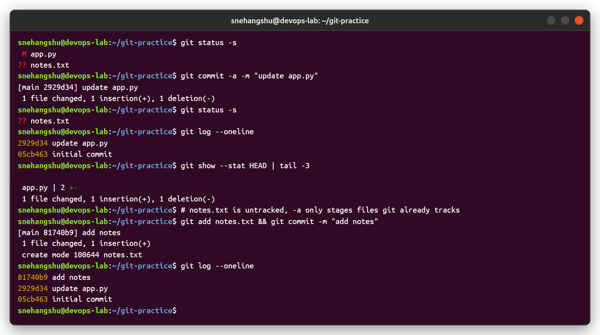
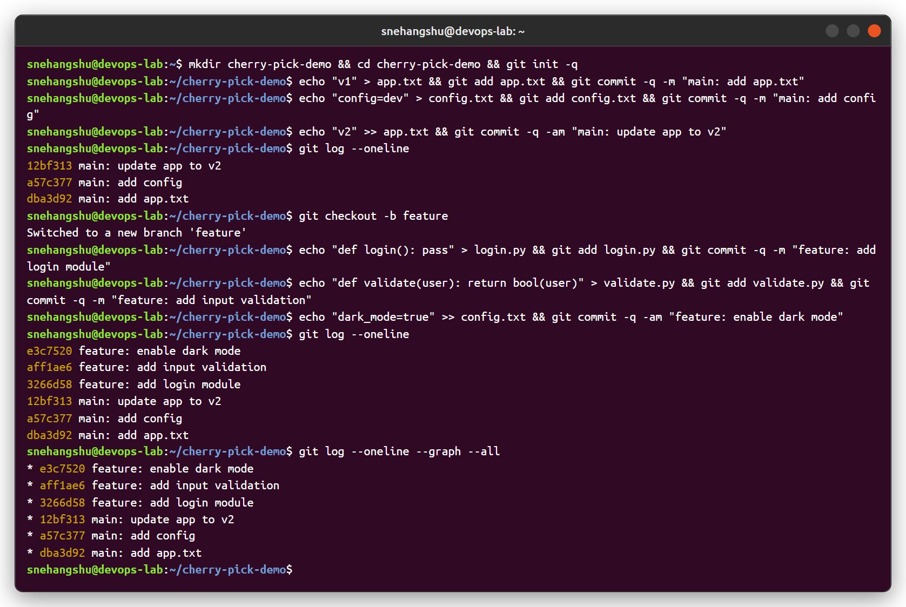
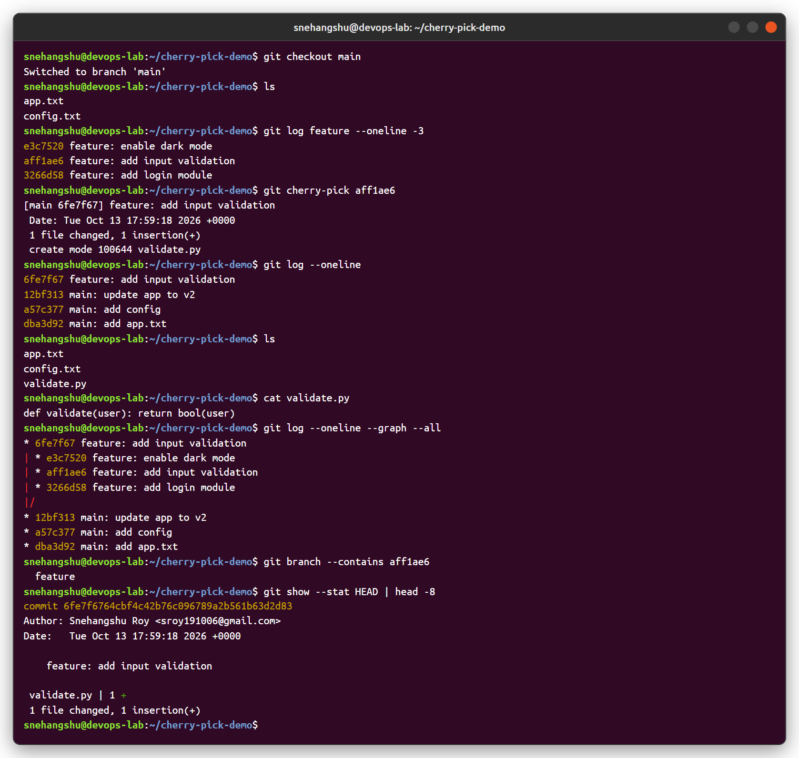

# Session 05 - Git and GitHub

## Task 1: `git commit -m` vs `git commit -a -m`

| | `git commit -m "msg"` | `git commit -a -m "msg"` |
|---|---|---|
| What gets committed | Only what is already in the staging area (`git add`) | Automatically stages **all modified/deleted tracked files**, then commits |
| Untracked (new) files | Not included | **Still not included** - must `git add` them first |
| Typical use | Normal workflow: `git add <files>` then commit | Quick commit of edits to files git already knows |

### Test 1 - `git commit -m` without `git add`

`app.py` (tracked) was modified and `notes.txt` (new) was created. Running `git commit -m` without staging anything fails with **"no changes added to commit"**.



### Test 2 - `git commit -a -m`

The same command with `-a` commits the modified `app.py` directly (no `git add` needed). `notes.txt` is still shown as untracked (`??`), so it had to be added with `git add` separately.



**Observation:** `-a` only saves the `git add` step for files that are already tracked. New files always need `git add`.

---

## Task 2: Git Cherry-Pick

`git cherry-pick <commit>` copies the changes of one specific commit from another branch onto the current branch, as a **new commit** with a new hash. The rest of the branch is not merged.

### Step 1 & 2 - 3 commits on main, then a feature branch with 3 commits

```bash
git log --oneline                      # 3 commits on main
git checkout -b feature                # new branch
# 3 commits: login module, input validation, dark mode
git log --oneline --graph --all
```



### Step 3 - Cherry-pick only "add input validation" (`aff1ae6`) into main

```bash
git checkout main
git log feature --oneline -3           # find the commit
git cherry-pick aff1ae6
git log --oneline
cat validate.py
git log --oneline --graph --all
```



### Verification

- `main` now has `6fe7f67 feature: add input validation` and the file `validate.py`.
- `login.py` and the dark mode change are **not** on main - only the selected commit came over.
- The new commit has a **different hash** (`6fe7f67`) from the original (`aff1ae6`) because the parent commit is different. `git branch --contains aff1ae6` still only lists `feature`.

### When is cherry-pick used?

- Moving a hotfix from `develop` to a `release`/`main` branch without merging everything else.
- Picking a commit that was made on the wrong branch.
- Backporting a fix to an older version branch.

Useful options: `git cherry-pick A B C` (several commits), `git cherry-pick A..B` (range), `-n` (apply without committing), `-x` (adds "cherry picked from commit ..." to the message), `--abort` / `--continue` when there is a conflict.
