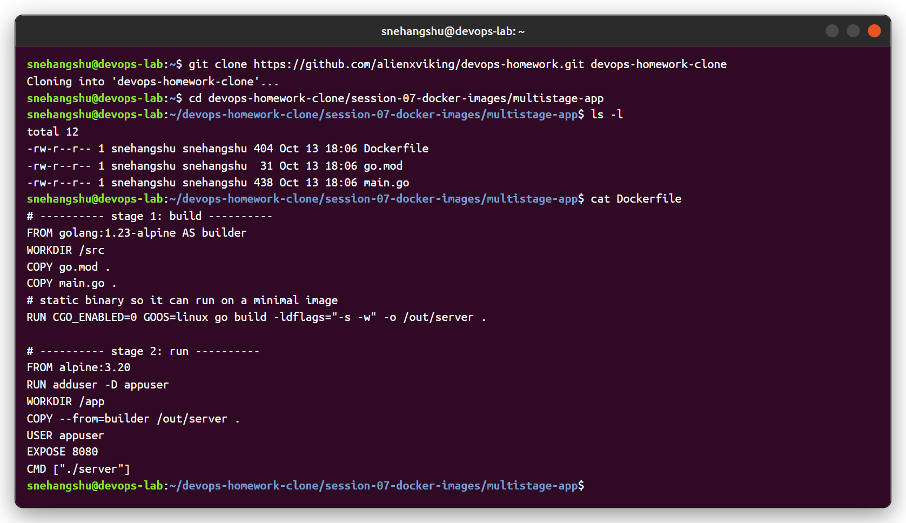
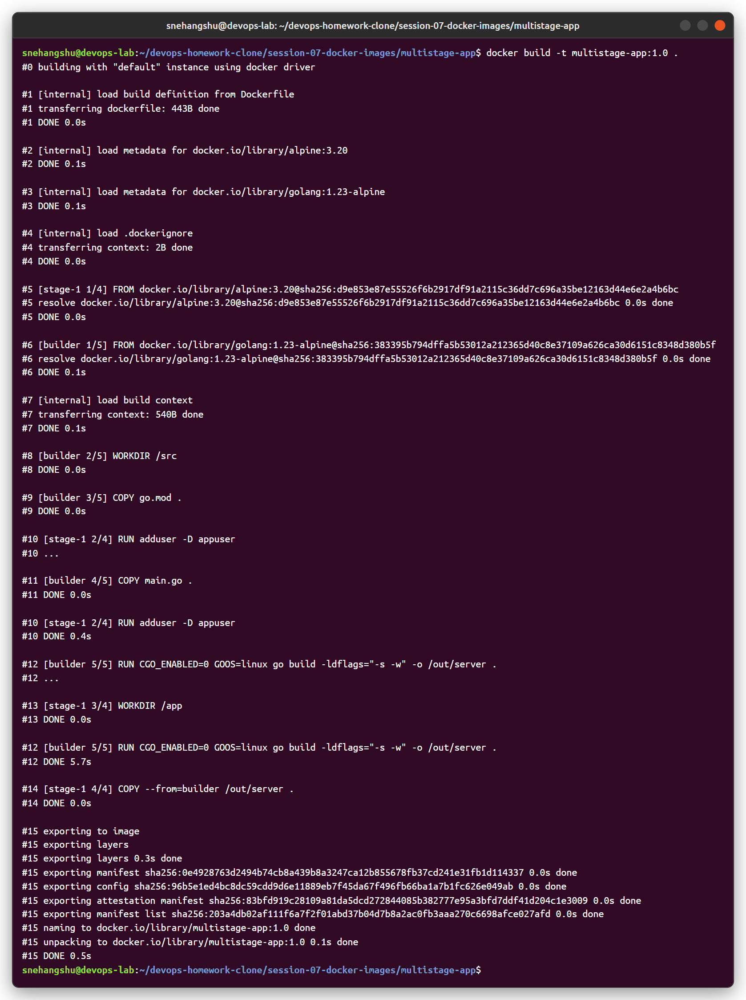
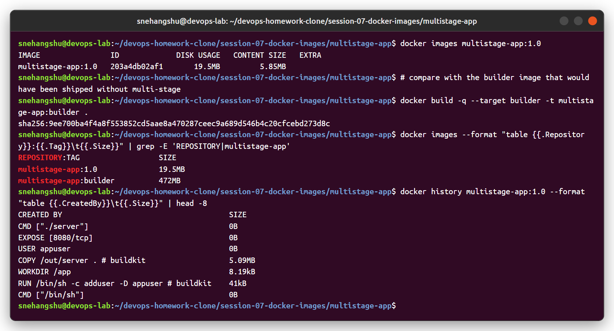
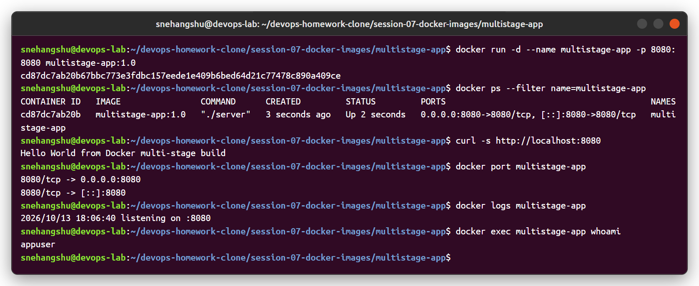
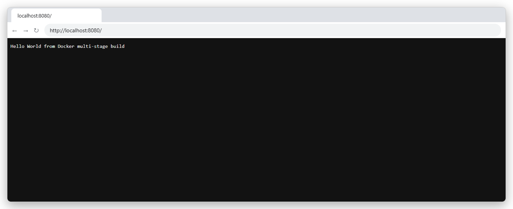
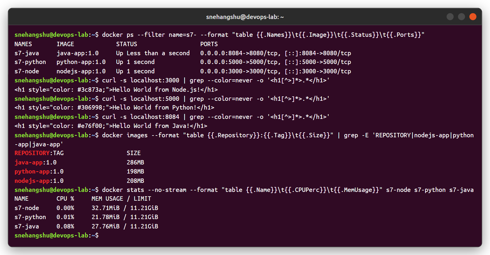
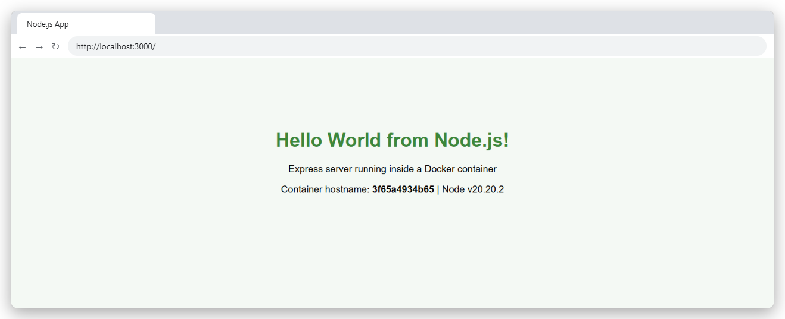
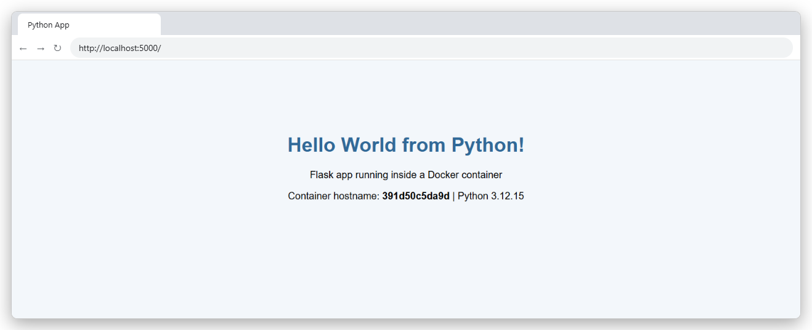
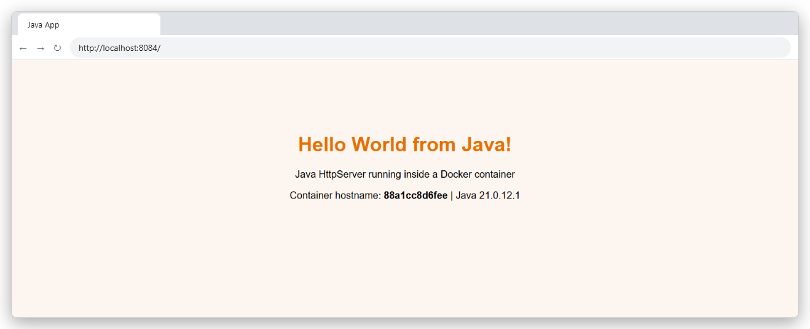

# Session 07 - Dockerfiles & Images (Multi-Stage Build)

**Name:** Snehangshu Roy
**Enrollment Number:** 24BCS10155

---

## Task 1: Run the multi-stage Dockerfile

App: [`multistage-app/`](multistage-app) - a small Go web server that returns `Hello World from Docker multi-stage build` on port 8080.

```dockerfile
# ---------- stage 1: build ----------
FROM golang:1.23-alpine AS builder
WORKDIR /src
COPY go.mod .
COPY main.go .
RUN CGO_ENABLED=0 GOOS=linux go build -ldflags="-s -w" -o /out/server .

# ---------- stage 2: run ----------
FROM alpine:3.20
RUN adduser -D appuser
WORKDIR /app
COPY --from=builder /out/server .
USER appuser
EXPOSE 8080
CMD ["./server"]
```

### 1. Clone the repository

```bash
git clone https://github.com/alienxviking/devops-homework.git devops-homework-clone
cd devops-homework-clone/session-07-docker-images/multistage-app
```



### 2. Build the image

```bash
docker build -t multistage-app:1.0 .
```



### 3. Why multi-stage - image size

The builder stage has the whole Go toolchain (**472 MB**). The final image only has Alpine + the compiled binary (**19.5 MB**). `docker history` shows the final image contains only the `COPY` of the binary, no compiler.



### 4. Run the container and verify

```bash
docker run -d --name multistage-app -p 8080:8080 multistage-app:1.0
docker ps --filter name=multistage-app
curl http://localhost:8080
```



## Task 2: Evidence

**Application running successfully** - `http://localhost:8080` shows *Hello World from Docker multi-stage build*:



**`docker ps` showing the running container on port 8080:**

```
CONTAINER ID   IMAGE                COMMAND      CREATED         STATUS         PORTS                                         NAMES
...            multistage-app:1.0   "./server"   2 seconds ago   Up 2 seconds   0.0.0.0:8080->8080/tcp, [::]:8080->8080/tcp   multistage-app
```

(full output in the screenshot of step 4 above)

---

## Task 3: Deploying 3 different types of applications

Used the Node.js, Python and Java apps from [Session 06](../session-06-docker-fundamentals) (each has its own Dockerfile there).

```bash
docker run -d --name s7-node   -p 3000:3000 nodejs-app:1.0
docker run -d --name s7-python -p 5000:5000 python-app:1.0
docker run -d --name s7-java   -p 8084:8080 java-app:1.0
```



| Node.js (3000) | Python (5000) | Java (8084) |
|---|---|---|
|  |  |  |

---

## Notes

- **Multi-stage build**: several `FROM` lines in one Dockerfile. Each `FROM` starts a new stage, and `COPY --from=<stage>` takes only the files you need from an earlier stage. Build tools, source code and caches stay behind.
- Benefits: smaller image, faster pull/deploy, smaller attack surface (no compiler/shell tools in production), one Dockerfile instead of separate build scripts.
- `--target builder` builds only up to a named stage (useful for debugging or running tests).
- Running as a non-root user (`USER appuser`) is a good practice - `docker exec ... whoami` returns `appuser`.
