# Session 08 - Docker Networking & Volumes

## Task 1: Container networking (frontend / backend / database)

Plan:

```
          frontend-net              backend-net             database-net
        ┌──────────────┐         ┌──────────────┐        ┌───────────────┐
        │  frontend    │         │              │        │   database    │
        │ (nginx)      │         │              │        │  (mysql:8.0)  │
        │       backend ◄─────────── backend ──────────────► backend     │
        └──────────────┘         │  (alpine)    │        └───────────────┘
                                 └──────────────┘
```

- `backend` is created on `backend-net` and then **added to 2 more networks** (`frontend-net` and `database-net`) with `docker network connect`.
- `frontend` and `database` share no network, so they should not be able to talk to each other.

### Create the 3 networks

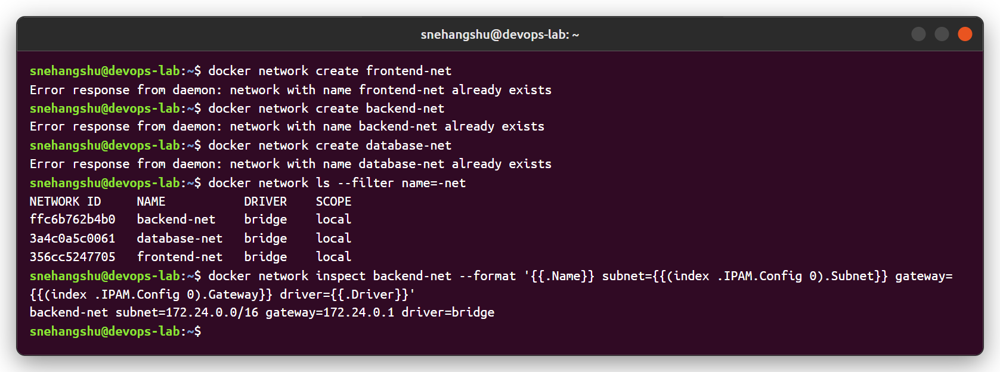

### Create the 3 containers and connect backend to 2 networks

```bash
docker run -d --name frontend --network frontend-net nginx:alpine
docker run -d --name backend  --network backend-net alpine:3.20 sleep infinity
docker run -d --name database --network database-net -e MYSQL_ROOT_PASSWORD=Root@123 -e MYSQL_DATABASE=appdb mysql:8.0
docker network connect frontend-net backend
docker network connect database-net backend
```

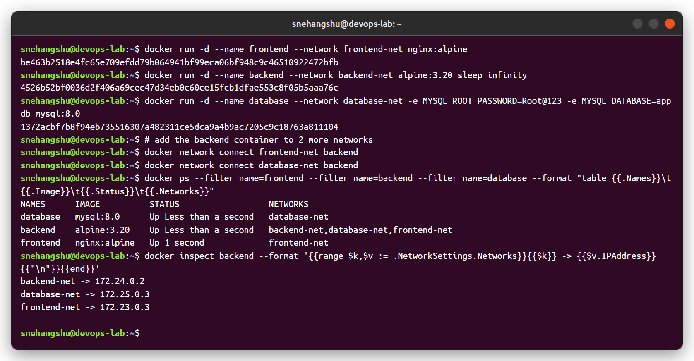

### Connectivity check

| From → To | Common network? | Result |
|---|---|---|
| backend → frontend | frontend-net | ping OK, HTTP OK (nginx page) |
| backend → database | database-net | ping OK, port 3306 open |
| frontend → backend | frontend-net | ping OK |
| frontend → database | none | `ping: bad address 'database'` |
| database → frontend | none | name not resolvable |

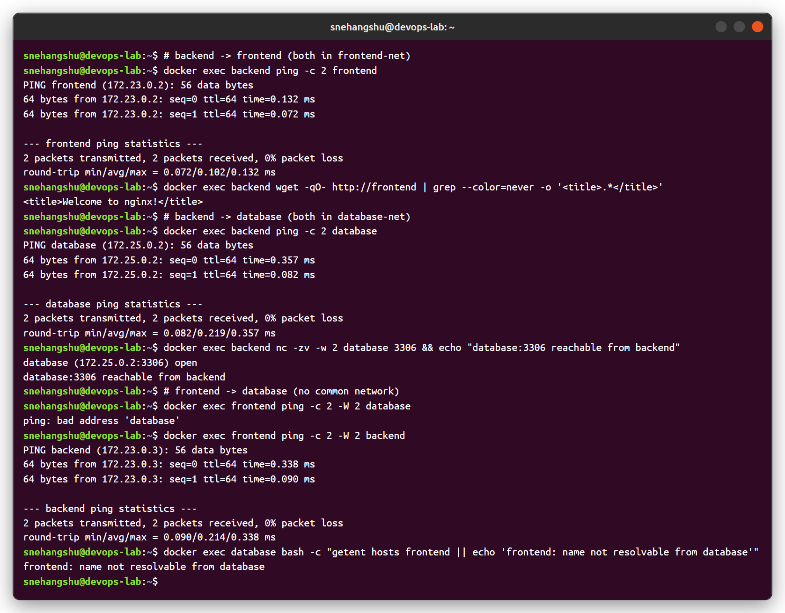

The backend container gets one interface per network (eth0, eth1, eth2), each with an IP from that network's subnet:

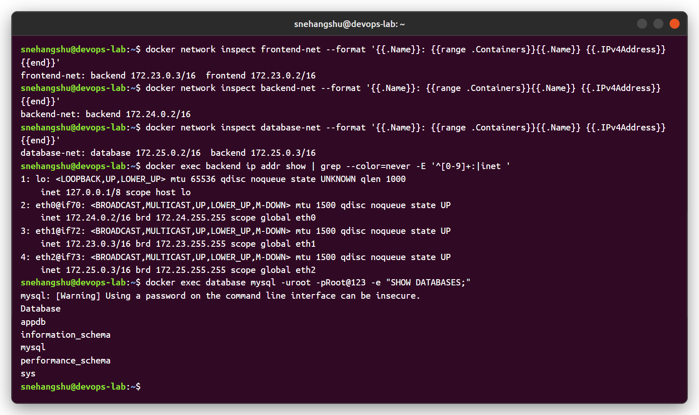

**What I understood:** user-defined bridge networks give automatic DNS by container name, and containers on different networks are isolated. Connecting the backend to both networks makes it the only path between frontend and database - this is how you keep the DB away from the public tier.

---

## Task 2: Apache2 with the host network

```bash
docker pull ubuntu/apache2
docker run -d --name apache2-host --network host ubuntu/apache2
curl http://localhost:80
```

With `--network host` the container uses the host's network stack directly: it is only attached to the `host` network, has no port mapping (`Ports={}`), and Apache listens on port 80 of the host itself (`ss` shows it on `*:80`).

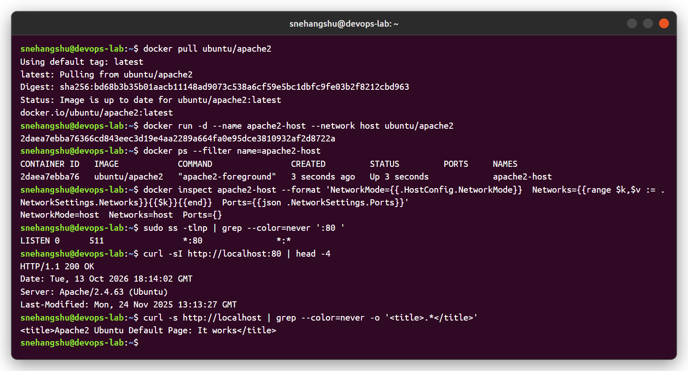

Opened `http://localhost` (port 80) from the Docker host:

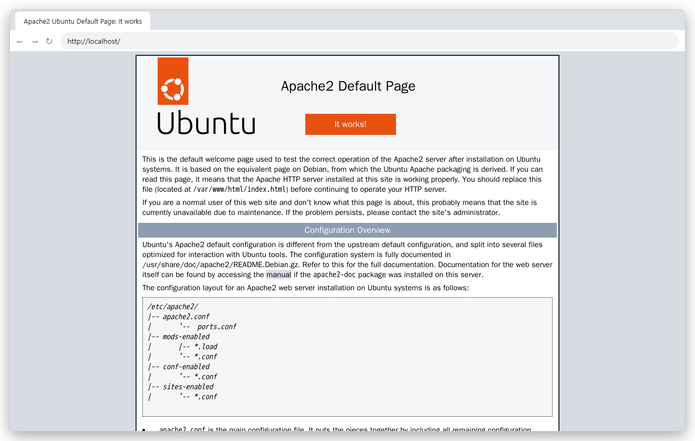

---

## Task 3: Bind mount

```bash
mkdir -p ~/nginx-bind-mount && cd ~/nginx-bind-mount
echo "<h1>Hello students</h1>" > index.html
docker run -d --name nginx-bind-mount -p 8085:80 -v ~/nginx-bind-mount:/usr/share/nginx/html nginx:alpine
```

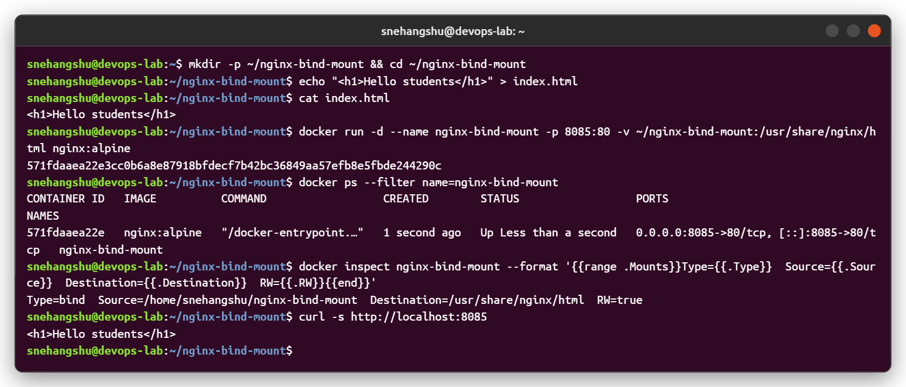

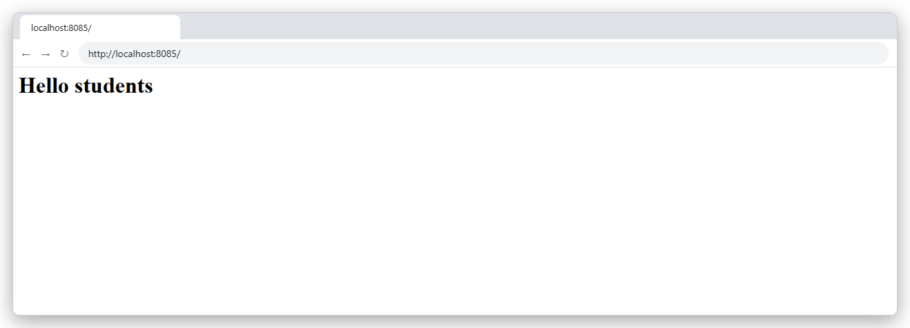

### Modify the file on the host - no restart

The change shows up immediately. `StartedAt` is the same before and after and `RestartCount=0`, so the container was not restarted - the folder on the host *is* the folder inside the container.

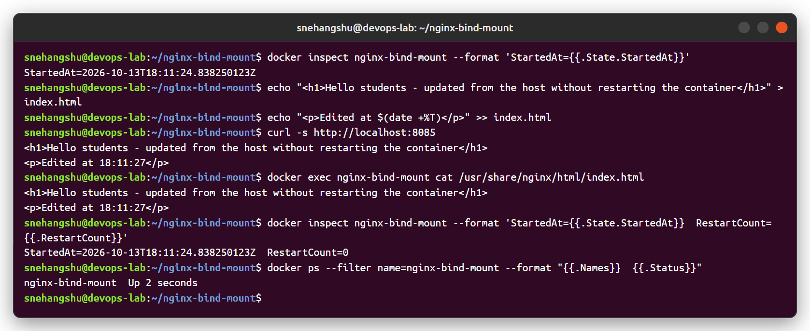

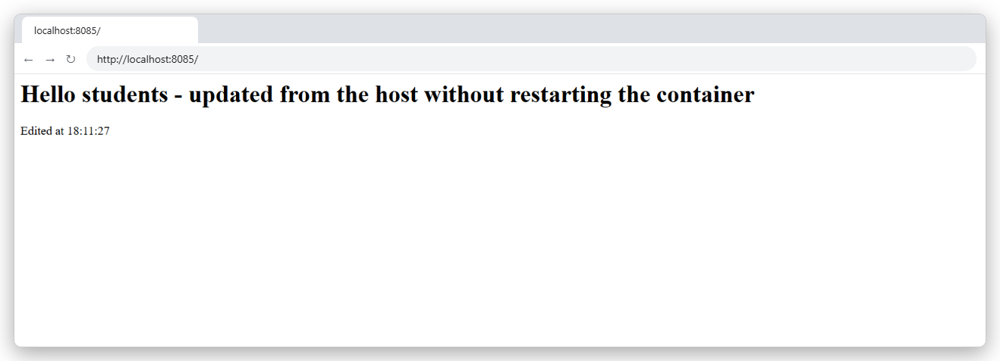

| | Bind mount | Named volume |
|---|---|---|
| Created with | `-v /host/path:/ctr/path` | `-v myvol:/ctr/path` |
| Stored at | Any path on the host you choose | Managed by Docker (`/var/lib/docker/volumes`) |
| Good for | Development, live code/config editing | Databases and persistent app data |

---

## Task 4: Overlay network

Research notes: [overlay-network.md](overlay-network.md)

I also tried it: two Docker hosts (docker-in-docker, `host1` and `host2`) joined into a swarm, an **attachable overlay** network `my-overlay` was created on the manager, and a container on host1 pinged a container on host2 by name.

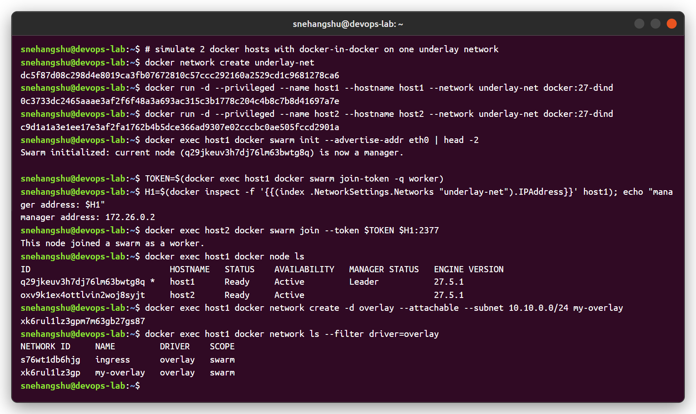

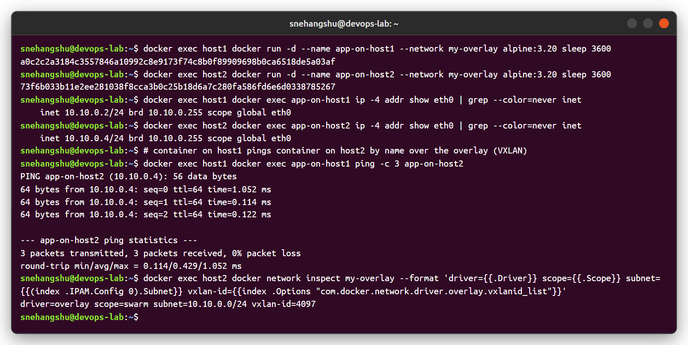

The container IPs come from the overlay subnet (10.10.0.0/24) even though the hosts are on a different underlay network (172.26.0.0/16). Docker wraps the traffic in VXLAN (UDP 4789, here VNI 4097) between the hosts.
