# Session 09 - Kubernetes Fundamentals

Setup: Windows 11 + Docker Desktop, Minikube with the `docker` driver.

Notes on architecture: **[architecture.md](architecture.md)**

---

## 1. Install and configure Minikube

Followed the Windows steps from the Minikube docs: download `minikube.exe` into `C:\minikube` and add that folder to the user `PATH`. `kubectl` comes with Docker Desktop.

```powershell
New-Item -Path 'C:\' -Name 'minikube' -ItemType Directory -Force
Invoke-WebRequest -OutFile 'C:\minikube\minikube.exe' -Uri 'https://github.com/kubernetes/minikube/releases/latest/download/minikube-windows-amd64.exe' -UseBasicParsing
[Environment]::SetEnvironmentVariable('Path', [Environment]::GetEnvironmentVariable('Path', 'User') + ';C:\minikube', 'User')
```

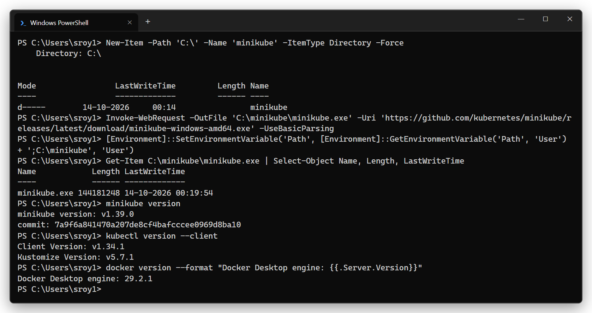

```powershell
minikube start --driver=docker --cpus=2 --memory=3072
```

Minikube runs the whole single-node cluster inside one Docker container (`kicbase` image) and sets the `kubectl` context to `minikube`.

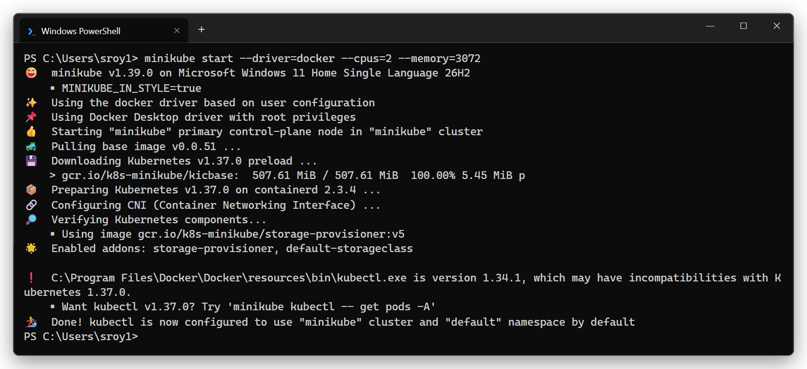

## 2. Verify cluster status

```powershell
minikube status
kubectl cluster-info
kubectl get nodes -o wide
kubectl get pods -n kube-system -o wide
```

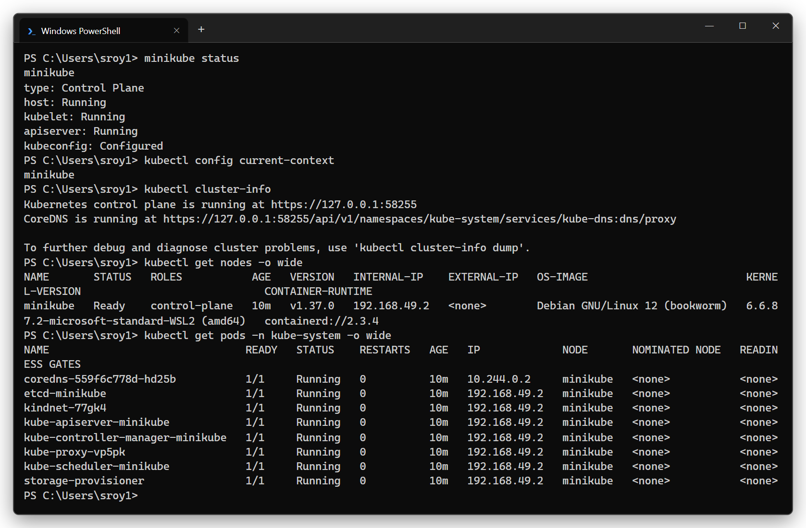

## 3. Explore the architecture

The control plane components run as **static pods** - their manifests are in `/etc/kubernetes/manifests` on the node and the kubelet starts them directly. `crictl ps` shows the actual containers in containerd. `/readyz?verbose` shows the API server health checks (including etcd).

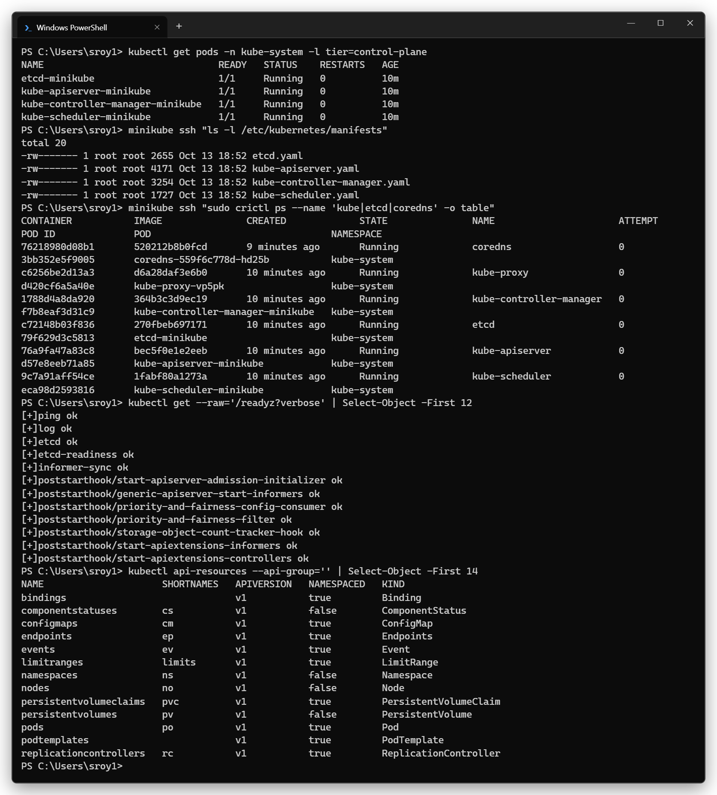

| Component | Seen as | Role |
|---|---|---|
| kube-apiserver | `kube-apiserver-minikube` | Front door of the cluster, every request goes through it |
| etcd | `etcd-minikube` | Key-value store with the whole cluster state |
| kube-scheduler | `kube-scheduler-minikube` | Picks a node for new pods |
| kube-controller-manager | `kube-controller-manager-minikube` | Runs controllers (Deployment, ReplicaSet, Node...) |
| kubelet | service on the node (`minikube status` → kubelet: Running) | Starts pods/containers on the node |
| kube-proxy | `kube-proxy-xxxxx` | Service networking rules |
| CoreDNS | `coredns-xxxxx` | DNS for services |
| CNI (kindnet) | `kindnet-xxxxx` | Pod networking |

More detail and the request flow: [architecture.md](architecture.md)

## 4. Basic objects and commands

Namespace, Pod, Deployment, ReplicaSet, Service, ConfigMap:

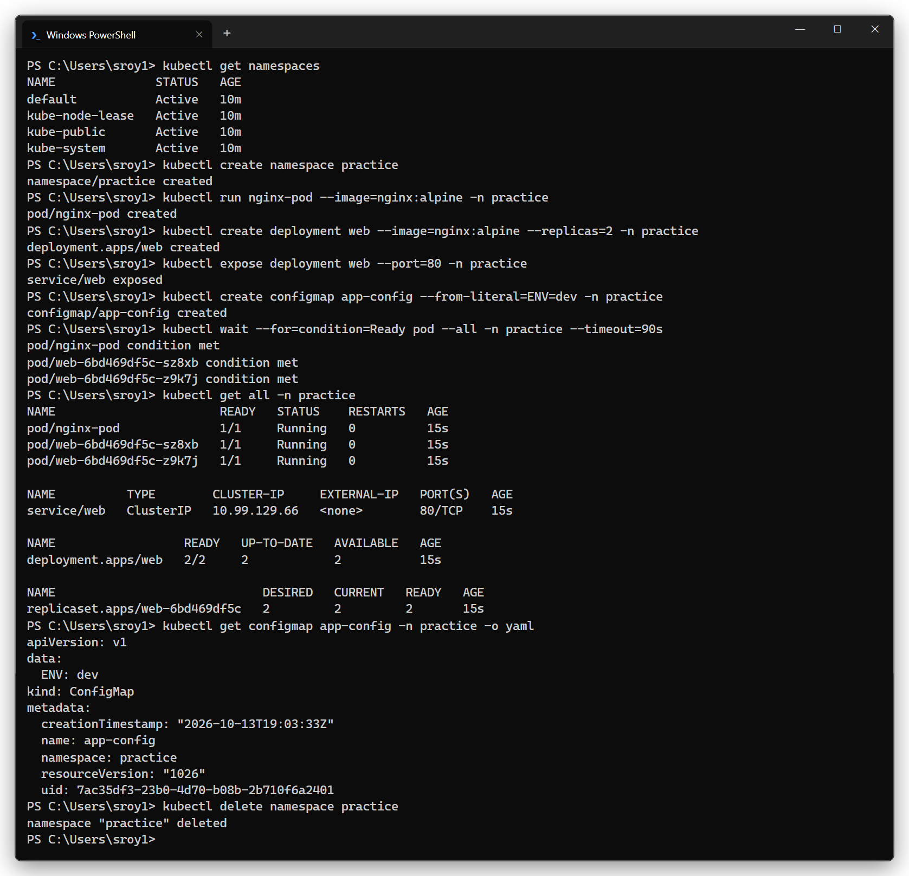

| Command | Use |
|---|---|
| `kubectl get <resource>` | List objects (`-o wide`, `-o yaml`, `-l label=value`, `-n ns`, `-A`) |
| `kubectl describe <resource> <name>` | Details + events |
| `kubectl create deployment / run / expose` | Imperative create |
| `kubectl apply -f file.yaml` | Declarative create/update |
| `kubectl logs <pod>` | Container logs |
| `kubectl exec <pod> -- <cmd>` | Run a command inside a container |
| `kubectl scale`, `kubectl set image`, `kubectl rollout` | Scale / update / rollback |
| `kubectl delete` | Remove objects |

---

## 5. Kubernetes Basics tutorial (hands-on)

### Module 2 - Create a Deployment

```powershell
kubectl create deployment kubernetes-bootcamp --image=gcr.io/google-samples/kubernetes-bootcamp:v1
```

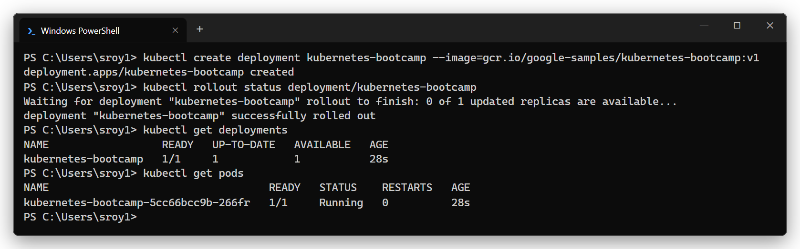

### Module 3 - Explore the app (pods, logs, exec)

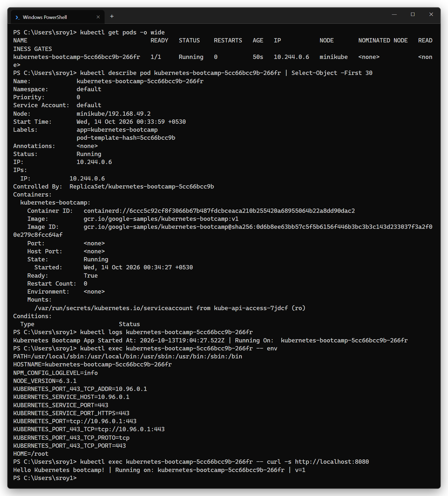

### Module 4 - Expose the app with a Service (NodePort) + labels

```powershell
kubectl expose deployment/kubernetes-bootcamp --type=NodePort --port 8080
```

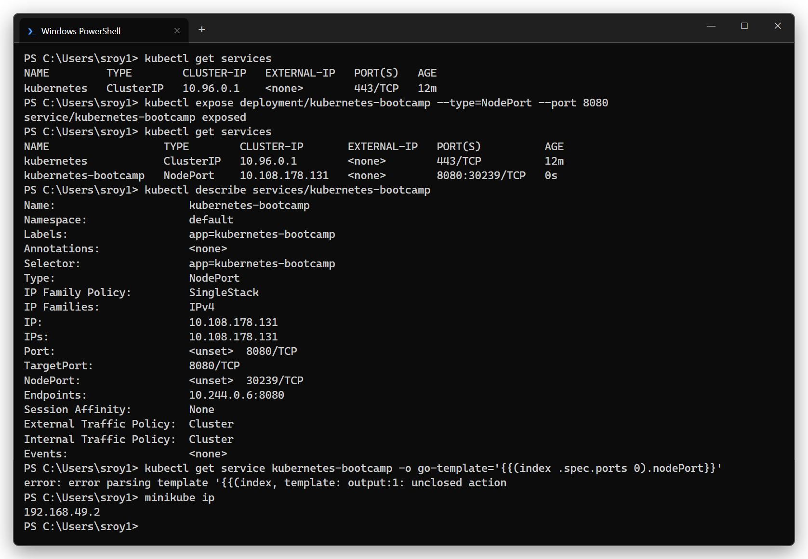

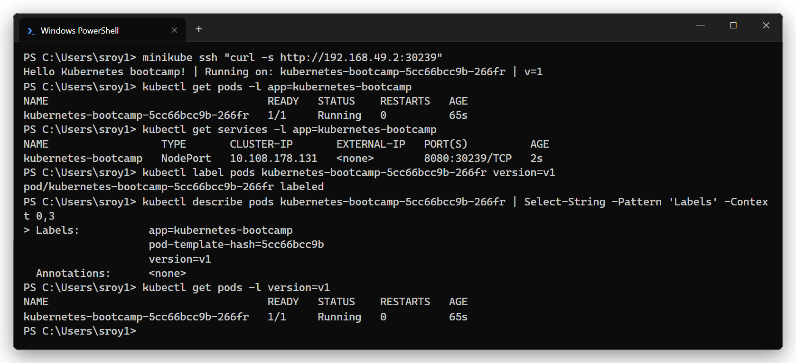

With the Docker driver on Windows the node IP is not reachable from the host, so `minikube service --url` opens a tunnel:

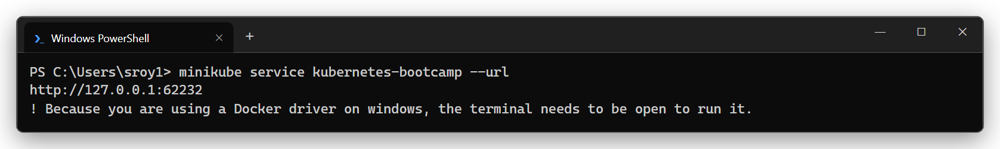

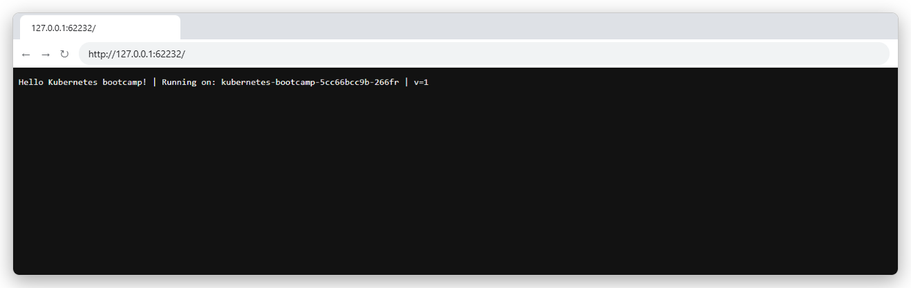

### Module 5 - Scale the app

Scaled to 4 replicas - requests through the Service are load balanced across the 4 pods (different pod names in the responses).

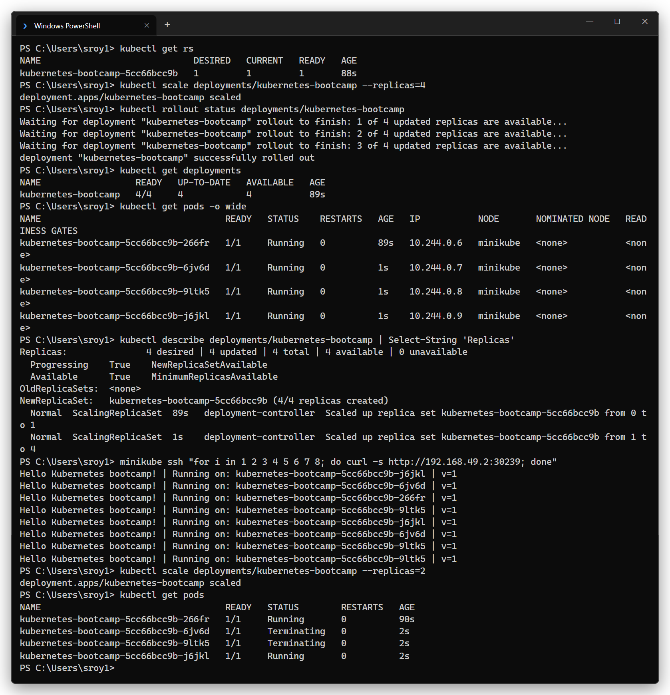

### Module 6 - Rolling update and rollback

Updated to `v2` (response now shows `v=2`):

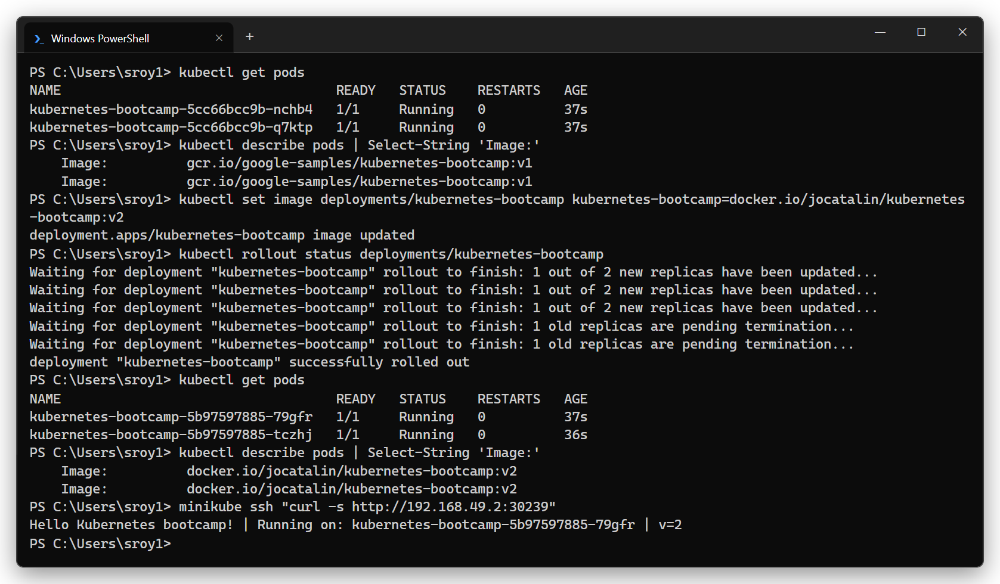

Then deployed a tag that does not exist (`v10`) → the new pod is stuck in `ImagePullBackOff`, but the old pods keep serving traffic. `kubectl rollout undo` brings it back to `v2`:

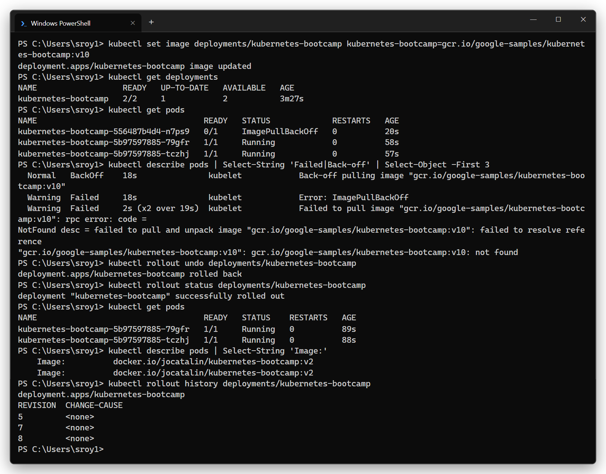

---

## What I learned

- Minikube = a full single node cluster on a laptop, good for learning and testing manifests.
- Kubernetes works on **desired state**: I say "4 replicas of this image", controllers keep making it true.
- A Deployment creates a ReplicaSet which creates the Pods. Pods get new names/IPs every time, so a Service with a label selector is needed for a stable address.
- Rolling updates replace pods gradually, and a broken update does not take the app down - the old ReplicaSet keeps running until new pods are Ready.
