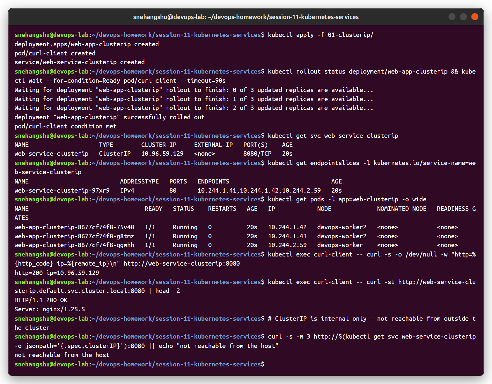
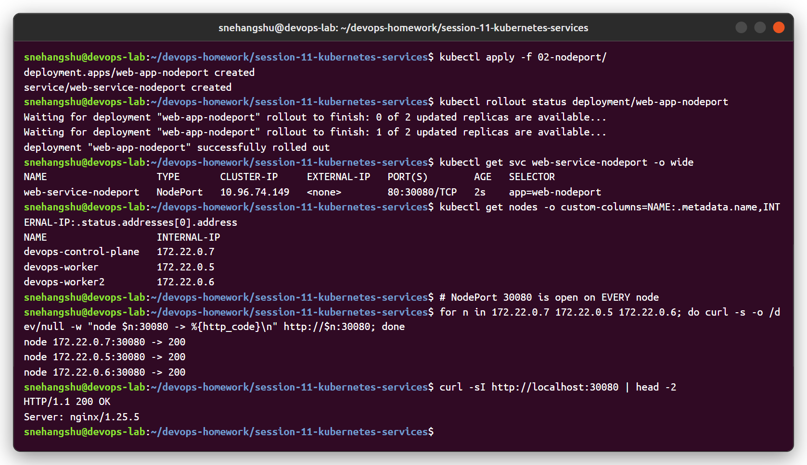
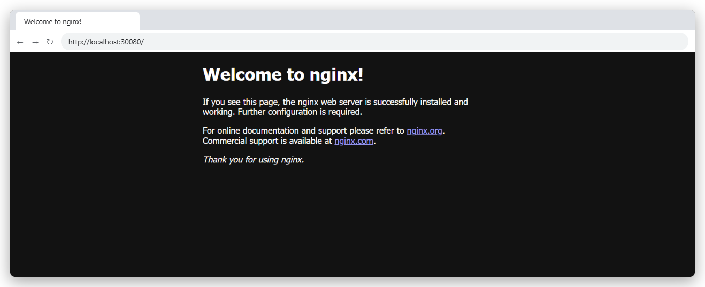
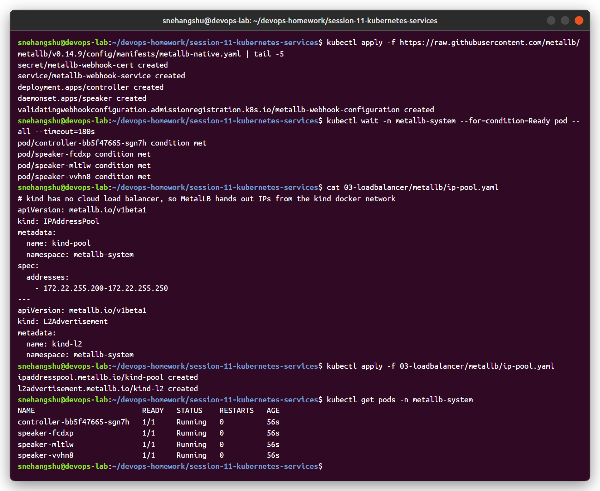
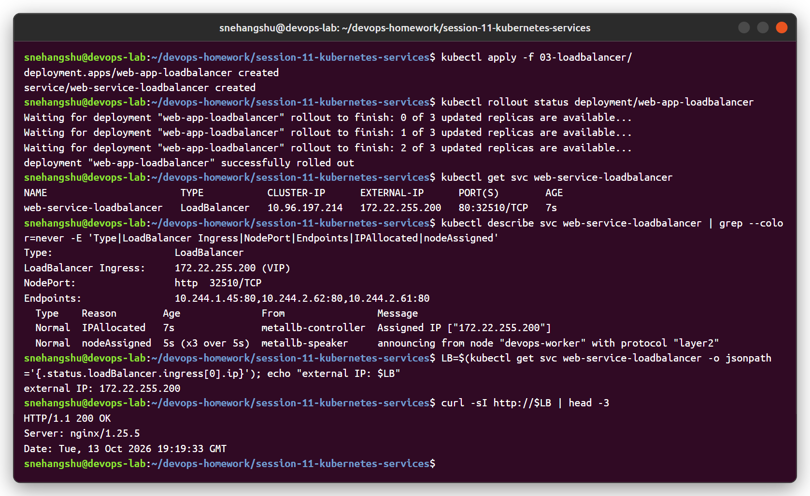
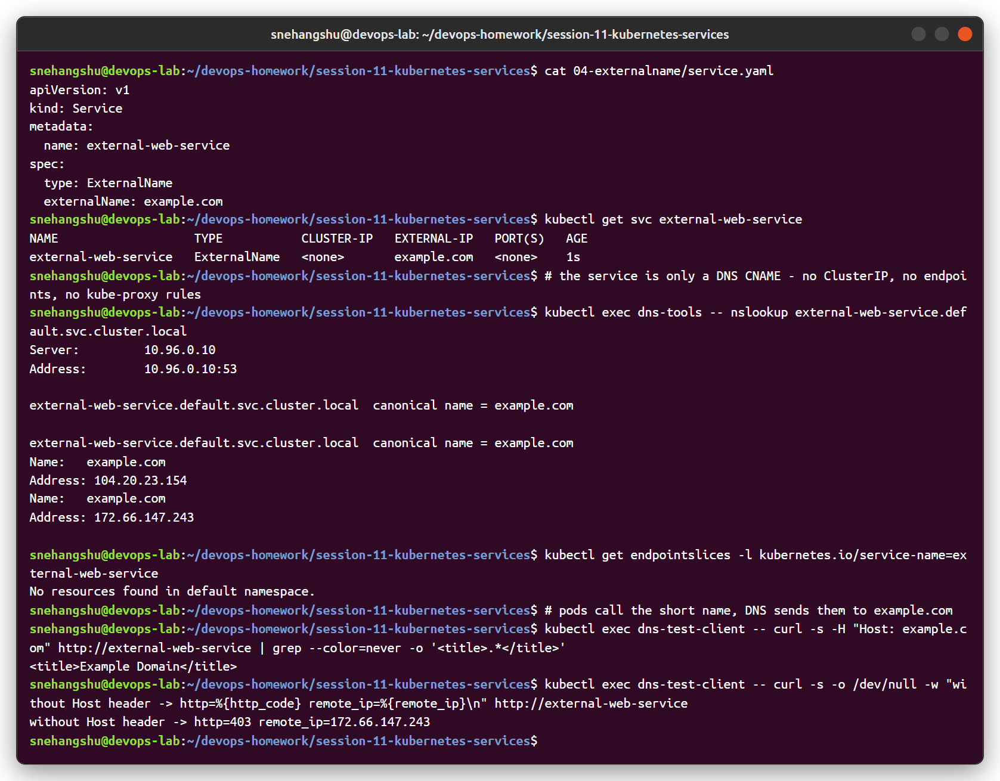
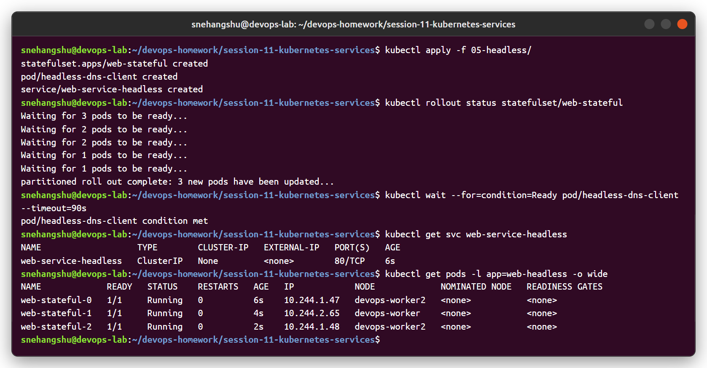
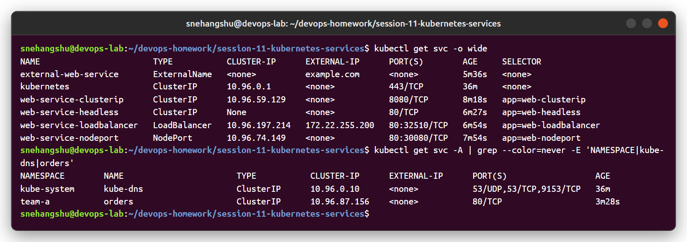
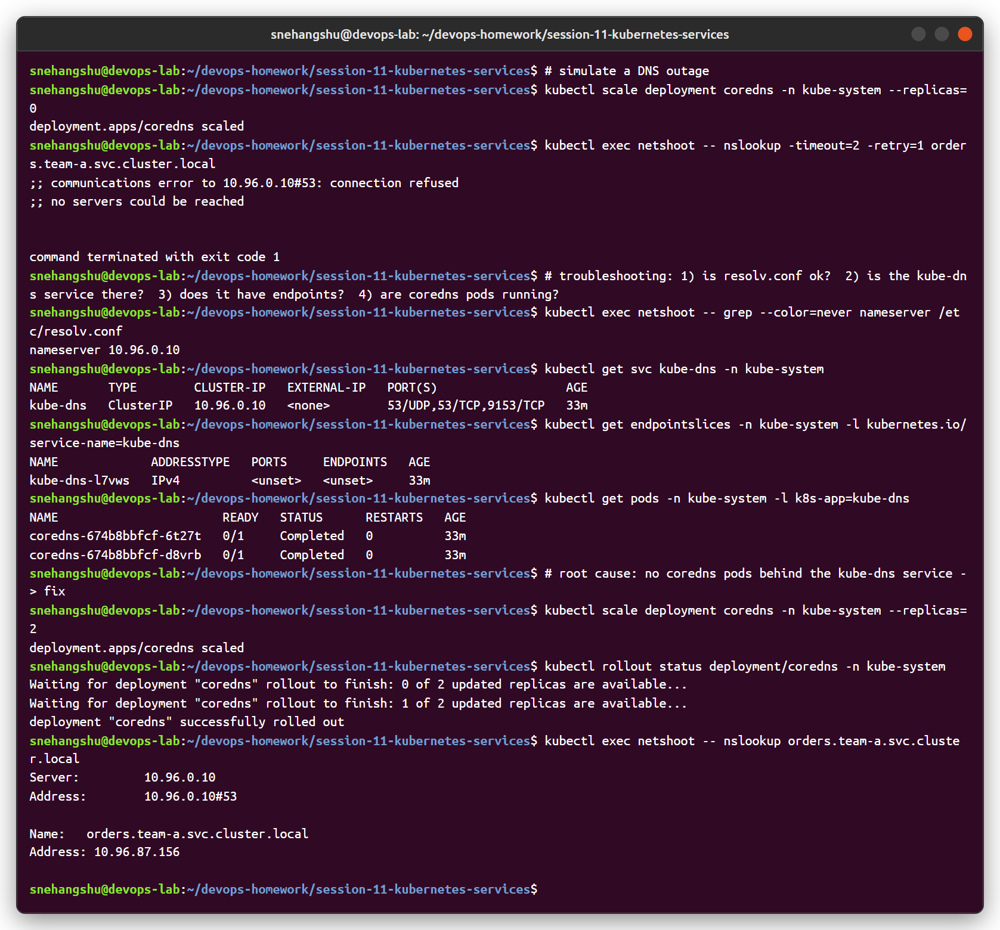

# Session 11 - Kubernetes Networking & Services

Cluster: kind (1 control plane + 2 workers). YAML files are from the course repo (`devops-heros/session-11-kubernetes-services`).

| Folder | Content |
|---|---|
| [01-clusterip](01-clusterip) | Deployment + ClusterIP service + curl client |
| [02-nodeport](02-nodeport) | Deployment + NodePort service (30080) |
| [03-loadbalancer](03-loadbalancer) | Deployment + LoadBalancer service, [MetalLB pool](03-loadbalancer/metallb/ip-pool.yaml) |
| [04-externalname](04-externalname) | ExternalName service → example.com |
| [05-headless](05-headless) | StatefulSet + headless service |
| [object-comparison.md](object-comparison.md) | Task 2 - Deployment vs ReplicaSet vs DaemonSet vs StatefulSet vs Service |
| [fqdn/README.md](fqdn/README.md) | Task 3 - FQDN and Kubernetes DNS names |
| [coredns/README.md](coredns/README.md) | Task 4 - CoreDNS |

---

## Task 1: The 5 Service types

### 1. ClusterIP (default)

Stable virtual IP reachable **only inside the cluster**. Port 8080 on the service → port 80 on the pods.

```bash
kubectl apply -f 01-clusterip/
kubectl exec curl-client -- curl http://web-service-clusterip:8080
```



**Result:** HTTP 200 from inside the cluster (short name and full FQDN both work). From outside the cluster, the ClusterIP is not reachable.

### 2. NodePort

Opens the same port (30080) on **every node** and forwards it to the service.



**Result:** all 3 node IPs answer on :30080. kind maps node port 30080 to my machine, so it also opens in the browser:



### 3. LoadBalancer

On a cloud (EKS/GKE/AKS) the cloud controller creates a real load balancer. kind has no cloud, so I installed **MetalLB**, which gives LoadBalancer services an IP from the kind docker network.





**Result:** `EXTERNAL-IP 172.22.255.200` assigned by MetalLB (`IPAllocated` event), announced from a node with layer 2 (ARP), and `curl http://172.22.255.200` returns 200. A LoadBalancer service also gets a NodePort and a ClusterIP automatically.

### 4. ExternalName

No pods, no ClusterIP, no endpoints. It only returns a **DNS CNAME** to an external name, so apps inside the cluster can use a stable internal name for an external dependency (managed DB, external API).

```yaml
spec:
  type: ExternalName
  externalName: example.com
```



**Result:** `external-web-service.default.svc.cluster.local` → `canonical name = example.com`. No EndpointSlices exist. Calling it works when the correct `Host` header is sent. Without it, the remote server sees `Host: external-web-service` and returns 403. This is the usual ExternalName caveat for HTTP/TLS, because Kubernetes only changes DNS, not the request.

### 5. Headless (`clusterIP: None`)

No virtual IP. DNS returns the **pod IPs directly**, and each StatefulSet pod gets its own DNS name.




**Result:** the normal service resolves to 1 IP (10.96.x.x), the headless one to the 3 pod IPs. `web-stateful-0.web-service-headless` always points to pod 0. This is what databases like MongoDB/Cassandra/Kafka need for peer discovery.

### All services



| Type | ClusterIP | Reachable from | Use case |
|---|---|---|---|
| ClusterIP | yes | inside cluster | internal microservices, DBs |
| NodePort | yes | `<any-node-ip>:30000-32767` | dev/testing, behind an external LB |
| LoadBalancer | yes (+NodePort) | external IP from cloud/MetalLB | public apps on cloud |
| ExternalName | no | DNS CNAME only | alias for an external service |
| Headless | `None` | pod IPs via DNS | StatefulSets, client-side load balancing |

---

## Task 2: Kubernetes object comparison

→ [object-comparison.md](object-comparison.md)

## Task 3: FQDN

→ [fqdn/README.md](fqdn/README.md) (with outputs from my cluster)


## Task 4: CoreDNS

→ [coredns/README.md](coredns/README.md) (Corefile, query logs and a DNS outage troubleshooting demo)


