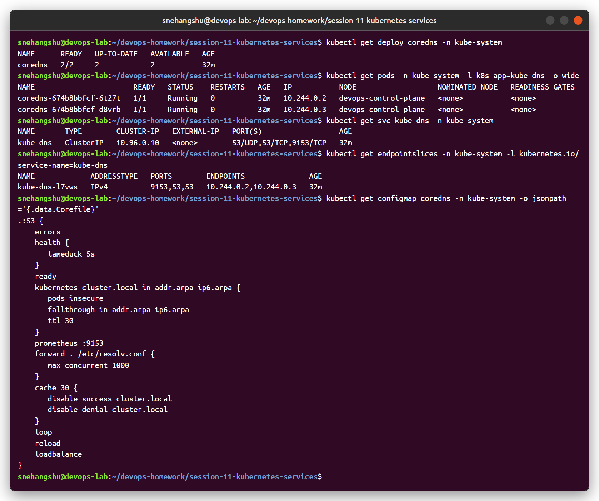
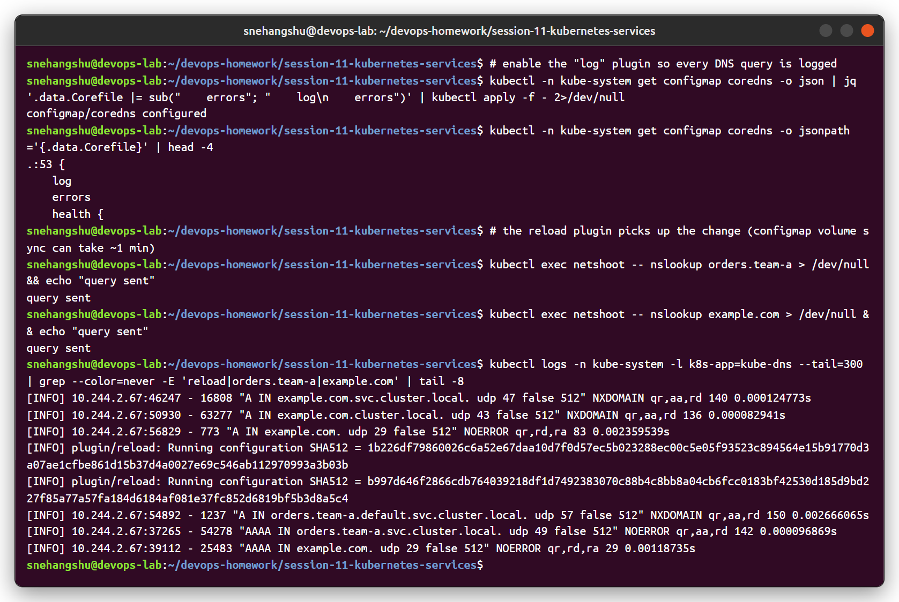

# Task 4: CoreDNS

## What is CoreDNS?

CoreDNS is a DNS server written in Go and a CNCF graduated project. It is built from **plugins**: each feature (serving Kubernetes records, caching, forwarding, metrics) is a plugin, and the config file (the **Corefile**) lists which plugins to use.

In Kubernetes it runs as:

- a **Deployment** named `coredns` in `kube-system` (usually 2 replicas),
- behind a **Service** named `kube-dns` (name kept for backward compatibility),
- configured by a **ConfigMap** named `coredns`.

## Why Kubernetes uses CoreDNS

Earlier clusters used **kube-dns**, which was three containers in one Pod (kubedns, dnsmasq, sidecar). CoreDNS replaced it and became the default DNS in kubeadm from v1.11 onward. Reasons:

- Single binary/container instead of three, so simpler to run.
- Plugin-based and easy to configure through one Corefile.
- Better performance and lower memory use in most cases.
- Built-in Prometheus metrics, health and readiness endpoints.
- Easy to add custom behaviour (stub domains, rewrites, hosts entries).

## How service discovery works

1. CoreDNS's `kubernetes` plugin **watches the API server** for Services, EndpointSlices and Namespaces.
2. It keeps that data in memory and answers DNS queries from it, for example:
   - `my-svc.my-ns.svc.cluster.local` -> ClusterIP
   - headless Service -> list of ready Pod IPs
   - `_http._tcp.my-svc.my-ns.svc.cluster.local` -> SRV record
3. kubelet writes `/etc/resolv.conf` into every Pod with `nameserver <kube-dns ClusterIP>` and the namespace search domains.
4. So when an app looks up a Service name, the request goes to CoreDNS, which already knows the answer.

When a Service is created or Pods change, CoreDNS picks it up from the watch automatically. No restart needed.

## How a DNS query is resolved from a Pod

Example: a Pod in namespace `shop` runs `curl http://backend`.

1. The app calls the system resolver for `backend`.
2. The resolver reads `/etc/resolv.conf`:
   ```
   search shop.svc.cluster.local svc.cluster.local cluster.local
   nameserver 10.96.0.10
   options ndots:5
   ```
3. `backend` has 0 dots (< 5), so it appends the first search domain and sends a query for `backend.shop.svc.cluster.local` to `10.96.0.10`.
4. `10.96.0.10` is the `kube-dns` ClusterIP. kube-proxy rules on the node forward the UDP packet to one of the CoreDNS Pods.
5. CoreDNS checks the zone. `cluster.local` belongs to the `kubernetes` plugin, so it looks up the Service in its cache of API data and returns the ClusterIP.
6. The resolver gets the answer and the app connects to the ClusterIP.

For an external name like `google.com`:

- The search domains are tried first (because of `ndots:5`) and each gets `NXDOMAIN` from CoreDNS.
- Then `google.com` itself is queried. It's not in `cluster.local`, so the `forward` plugin sends it to the upstream DNS (from the node's `/etc/resolv.conf`).
- The answer is cached by the `cache` plugin and returned.

## Default Corefile

This is the typical Corefile created by kubeadm:

```
.:53 {
    errors
    health {
       lameduck 5s
    }
    ready
    kubernetes cluster.local in-addr.arpa ip6.arpa {
       pods insecure
       fallthrough in-addr.arpa ip6.arpa
       ttl 30
    }
    prometheus :9153
    forward . /etc/resolv.conf {
       max_concurrent 1000
    }
    cache 30
    loop
    reload
    loadbalance
}
```

`.:53` means: this server block handles all zones (`.`) on port 53.

| Plugin | What it does |
|--------|-------------|
| `errors` | Logs errors to stdout. |
| `health` | HTTP health endpoint on `:8080/health`, used by the liveness probe. `lameduck 5s` keeps it serving for 5s while shutting down. |
| `ready` | HTTP endpoint on `:8181/ready`; returns OK once all plugins are ready. Used by the readiness probe. |
| `kubernetes` | Answers queries for `cluster.local` and reverse zones using data from the Kubernetes API. `pods insecure` enables Pod A records (`1-2-3-4.ns.pod.cluster.local`). `fallthrough` passes reverse lookups it can't answer to the next plugin. `ttl 30` sets record TTL. |
| `prometheus` | Exposes metrics on `:9153/metrics`. |
| `forward` | Sends everything outside the cluster domain to upstream DNS servers, here taken from the node's `/etc/resolv.conf`. |
| `cache` | Caches answers for up to 30 seconds. |
| `loop` | Detects forwarding loops (CoreDNS forwarding to itself) and stops the process if found. |
| `reload` | Watches the Corefile and reloads it automatically when the ConfigMap changes. |
| `loadbalance` | Randomizes the order of A/AAAA records in answers (round-robin). |

## Viewing and editing the Corefile

```bash
# view
kubectl -n kube-system get configmap coredns -o yaml

# edit in place
kubectl -n kube-system edit configmap coredns

# check CoreDNS deployment and service
kubectl -n kube-system get deploy coredns
kubectl -n kube-system get svc kube-dns
```

After editing, the `reload` plugin picks up the change on its own (it can take up to a couple of minutes for the ConfigMap update to reach the Pods). To apply it right away:

```bash
kubectl -n kube-system rollout restart deployment coredns
```

Example change: forward a company domain to an internal DNS server (stub domain):

```
corp.example.com:53 {
    errors
    cache 30
    forward . 10.0.0.53
}
```

Example change: turn on query logging while debugging, by adding `log` inside the `.:53` block. Remove it afterwards since it is noisy.

## DNS troubleshooting checklist

### 1. Test from a debug Pod

```bash
kubectl run dnsutils --image=registry.k8s.io/e2e-test-images/jessie-dnsutils:1.3 \
  --restart=Never -- sleep infinity

kubectl exec -it dnsutils -- nslookup kubernetes.default
kubectl exec -it dnsutils -- nslookup <svc>.<ns>.svc.cluster.local
kubectl exec -it dnsutils -- dig <svc>.<ns>.svc.cluster.local
kubectl exec -it dnsutils -- dig google.com
```

- `kubernetes.default` works but external names fail -> upstream/`forward` problem.
- Nothing resolves -> CoreDNS or network problem.
- Only one Service fails -> check the Service name, namespace and endpoints.

### 2. Check resolv.conf inside the Pod

```bash
kubectl exec -it dnsutils -- cat /etc/resolv.conf
```

- `nameserver` should be the `kube-dns` ClusterIP.
- `search` should start with `<pod-namespace>.svc.cluster.local`.
- If the Pod uses `hostNetwork: true`, it needs `dnsPolicy: ClusterFirstWithHostNet` to use cluster DNS.

### 3. Check CoreDNS Pods

```bash
kubectl -n kube-system get pods -l k8s-app=kube-dns -o wide
kubectl -n kube-system describe pods -l k8s-app=kube-dns
kubectl -n kube-system logs -l k8s-app=kube-dns
```

Look for `CrashLoopBackOff`, errors in logs, or `[FATAL] plugin/loop: Loop ... detected`. The loop error usually happens when the node's `/etc/resolv.conf` points to a local stub like `127.0.0.53` (systemd-resolved). Fix: point kubelet `resolvConf` to the real file (e.g. `/run/systemd/resolve/resolv.conf`) or forward to a real upstream IP.

### 4. Check the kube-dns Service and endpoints

```bash
kubectl -n kube-system get svc kube-dns
kubectl -n kube-system get endpointslices -l kubernetes.io/service-name=kube-dns
```

If there are no endpoints, the CoreDNS Pods aren't Ready.

### 5. Check the target Service

```bash
kubectl get svc -n <ns>
kubectl get endpointslices -n <ns> -l kubernetes.io/service-name=<svc>
```

DNS can work fine and the app still fails if the Service has no endpoints (wrong selector, Pods not Ready).

### 6. NetworkPolicy blocking DNS

If a namespace has a default-deny egress policy, Pods can't reach CoreDNS. Allow UDP and TCP 53 to `kube-system`:

```yaml
apiVersion: networking.k8s.io/v1
kind: NetworkPolicy
metadata:
  name: allow-dns
  namespace: shop
spec:
  podSelector: {}
  policyTypes: ["Egress"]
  egress:
    - to:
        - namespaceSelector:
            matchLabels:
              kubernetes.io/metadata.name: kube-system
          podSelector:
            matchLabels:
              k8s-app: kube-dns
      ports:
        - protocol: UDP
          port: 53
        - protocol: TCP
          port: 53
```

### 7. ndots and slow external lookups

With `ndots:5`, a name like `api.example.com` is tried with every search domain first, so each external lookup can become 4+ queries (double with IPv4 + IPv6). Symptoms: slow requests, high CoreDNS load. Fixes: use a trailing dot (`api.example.com.`), or set `ndots` lower with `dnsConfig` on the Pod.

### 8. Other things to check

- CoreDNS resource limits / CPU throttling under heavy load (scale up replicas).
- `kubectl -n kube-system get configmap coredns -o yaml` for typos after manual edits.
- Node firewall or CNI issues blocking Pod-to-Pod UDP traffic.

### Cleanup

```bash
kubectl delete pod dnsutils
```

## Hands-on output from my cluster

CoreDNS deployment, the `kube-dns` service (10.96.0.10) and the default Corefile on my kind cluster:



Turned on the `log` plugin to see real queries. You can see the search list in action: `example.com` is first tried as `example.com.default.svc.cluster.local`, `example.com.svc.cluster.local`, `example.com.cluster.local` (NXDOMAIN, answered by the `kubernetes` plugin) and only then forwarded upstream (NOERROR). This is the `ndots:5` effect.



DNS outage demo: scaled CoreDNS to 0 → lookups fail with `connection refused` on 10.96.0.10:53. Checked resolv.conf → service → endpoints → pods, found no CoreDNS pods, scaled back to 2 and DNS worked again.


(The `log` plugin was removed again afterwards.)
