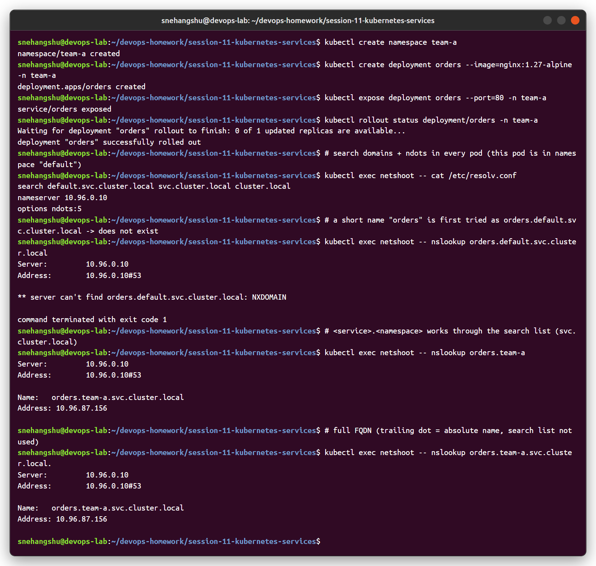
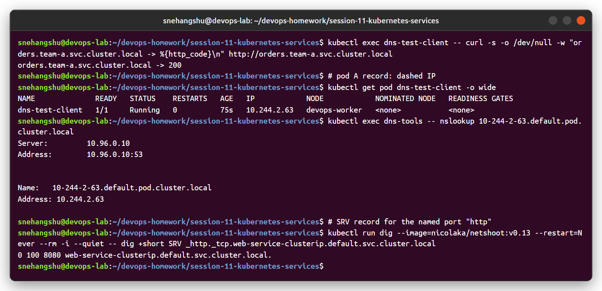
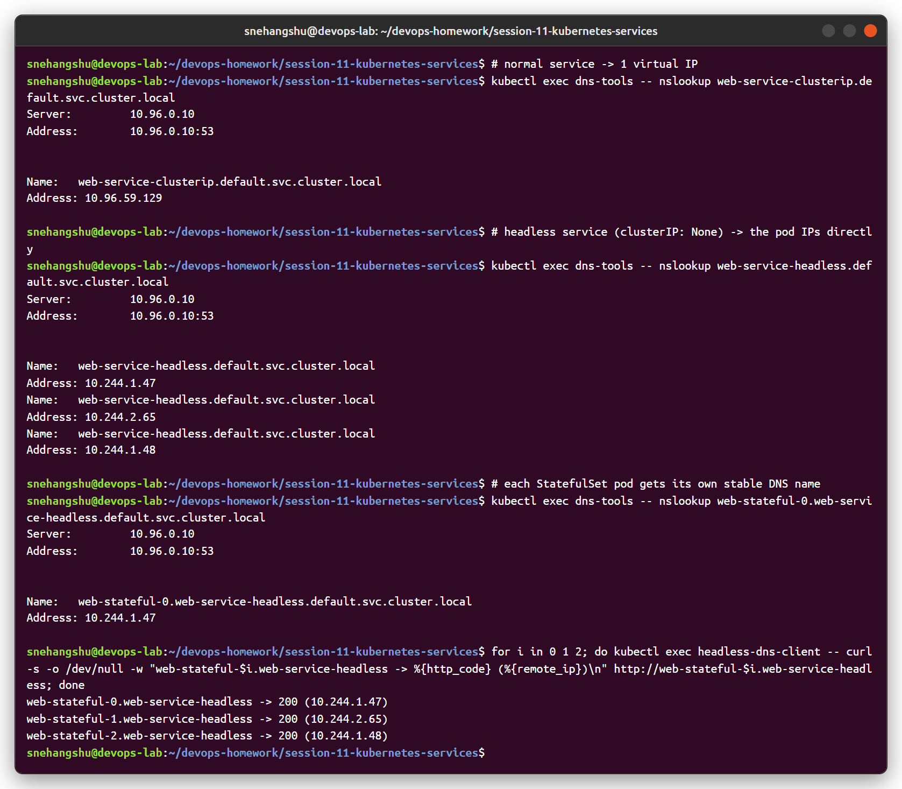

# Task 3: FQDN and Kubernetes Service DNS

## What is an FQDN?

A **Fully Qualified Domain Name (FQDN)** is the complete name of a host, including every level up to the root of the DNS tree. It points to exactly one place and doesn't depend on the client's search domains.

Example: `www.example.com.`

- `www` = host
- `example` = domain
- `com` = top-level domain
- the trailing `.` = DNS root (usually left out when typing)

A short name like `www` is **not** fully qualified. The resolver has to add search domains to it to find the full name.

## DNS in Kubernetes

Every cluster runs a DNS server (CoreDNS) that creates records for Services and Pods automatically. Pods are configured to use it, so applications can connect using names instead of IPs.

The cluster domain is `cluster.local` by default (set in kubelet's `clusterDomain`).

## Service naming convention

```
<service-name>.<namespace>.svc.<cluster-domain>
```

So a Service `backend` in namespace `shop` is:

```
backend.shop.svc.cluster.local
```

| Part | Meaning |
|------|---------|
| `backend` | Service name |
| `shop` | Namespace |
| `svc` | Fixed label meaning "this is a Service record" |
| `cluster.local` | Cluster domain |

Records created for a normal (ClusterIP) Service:

- **A / AAAA record**: the FQDN resolves to the Service's ClusterIP.
- **SRV records** for each named port (see below).

## Namespace-based DNS and search domains

Pods usually don't need the full name, because of `/etc/resolv.conf`. For a Pod in namespace `shop` it looks like this (sample content):

```
search shop.svc.cluster.local svc.cluster.local cluster.local
nameserver 10.96.0.10
options ndots:5
```

- `nameserver` is the ClusterIP of the `kube-dns` Service (CoreDNS).
- `search` lists the suffixes that get added to short names, in order.
- The first entry is the Pod's **own namespace**, which is why a short name finds Services in the same namespace.

What this means in practice:

| Pod in `shop` looks up | Resolves because it tries | Result |
|------------------------|---------------------------|--------|
| `backend` | `backend.shop.svc.cluster.local` | Service in same namespace |
| `backend.shop` | `backend.shop.svc.cluster.local` (via `svc.cluster.local`) | Same Service, namespace explicit |
| `db.data` | `db.data.svc.cluster.local` | Service in another namespace |
| `db` | `db.shop.svc.cluster.local` | Fails if `db` only exists in `data` |

So: **same namespace -> just the service name; other namespace -> at least `<svc>.<ns>`**.

### ndots:5

`ndots:5` means: if a name has **fewer than 5 dots**, try the search domains first before trying it as an absolute name.

- `backend` (0 dots) -> tries `backend.shop.svc.cluster.local` first. Good.
- `api.github.com` (2 dots) -> tries `api.github.com.shop.svc.cluster.local`, `api.github.com.svc.cluster.local`, `api.github.com.cluster.local`, and only then `api.github.com`. That means extra lookups for every external name.

Ways to avoid the extra lookups:

- Use a trailing dot: `api.github.com.` (treated as absolute).
- Use the full name for internal services: `backend.shop.svc.cluster.local.`
- Lower `ndots` for the Pod with `dnsConfig`:

```yaml
spec:
  dnsConfig:
    options:
      - name: ndots
        value: "2"
```

## Pod-to-Service communication

Typical flow when a frontend Pod calls `http://backend:8080`:

1. The app asks the resolver for `backend`.
2. The resolver adds the first search suffix and queries CoreDNS for `backend.shop.svc.cluster.local`.
3. CoreDNS returns the ClusterIP of the Service.
4. The app connects to `ClusterIP:8080`. kube-proxy rules on the node forward it to one of the backend Pods.

Example from a test Pod:

```bash
kubectl run tmp --rm -it --image=busybox:1.36 -n shop -- sh
# inside the pod
cat /etc/resolv.conf
nslookup backend
nslookup backend.shop.svc.cluster.local
wget -qO- http://backend:8080
```

## Headless Services and StatefulSet Pod DNS

A **headless Service** is one with `clusterIP: None`. It has no virtual IP and kube-proxy doesn't handle it. Instead:

- The Service name resolves to the **IPs of all ready Pods** (multiple A records), not one ClusterIP.
- Clients pick a Pod themselves (common for databases and clustered apps).

When a StatefulSet uses a headless Service (`serviceName`), **each Pod gets its own stable DNS name**:

```
<pod-name>.<service-name>.<namespace>.svc.cluster.local
```

For StatefulSet `mysql` with headless Service `mysql` in `data`:

```
mysql-0.mysql.data.svc.cluster.local
mysql-1.mysql.data.svc.cluster.local
mysql-2.mysql.data.svc.cluster.local
```

These names stay the same even if the Pod is recreated with a different IP. That is how replicas can find the primary (e.g. always connect to `mysql-0`).

```yaml
apiVersion: v1
kind: Service
metadata:
  name: mysql
  namespace: data
spec:
  clusterIP: None
  selector:
    app: mysql
  ports:
    - name: mysql
      port: 3306
```

Regular Pods (not in a StatefulSet) can get the same kind of name if you set `spec.hostname` and `spec.subdomain` (subdomain = headless Service name) on the Pod.

## Pod A records

Pods also get a DNS record based on their IP, with dots replaced by dashes:

```
<pod-ip-with-dashes>.<namespace>.pod.cluster.local
```

A Pod with IP `10.244.1.5` in `default`:

```
10-244-1-5.default.pod.cluster.local
```

This is not used much, since you need to know the IP already. It is mainly useful for things like TLS certificates. It depends on the `pods` option in the CoreDNS `kubernetes` plugin (`pods insecure` in the default config).

## SRV records for named ports

For each **named port** on a Service, DNS creates an SRV record:

```
_<port-name>._<protocol>.<service>.<namespace>.svc.cluster.local
```

For a Service `web` in `default` with a port named `http` over TCP:

```
_http._tcp.web.default.svc.cluster.local
```

The SRV record returns the port number and the target hostname. For a normal Service the target is the Service FQDN; for a headless Service there is one SRV record per Pod.

```bash
dig SRV _http._tcp.web.default.svc.cluster.local
```

## ExternalName Services

A Service of `type: ExternalName` creates a **CNAME** record instead of an A record:

```yaml
apiVersion: v1
kind: Service
metadata:
  name: payments
  namespace: shop
spec:
  type: ExternalName
  externalName: api.payments-provider.com
```

`payments.shop.svc.cluster.local` -> CNAME `api.payments-provider.com`.

## Example FQDNs

| Name | What it resolves to |
|------|---------------------|
| `kubernetes.default.svc.cluster.local` | ClusterIP of the API server Service |
| `kube-dns.kube-system.svc.cluster.local` | ClusterIP of CoreDNS |
| `backend.shop.svc.cluster.local` | ClusterIP of `backend` Service in `shop` |
| `frontend.default.svc.cluster.local` | ClusterIP of `frontend` in `default` |
| `mysql.data.svc.cluster.local` | All ready Pod IPs (headless Service) |
| `mysql-0.mysql.data.svc.cluster.local` | IP of Pod `mysql-0` |
| `web-1.nginx.default.svc.cluster.local` | IP of Pod `web-1` of StatefulSet `web` |
| `10-244-1-5.default.pod.cluster.local` | Pod with IP 10.244.1.5 |
| `_http._tcp.web.default.svc.cluster.local` | SRV for port `http` of Service `web` |
| `payments.shop.svc.cluster.local` | CNAME to an external host (ExternalName) |

## Summary

- Service FQDN: `<svc>.<ns>.svc.cluster.local`.
- Same namespace: the short name is enough. Other namespace: use `<svc>.<ns>` or the full FQDN.
- Search domains + `ndots:5` make short names work but add extra lookups for external names.
- Headless Services return Pod IPs; StatefulSet Pods get stable names `<pod>.<svc>.<ns>.svc.cluster.local`.
- Named ports get SRV records.

## Hands-on on my cluster

Created service `orders` in namespace `team-a` and resolved it from a pod in `default`:

- `orders.default.svc.cluster.local` → NXDOMAIN (a short name only searches the pod's own namespace)
- `orders.team-a` → works through the `svc.cluster.local` search domain
- `orders.team-a.svc.cluster.local.` → full FQDN, works from anywhere



Pod A record (`10-244-2-63.default.pod.cluster.local`) and SRV record for the named port `http` of `web-service-clusterip`:



StatefulSet pods behind a headless service: `web-stateful-0.web-service-headless.default.svc.cluster.local`:



