# Session 12 - Ingress, ConfigMaps & Secrets

Cluster: kind (3 nodes) with the ingress-nginx controller. The YAMLs for ConfigMap, Secret and the full demo are from the course repo (`devops-heros/session-12-ingress-configmaps-secrets`).

| Folder | Content |
|---|---|
| [01-configmap](01-configmap) | `yatri-app-config` ConfigMap + demo pod |
| [02-secret](02-secret) | `yatri-db-secret` Secret + demo pod |
| [03-ingress](03-ingress) | Ingress examples (path based, routes, TLS) |
| [04-full-demo](04-full-demo) | Frontend + backend + ConfigMap + Secret + Ingress |
| [05-troubleshooting](05-troubleshooting) | Secret base64 newline bug - before/after |
| [ingress-vs-ingress-controller](ingress-vs-ingress-controller/README.md) | Task 4 |

---

## Task 1: ConfigMap

### Create the ConfigMap

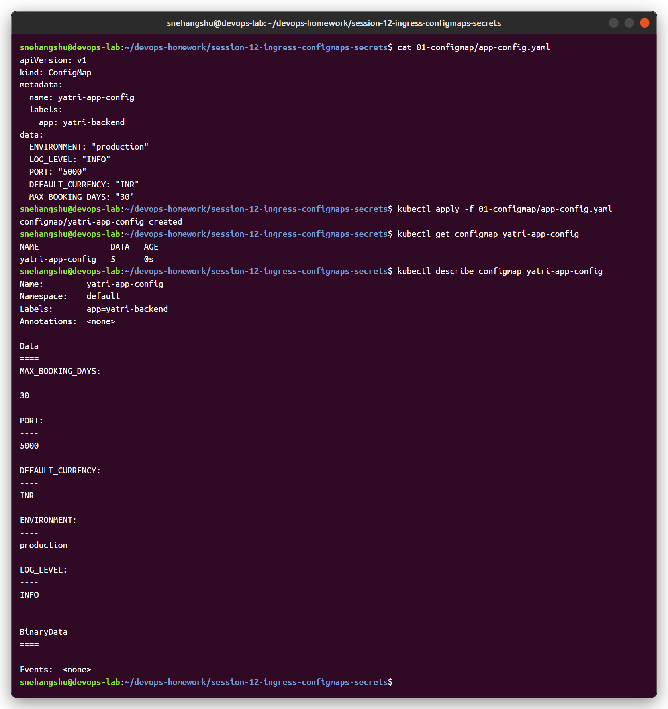

### Inject it into a pod - 3 ways

[`configmap-demo-pod.yaml`](01-configmap/configmap-demo-pod.yaml) uses:
- `env.valueFrom.configMapKeyRef` - one key, renamed to `APP_ENV`
- `envFrom.configMapRef` - all keys as env variables
- a `configMap` volume - every key becomes a file in `/etc/app-config`

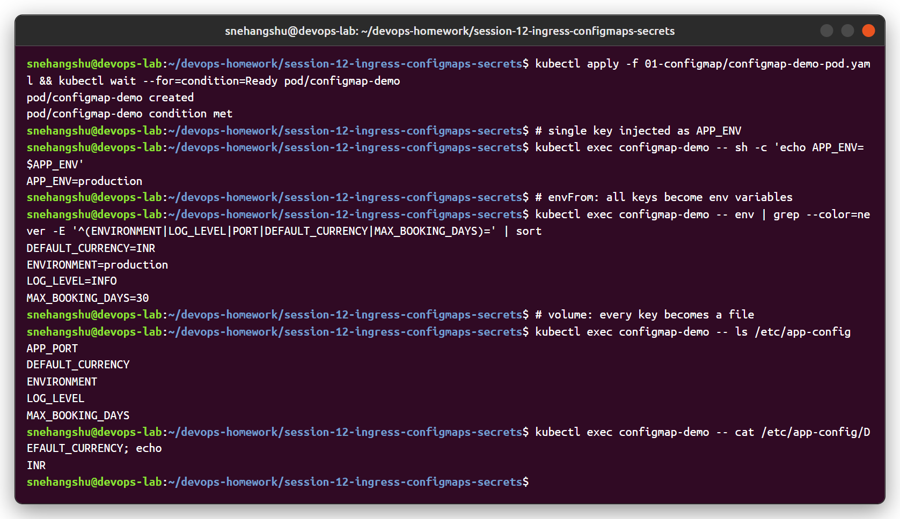

### Updating a ConfigMap

The mounted file changed to `DEBUG` after ~10 seconds, but the env variable still shows `INFO`. Env variables are only read when the container starts, so the pod must be restarted (`kubectl rollout restart`) to pick them up.

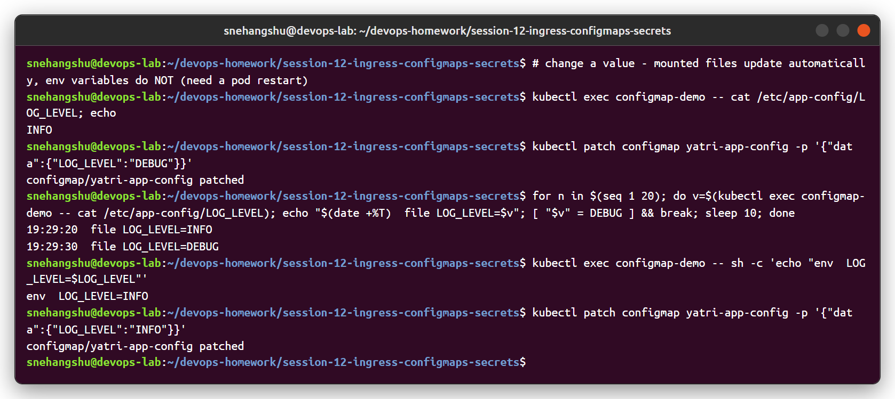

---

## Task 2: Secret

### Create the Secret

Values under `data:` must be base64 (`echo -n "value" | base64`). `kubectl describe` only shows the size, not the value.

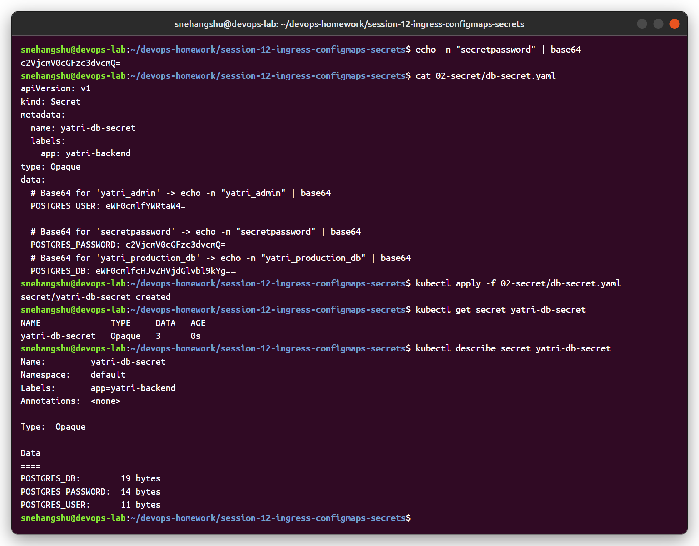

### Inject it into a pod

[`secret-demo-pod.yaml`](02-secret/secret-demo-pod.yaml) uses `secretKeyRef` env variables and a secret volume. Inside the container the values are already decoded. The volume is a **tmpfs** (in memory, never written to the node disk) with file mode `0400`.

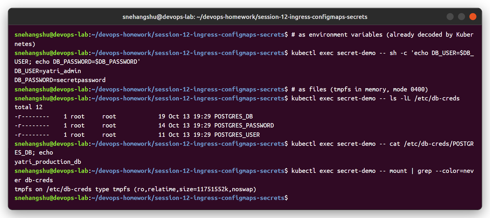

### Why Secrets should not be committed to Git

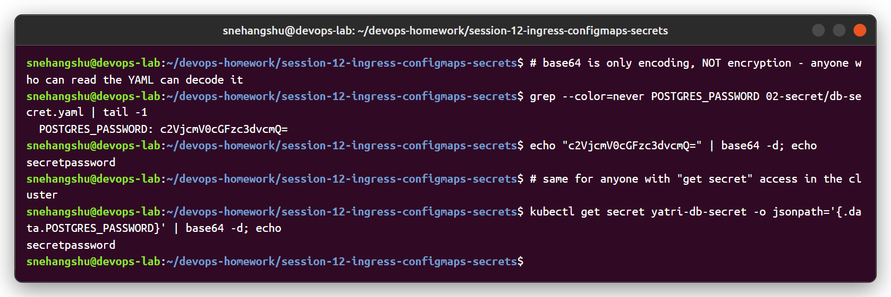

- base64 is **encoding, not encryption**. Anyone who can see the YAML can decode it in one command.
- Git keeps history forever. Even if the file is deleted later, the old commit still has the password, and public repos are scanned by bots within minutes.
- Leaked credentials have to be rotated everywhere.

What to do instead:
- keep secret YAML out of git (`.gitignore`) and create secrets in the pipeline from CI secrets (`kubectl create secret ... --from-literal=$DB_PASS`)
- **Sealed Secrets** (encrypted with the cluster key, safe to commit)
- **External Secrets Operator** with AWS Secrets Manager / Azure Key Vault / HashiCorp Vault
- **SOPS** encrypted files
- enable encryption at rest for etcd and limit `get secrets` with RBAC

---

## Task 3: Ingress

### Ingress controller

kind does not ship one, so I installed **ingress-nginx** (the kind version, which listens on node ports 80/443 that kind maps to my machine).

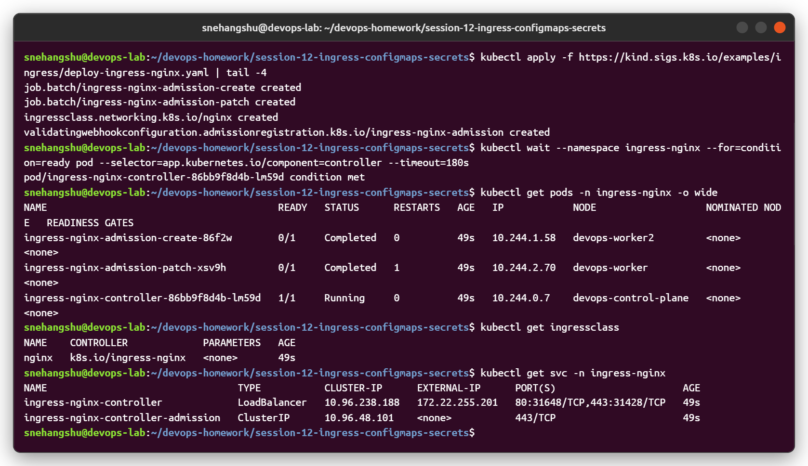

### Deploy app + services + ingress

[04-full-demo](04-full-demo): nginx frontend, Python backend (prints the values it got from the ConfigMap and Secret), both as ClusterIP services, and an Ingress for host `yatri.local`:

- `/` → `yatri-frontend-service`
- `/api(/|$)(.*)` → `yatri-backend-service` (with `rewrite-target: /$2` so the backend receives `/`)

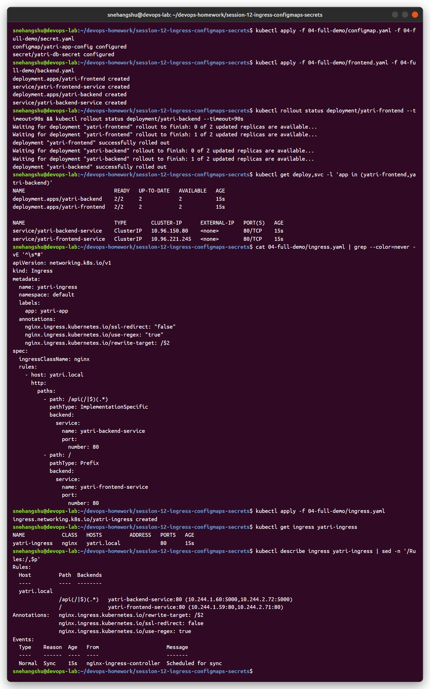

### Verify routing

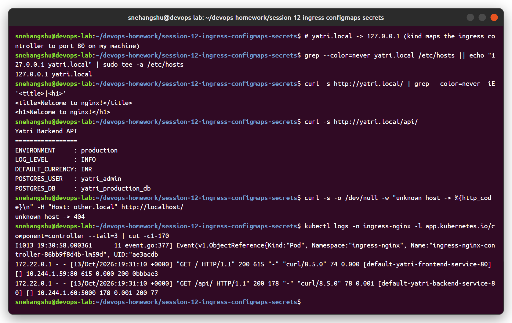

- `http://yatri.local/` → nginx frontend
- `http://yatri.local/api/` → backend, showing `ENVIRONMENT`, `LOG_LEVEL`, `DEFAULT_CURRENCY` from the ConfigMap and `POSTGRES_USER`, `POSTGRES_DB` from the Secret
- unknown host → 404 from the ingress controller default backend
- the controller access log shows which upstream service handled each request

In the browser:

| `/` | `/api/` |
|---|---|
| 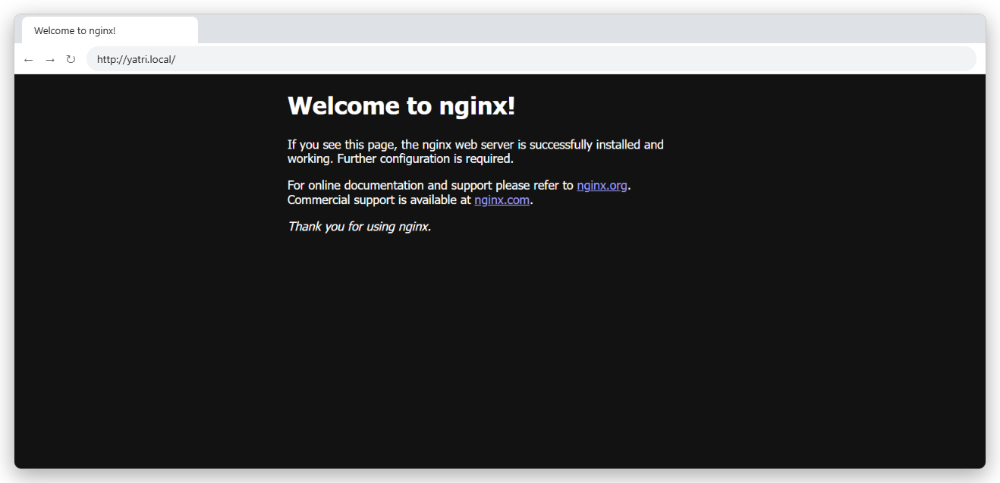 | 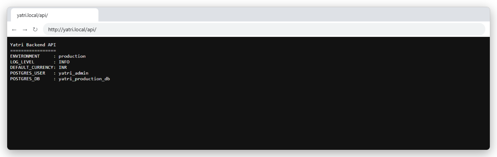 |

---

## Task 4: Ingress vs Ingress Controller

→ [ingress-vs-ingress-controller/README.md](ingress-vs-ingress-controller/README.md)

---

## Task 5: Troubleshooting

Scenario from the course `troubleshooting/secret-base64-gotcha.md`.

### Problem

Postgres runs with password `mypassword`. The app's secret was made with `echo "mypassword" | base64`, and the app fails with:

```
FATAL:  password authentication failed for user "yatri_admin"
```

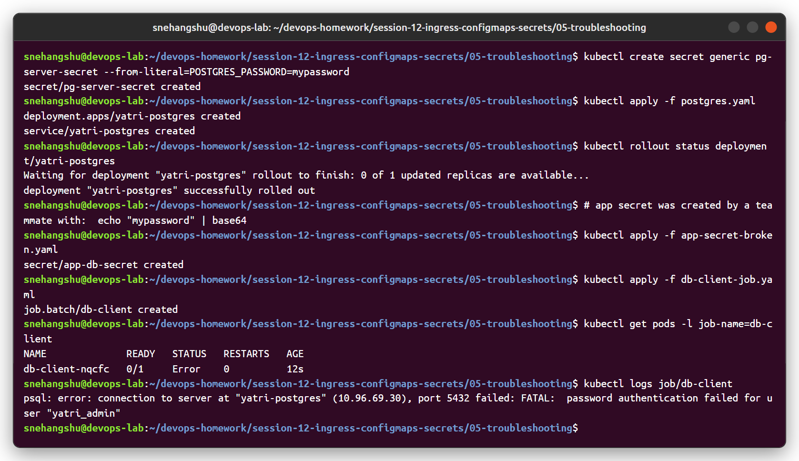

### Investigation and root cause

- The decoded password *looks* right.
- `kubectl describe secret` shows **11 bytes** for the app secret but **10 bytes** for the server secret.
- `xxd` shows an extra `0a` byte at the end, which is a newline.
- `echo` adds `\n` by default, so `bXlwYXNzd29yZAo=` (ends in `Ao=`) is "mypassword\n", while `bXlwYXNzd29yZA==` is the real value.

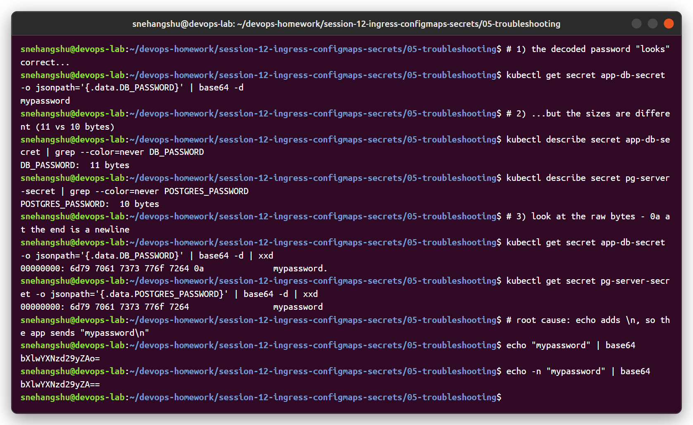

### Fix and verify

Re-created the secret with `echo -n` ([app-secret-fixed.yaml](05-troubleshooting/app-secret-fixed.yaml)), re-ran the client job, and it now connects and prints the PostgreSQL version.

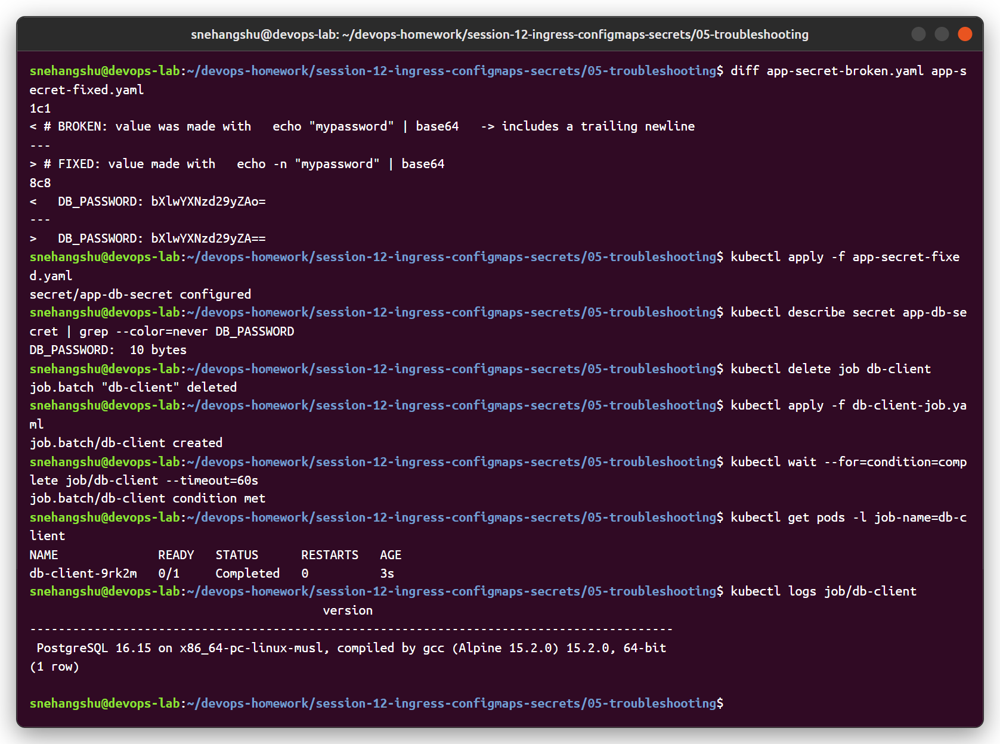

**Lesson:** always use `echo -n ... | base64`, or let kubectl do it: `kubectl create secret generic x --from-literal=KEY=value`. Using `stringData:` in YAML also avoids manual base64.
