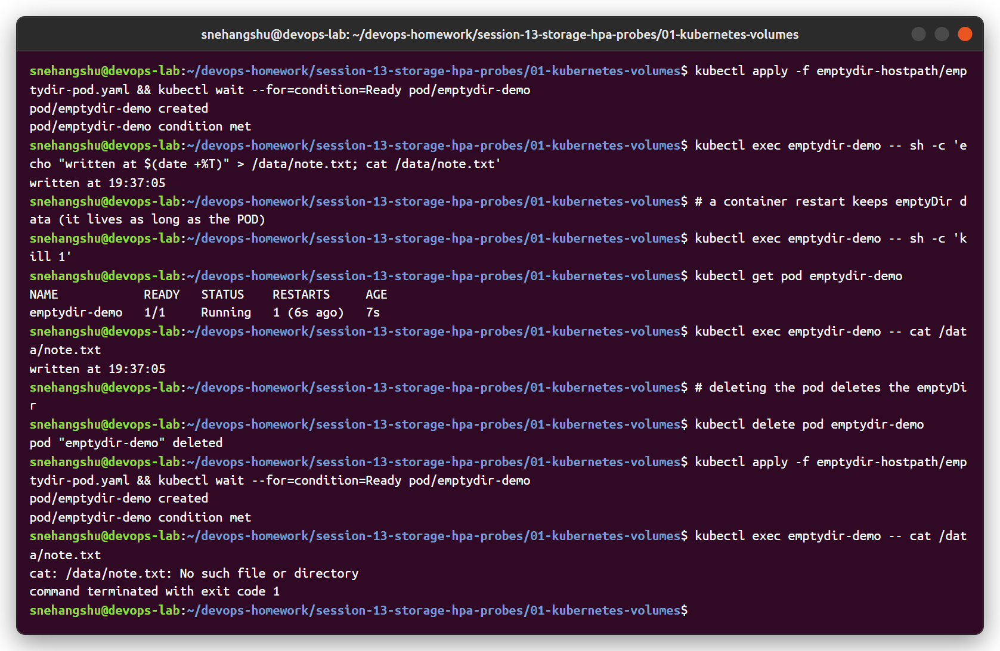
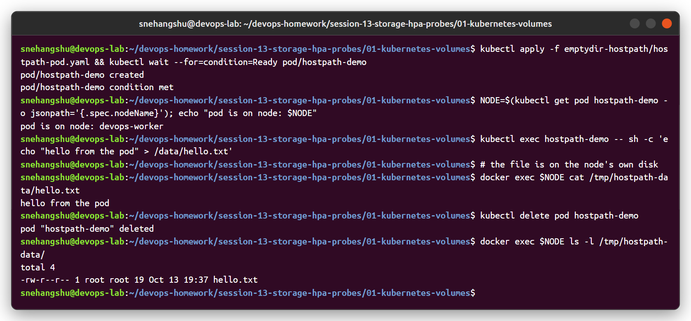
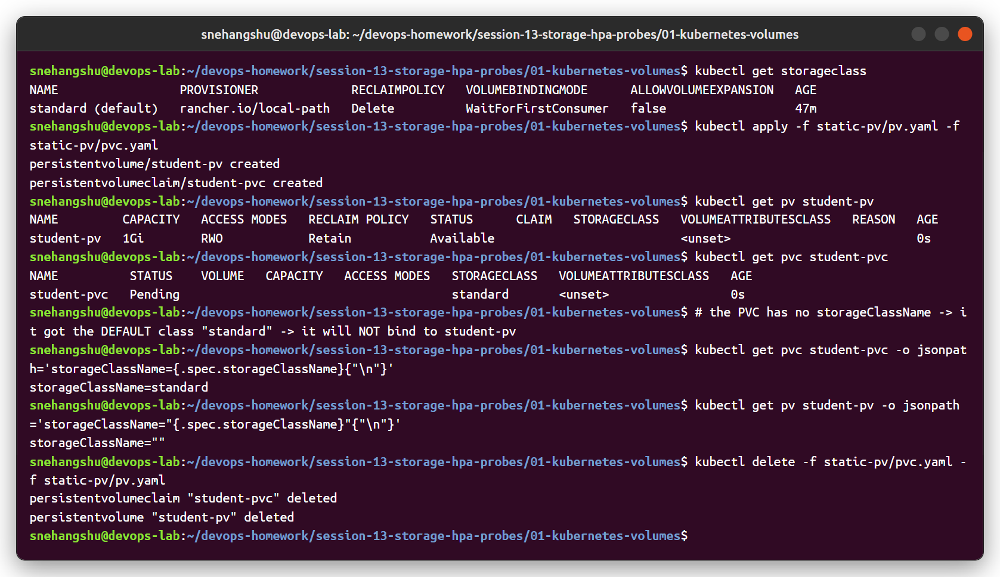
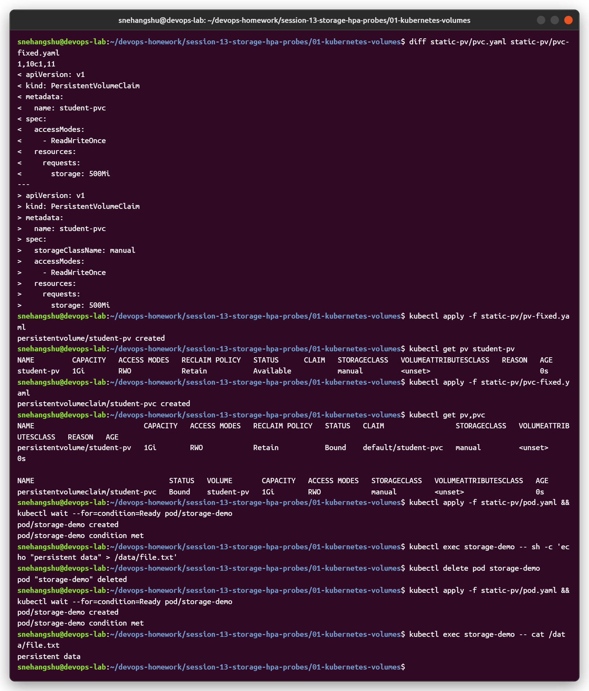
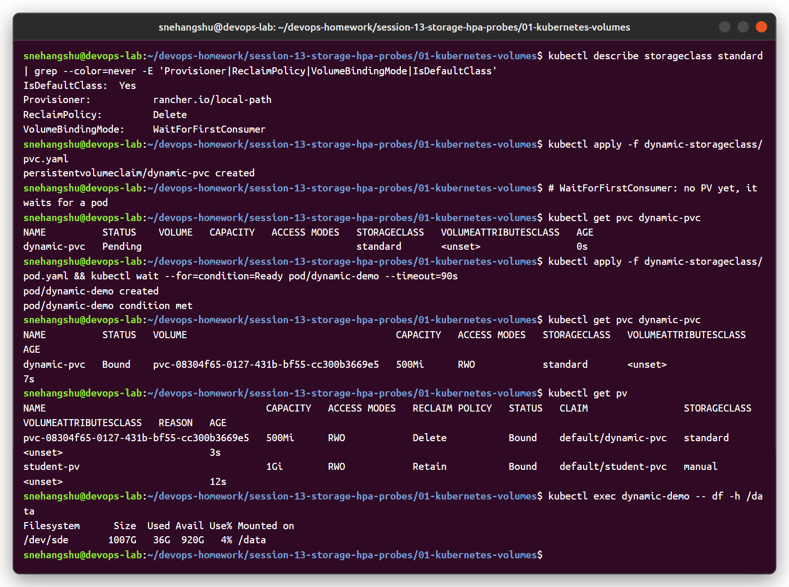
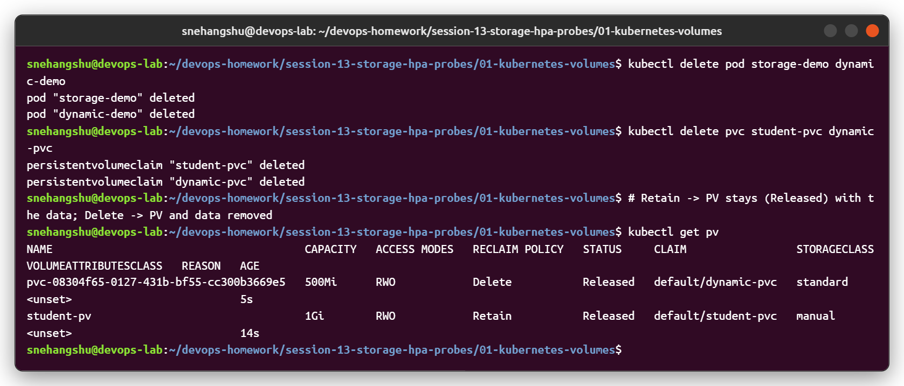
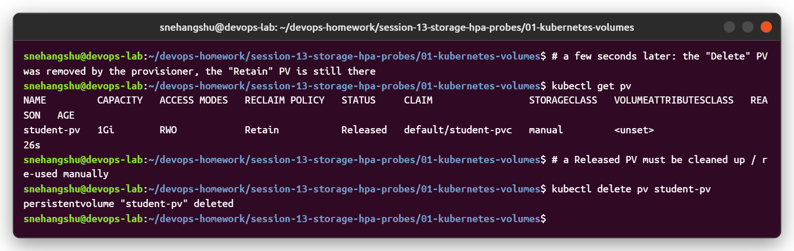

# Task 1: Kubernetes Volumes and Persistent Storage

Containers have a temporary filesystem. When a container restarts, anything written inside it is lost. Kubernetes **volumes** solve this, and different volume types live for different lengths of time:

| Type | Lives as long as | Use for |
|------|------------------|---------|
| `emptyDir` | The Pod | Scratch space, sharing files between containers |
| `hostPath` | The node | Reading node files (agents), local testing |
| PersistentVolume + Claim | Independent of Pods | Databases, uploads, anything that must survive |

## emptyDir

An empty directory created when the Pod is assigned to a node. All containers in the Pod can mount it. It survives **container** restarts but is **deleted when the Pod is removed**.

```yaml
apiVersion: v1
kind: Pod
metadata:
  name: shared-data
spec:
  containers:
    - name: writer
      image: busybox:1.36
      command: ["sh", "-c", "while true; do date >> /data/log.txt; sleep 5; done"]
      volumeMounts:
        - name: shared
          mountPath: /data
    - name: reader
      image: busybox:1.36
      command: ["sh", "-c", "tail -f /data/log.txt"]
      volumeMounts:
        - name: shared
          mountPath: /data
  volumes:
    - name: shared
      emptyDir:
        sizeLimit: 100Mi
        # medium: Memory   # use RAM (tmpfs) instead of node disk
```

## hostPath

Mounts a file or directory from the **node's filesystem** into the Pod.

```yaml
apiVersion: v1
kind: Pod
metadata:
  name: hostpath-demo
spec:
  containers:
    - name: app
      image: busybox:1.36
      command: ["sh", "-c", "ls /host-logs; sleep 3600"]
      volumeMounts:
        - name: logs
          mountPath: /host-logs
          readOnly: true
  volumes:
    - name: logs
      hostPath:
        path: /var/log
        type: Directory     # others: DirectoryOrCreate, File, FileOrCreate, Socket
```

Cautions:

- Data is tied to one node. If the Pod moves to another node, it sees different data.
- Security risk: a Pod can read or write host files. Often blocked by Pod Security Standards (`baseline`/`restricted`).
- Fine for DaemonSets (log/metrics agents) and single-node test clusters (minikube, kind). Not for real app data.

## PersistentVolume (PV)

A **PV** is a piece of storage in the cluster, created by an admin (static) or automatically by a StorageClass (dynamic). It is a cluster-scoped object and exists independently of any Pod.

Static PV example (hostPath, for a local test cluster only):

```yaml
apiVersion: v1
kind: PersistentVolume
metadata:
  name: pv-demo
spec:
  capacity:
    storage: 1Gi
  accessModes:
    - ReadWriteOnce
  persistentVolumeReclaimPolicy: Retain
  storageClassName: manual
  hostPath:
    path: /mnt/data
```

In real clusters a PV would point at a CSI volume, NFS share, cloud disk, etc.

## PersistentVolumeClaim (PVC)

A **PVC** is a request for storage by a user/app: "I need 1Gi, ReadWriteOnce, from class X". It is namespaced. Kubernetes finds (or creates) a matching PV and **binds** them one-to-one.

```yaml
apiVersion: v1
kind: PersistentVolumeClaim
metadata:
  name: pvc-demo
spec:
  accessModes:
    - ReadWriteOnce
  storageClassName: manual
  resources:
    requests:
      storage: 1Gi
```

Using the PVC in a Pod:

```yaml
apiVersion: v1
kind: Pod
metadata:
  name: pvc-pod
spec:
  containers:
    - name: nginx
      image: nginx:1.27
      volumeMounts:
        - name: web-data
          mountPath: /usr/share/nginx/html
  volumes:
    - name: web-data
      persistentVolumeClaim:
        claimName: pvc-demo
```

The Pod only knows the claim name. It doesn't care what storage is behind it. That is the point of the PV/PVC split: **admins manage PVs, developers request PVCs**.

## StorageClass and dynamic provisioning

Creating PVs by hand doesn't scale. A **StorageClass** describes a "type" of storage and which **provisioner** (usually a CSI driver) creates it. When a PVC asks for that class, the provisioner creates the PV automatically. This is **dynamic provisioning**.

```yaml
apiVersion: storage.k8s.io/v1
kind: StorageClass
metadata:
  name: fast-ssd
  annotations:
    storageclass.kubernetes.io/is-default-class: "false"
provisioner: ebs.csi.aws.com          # AWS EBS CSI driver
parameters:
  type: gp3
reclaimPolicy: Delete
volumeBindingMode: WaitForFirstConsumer
allowVolumeExpansion: true
```

PVC using it (no PV needs to exist beforehand):

```yaml
apiVersion: v1
kind: PersistentVolumeClaim
metadata:
  name: data
spec:
  accessModes: ["ReadWriteOnce"]
  storageClassName: fast-ssd
  resources:
    requests:
      storage: 10Gi
```

Notes:

- If a PVC has no `storageClassName`, the **default** StorageClass is used (the one with `is-default-class: "true"`).
- `storageClassName: ""` means "no dynamic provisioning, bind only to a pre-created PV with no class".
- Local clusters come with a default class, e.g. kind uses `rancher.io/local-path` and minikube uses `k8s.io/minikube-hostpath`.
- `allowVolumeExpansion: true` lets you increase the PVC size later by editing `resources.requests.storage`.

## Access modes

| Mode | Short | Meaning |
|------|-------|---------|
| ReadWriteOnce | RWO | Read-write by **one node** (several Pods on that same node can still use it) |
| ReadOnlyMany | ROX | Read-only by many nodes |
| ReadWriteMany | RWX | Read-write by many nodes (needs shared storage like NFS, CephFS, EFS, Azure Files) |
| ReadWriteOncePod | RWOP | Read-write by **one Pod** only (GA in v1.29, CSI volumes only) |

The storage backend decides which modes are possible. Block disks like EBS or Persistent Disk are usually RWO only.

## Reclaim policies

What happens to the PV (and the real disk) when its PVC is deleted:

| Policy | Behaviour |
|--------|-----------|
| `Retain` | PV stays with status `Released`, data kept. Admin must clean up / reuse manually. Safe for important data. |
| `Delete` | PV and the underlying storage are deleted. Default for dynamically provisioned volumes. |
| `Recycle` | Old basic wipe (`rm -rf`) and reuse. **Deprecated**; use dynamic provisioning instead. |

The policy can be changed on an existing PV:

```bash
kubectl patch pv <pv-name> -p '{"spec":{"persistentVolumeReclaimPolicy":"Retain"}}'
```

## volumeBindingMode

| Mode | When the PV is provisioned/bound |
|------|-----------------------------------|
| `Immediate` (default) | As soon as the PVC is created |
| `WaitForFirstConsumer` | Only when a Pod using the PVC is scheduled |

`WaitForFirstConsumer` matters for storage tied to a zone or node (cloud disks, local volumes). With `Immediate`, the disk could be created in zone A while the scheduler later puts the Pod in zone B, and the Pod gets stuck. Waiting lets the scheduler pick the node first and then create the disk in the right place. While waiting, the PVC shows `Pending`, which is normal.

## PV / PVC lifecycle and binding

1. **Provisioning**: static (admin creates PV) or dynamic (StorageClass creates PV when a PVC appears).
2. **Binding**: the control plane matches a PVC to a PV with enough capacity, a compatible access mode and the same StorageClass. The binding is one-to-one and exclusive. If nothing matches, the PVC stays `Pending` until a match exists.
3. **Using**: a Pod mounts the PVC. While in use, the PVC and PV are protected by finalizers (`kubernetes.io/pvc-protection`, `kubernetes.io/pv-protection`), so deleting them waits until no Pod is using them.
4. **Releasing**: the PVC is deleted. The PV becomes `Released` (it still holds the old data and can't be bound to a new claim automatically).
5. **Reclaiming**: the reclaim policy runs (`Retain` keeps it, `Delete` removes it).

PV phases: `Available` -> `Bound` -> `Released` (or `Failed` if automatic reclamation fails).
PVC phases: `Pending` -> `Bound` (or `Lost` if its PV disappears).

```
   PVC created
       |
       v
  [PVC Pending] --(match / provision)--> [PV Bound] <--> [PVC Bound] --> Pod uses it
                                                              |
                                                       PVC deleted
                                                              v
                                                      [PV Released]
                                                       /           \
                                                 Retain           Delete
                                              (kept, manual)   (PV + disk removed)
```

## Useful commands

```bash
kubectl get storageclass
kubectl get pv
kubectl get pvc -A
kubectl describe pvc <name>        # events show why it is Pending
kubectl describe pv <name>
kubectl get pvc <name> -o jsonpath='{.spec.volumeName}'   # which PV it is bound to
kubectl exec -it pvc-pod -- df -h /usr/share/nginx/html
```

## Summary

- `emptyDir` = per-Pod scratch space. `hostPath` = node files, avoid for app data.
- PV = the storage, PVC = the request, bound one-to-one.
- StorageClass + provisioner = PVs created automatically (dynamic provisioning).
- Pick access mode and reclaim policy based on the backend and how important the data is.
- Use `WaitForFirstConsumer` for zonal or local storage.

## What I ran

YAML files used (from the course repo): [emptydir-hostpath/](emptydir-hostpath), [static-pv/](static-pv), [dynamic-storageclass/](dynamic-storageclass)

**emptyDir** - data survives a container restart (`kill 1` → RESTARTS 1, file still there) but is gone when the pod is deleted.



**hostPath** - the file written by the pod is visible directly on the kind node (`docker exec <node> cat /tmp/hostpath-data/hello.txt`) and stays there after the pod is deleted.



**Static PV + PVC - a gotcha I hit.** The course `pvc.yaml` has no `storageClassName`, so the DefaultStorageClass admission plugin gave it `standard`. The PV has no class (`""`), so the claim never bound to `student-pv` and just waited for dynamic provisioning.



Fix: give both the same class ([pv-fixed.yaml](static-pv/pv-fixed.yaml), [pvc-fixed.yaml](static-pv/pvc-fixed.yaml) use `storageClassName: manual`). Now they bind, and the data written by the pod survives deleting the pod:



**StorageClass + dynamic provisioning** - kind's `standard` class uses the `rancher.io/local-path` provisioner with `WaitForFirstConsumer`. The PVC stays `Pending` until a pod uses it, then a PV (`pvc-<uid>`) is created automatically.



**Reclaim policy** - after deleting the claims, both PVs go to `Released`. A few seconds later the `Delete` PV is removed by the provisioner, while the `Retain` PV stays (with its data) until an admin deletes it.



