# Session 13 - Kubernetes Storage, HPA & Probes

Cluster: kind (1 control plane + 2 workers). YAML files are from the course repo (`devops-heros/session-13-storage-hpa-probes`).

| Folder | Content |
|---|---|
| [01-kubernetes-volumes](01-kubernetes-volumes/README.md) | Task 1 - volume notes + hands-on (emptyDir, hostPath, PV/PVC, StorageClass) |
| [02-hpa](02-hpa) | Task 2 - `hpa.yaml`, deployment, service, load generator |
| [03-probes](03-probes) | startup / readiness / liveness probe demos |
| [04-mini-project](04-mini-project) | Task 3 - PVC + HPA + probes web app |

---

## Task 1: Kubernetes Volumes

Notes + outputs: **[01-kubernetes-volumes/README.md](01-kubernetes-volumes/README.md)**

| Type | Lifetime | Example output |
|---|---|---|
| emptyDir | pod |  |
| hostPath | node |  |
| PV + PVC | independent of pods |  |
| StorageClass | dynamic PV per claim |  |

---

## Task 2: HPA hands-on

### 1. Metrics Server

HPA needs CPU metrics from metrics-server. On kind the kubelet certificates are self-signed, so I added `--kubelet-insecure-tls` (lab only).

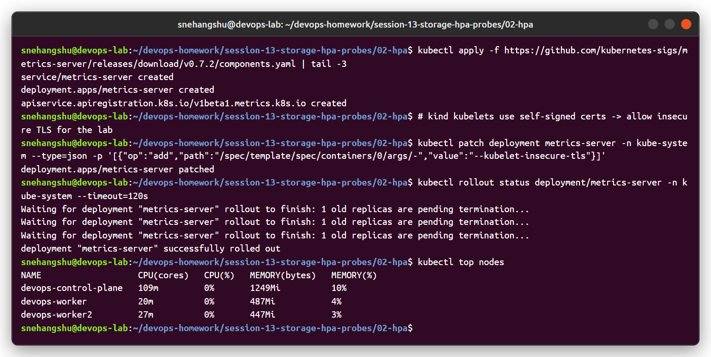

### 2-3. Deploy the app and configure the HPA

[`hpa.yaml`](02-hpa/hpa.yaml): min 1, max 5 replicas, target **50% CPU of the request** (request = 100m, so the target is 50m per pod).

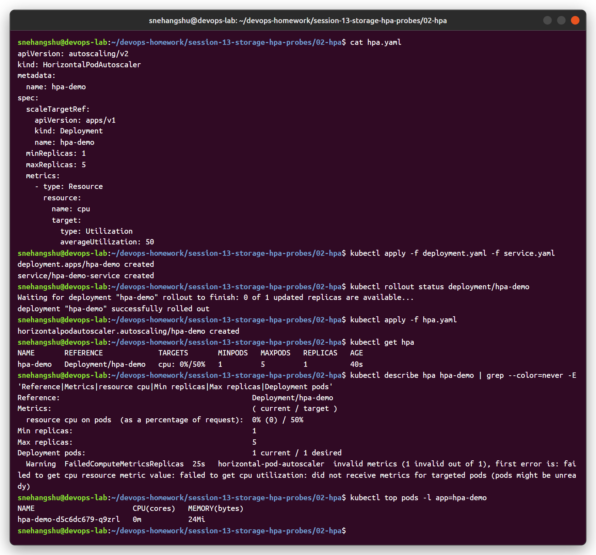

Right after creation the HPA shows `<unknown>` / a `FailedGetResourceMetric` warning until metrics-server has the first sample, which is normal.

### 4-7. Load generator → CPU goes up → pods scale

[`load-generator.yaml`](02-hpa/load-generator.yaml) runs 4 busybox pods hitting the service in a loop (same idea as the course `load_generator.sh`).

```bash
kubectl apply -f load-generator.yaml
kubectl get hpa hpa-demo --watch
kubectl top pods
```

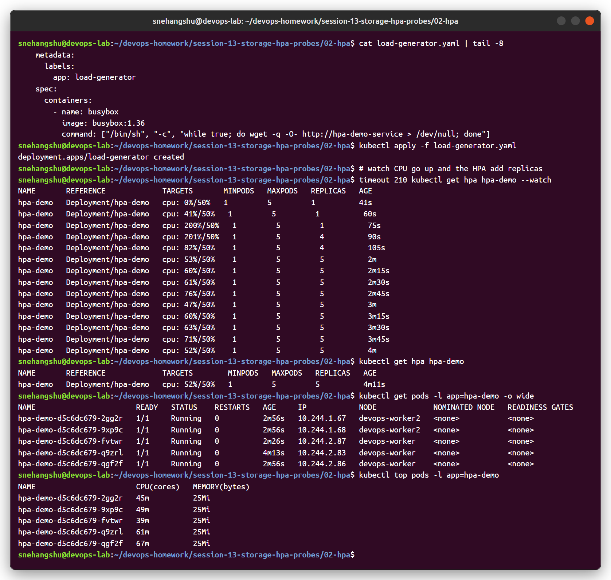

| Time | CPU / target | Replicas |
|---|---|---|
| 60s | 41% / 50% | 1 |
| 75s | 200% / 50% | 1 |
| 90s | 201% / 50% | **4** |
| 2m | 53% / 50% | **5** (max) |

Formula: `desired = ceil(current replicas × current% / target%)` = ceil(1 × 201 / 50) = 5, but it scales in steps and caps at `maxReplicas: 5`.

### `kubectl describe hpa`

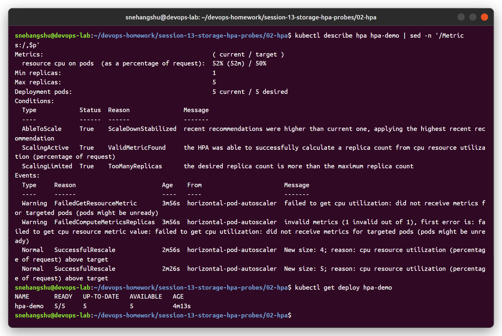

Events: `New size: 4; reason: cpu resource utilization above target` → `New size: 5`. `ScalingLimited: TooManyReplicas` means it wanted more than 5.

### Scale down

After deleting the load generator, the HPA waited for the **5-minute scale-down stabilization window**, then went 5 → 2 → 1 (`All metrics below target`).

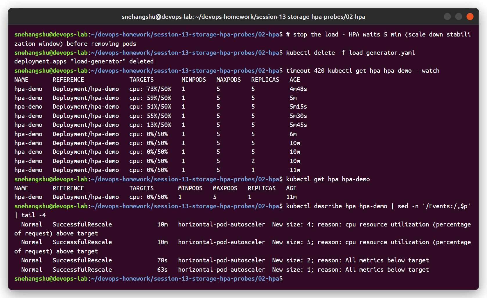

---

## Probes

| Probe | Question it answers | On failure |
|---|---|---|
| startupProbe | Has the app finished starting? (other probes wait for it) | container restarted after `failureThreshold × periodSeconds` |
| readinessProbe | Can it receive traffic right now? | removed from Service endpoints, **not** restarted |
| livenessProbe | Is it stuck/dead? | container **restarted** |

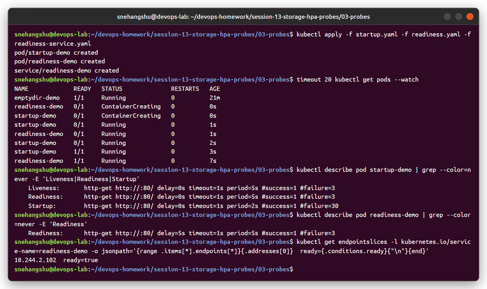

**Liveness failure:** deleted nginx `index.html` → `/` returns 403 → `Liveness probe failed: HTTP probe failed with statuscode: 403` → `Container nginx failed liveness probe, will be restarted`. RESTARTS became 1 and the file came back from the image.

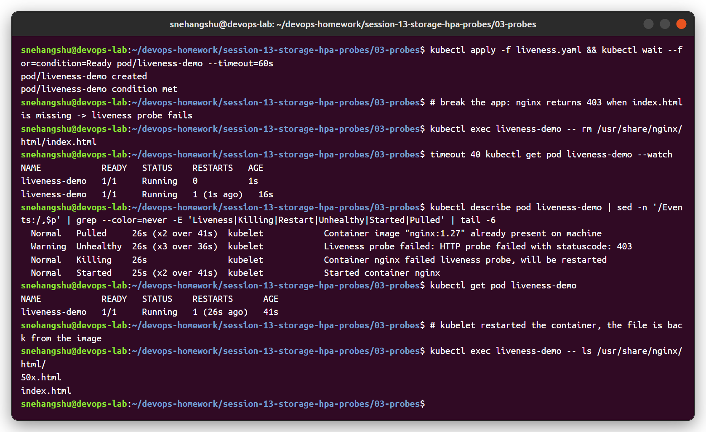

**Readiness failure:** same trick on the readiness pod → pod becomes `0/1`, endpoint `ready=false` (no traffic), restart count stays 0. After restoring the file it is `1/1` and `ready=true` again.

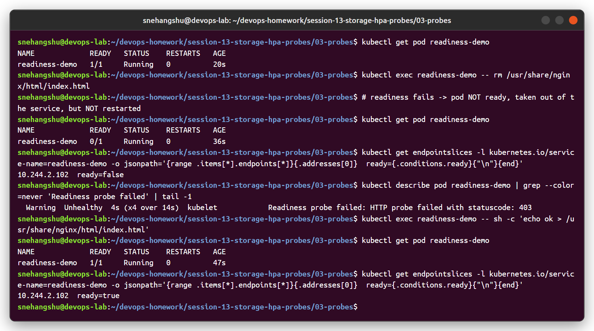

---

## Task 3: Mini Project - Production-ready web app

[04-mini-project](04-mini-project): namespace `production-webapp`, PVC `web-data` (500Mi RWO), Deployment `web-app` (2 replicas, startup/readiness/liveness probes, CPU requests/limits, `/data` on the PVC), ClusterIP service, HPA 2-5 at 50% CPU.

### Deploy

The PVC is `Pending` until the first pod is scheduled (`WaitForFirstConsumer`), then it is bound to a dynamically created PV.

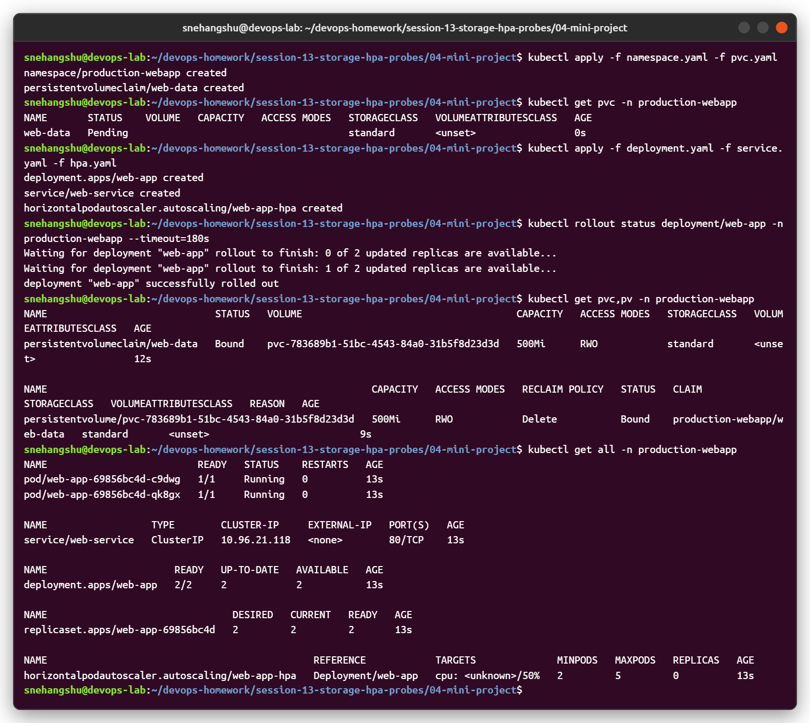

### State persistence

Wrote a line to `/data/bookings.log`, deleted **all** pods, and the new pod still has the file.

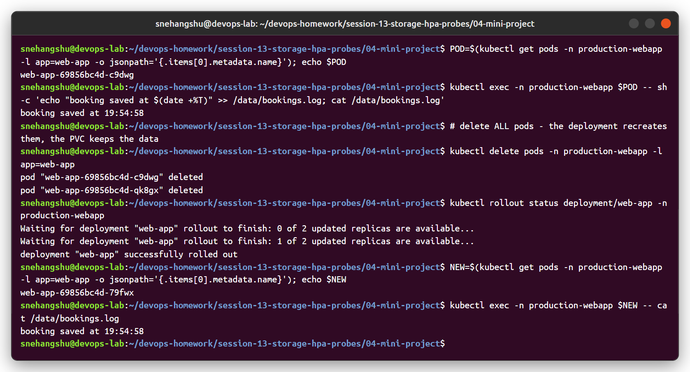

### Health diagnostics

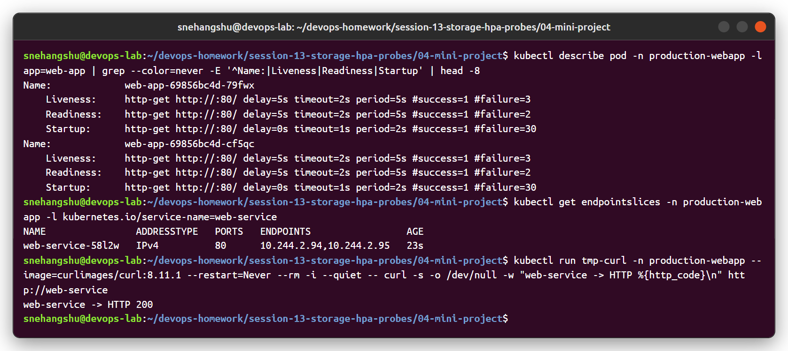

### Elastic scaling

Load → CPU 196% → HPA scaled 2 → 4 → 5.

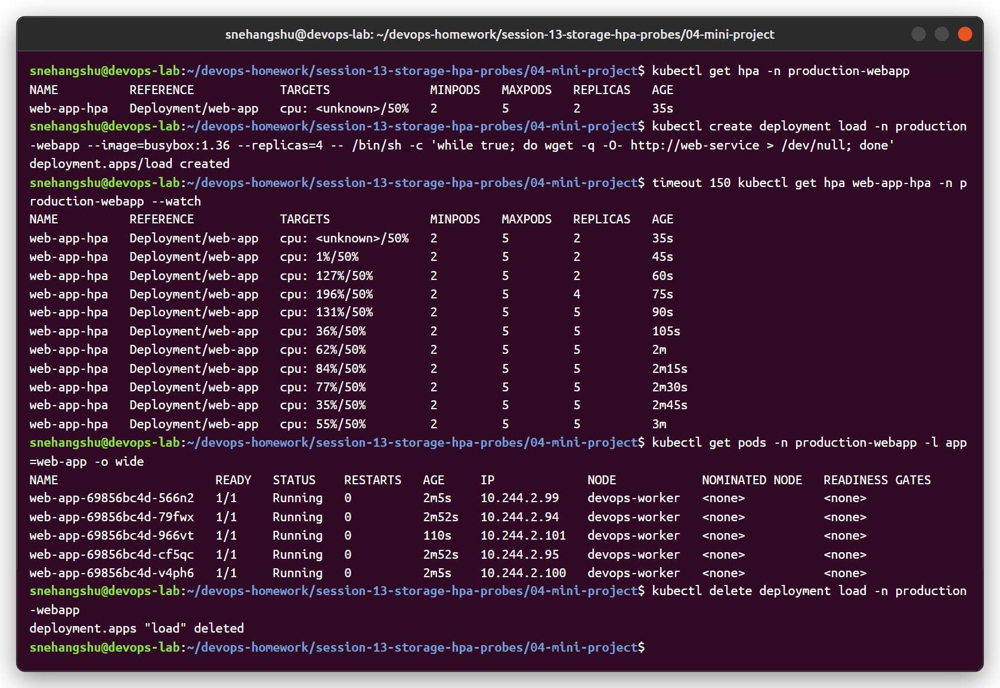

> Note: because the PVC is `ReadWriteOnce` with a local-path volume, all replicas have to run on the same node as the volume. In production you would use RWX storage (EFS/NFS) or a StatefulSet with one volume per pod.
