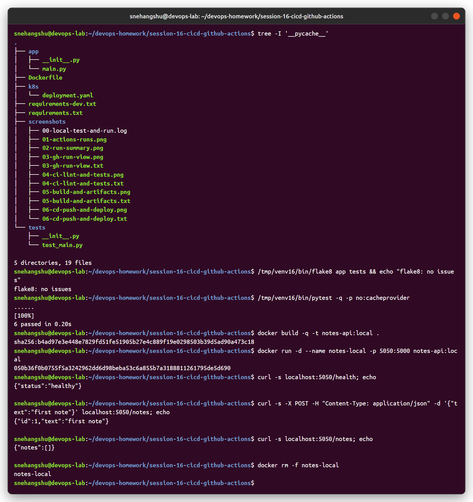
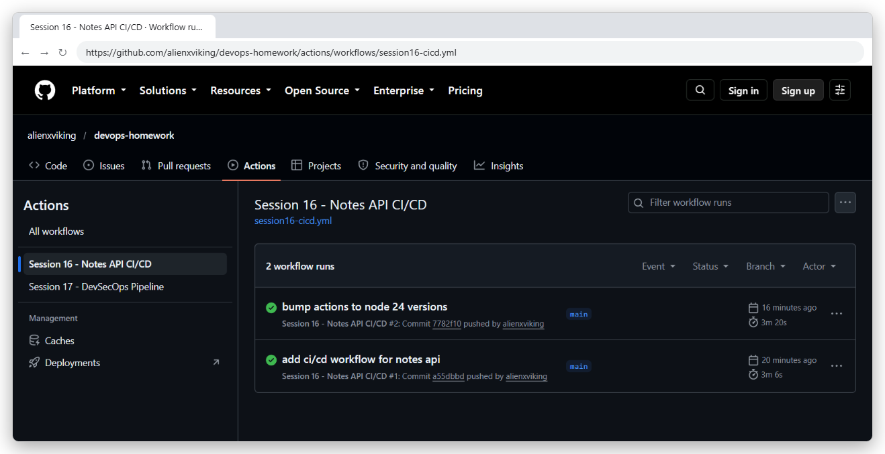
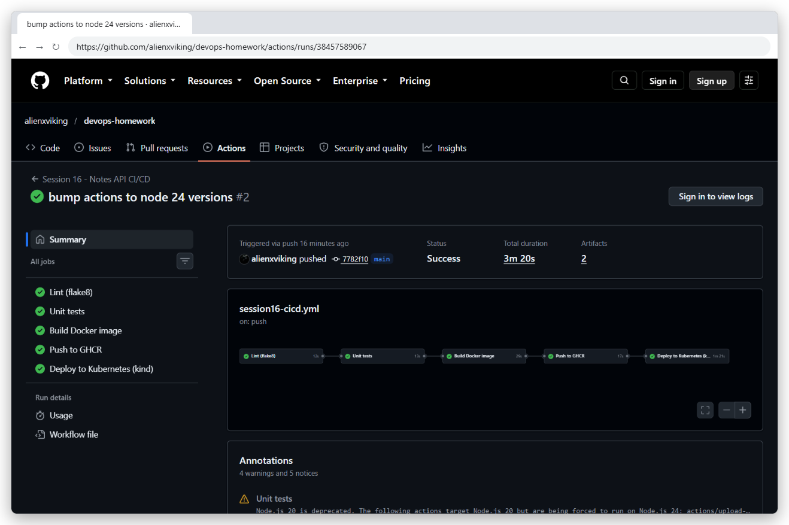
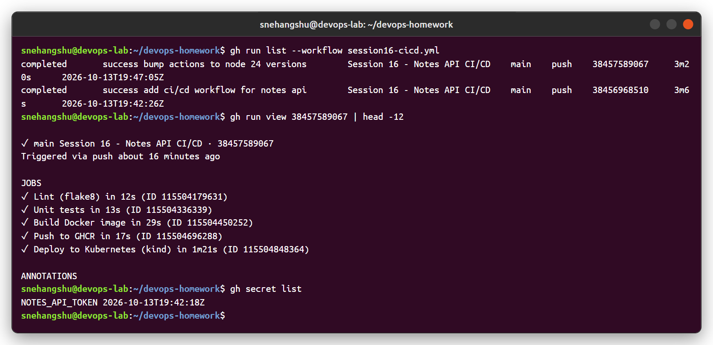
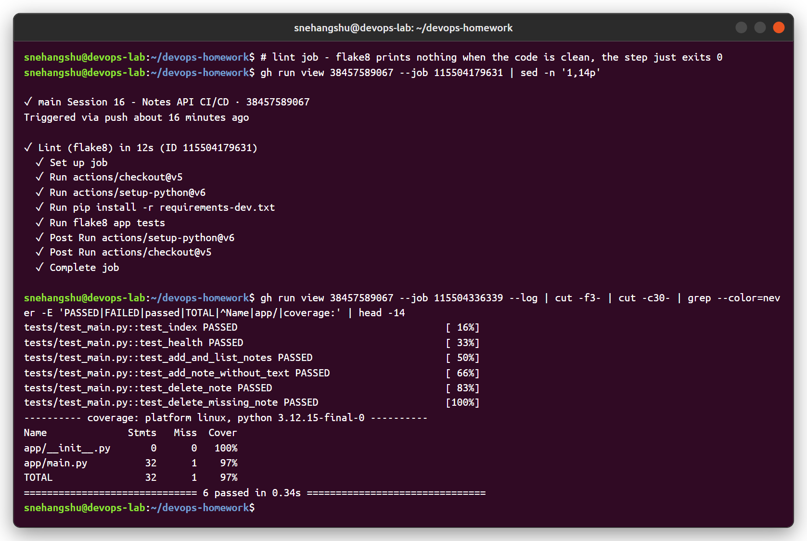
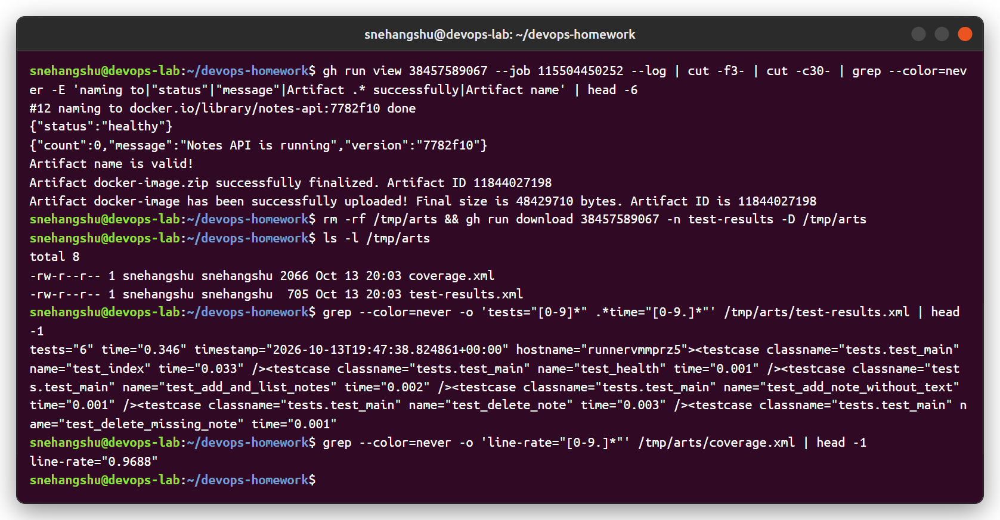
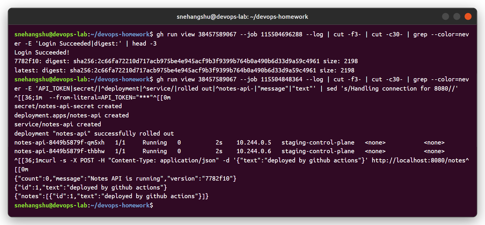

# Session 16 - CI/CD & GitHub Actions

Demo project: **Notes API** (Flask) with a full GitHub Actions CI/CD pipeline.

- Workflow: [`.github/workflows/session16-cicd.yml`](../.github/workflows/session16-cicd.yml)
- Runs: https://github.com/alienxviking/devops-homework/actions/workflows/session16-cicd.yml

```
session-16-cicd-github-actions/
├── app/main.py            # Flask API: /, /health, GET/POST /notes, DELETE /notes/<id>
├── tests/test_main.py     # 6 pytest tests
├── requirements.txt       # flask, gunicorn
├── requirements-dev.txt   # pytest, pytest-cov, flake8
├── Dockerfile             # python:3.12-slim, non-root user, healthcheck, gunicorn
└── k8s/deployment.yaml    # Deployment (2 replicas, probes, secret env) + Service
```

---

## Concepts

| Term | Meaning | In this project |
|---|---|---|
| **CI** (Continuous Integration) | Every push is automatically built and tested | lint → test → build image |
| **CD** (Continuous Delivery/Deployment) | Tested build is automatically released/deployed | push to GHCR → deploy to Kubernetes |
| **Pipeline** | The whole automated flow from commit to deployment | 5 jobs chained with `needs:` |
| **Workflow** | YAML file in `.github/workflows/` | `session16-cicd.yml` |
| **Event / trigger** | What starts the workflow | `push` and `pull_request` to `main` (only when this folder changes), `workflow_dispatch` (manual) |
| **Job** | Group of steps that runs on one runner; jobs run in parallel unless `needs:` is used | lint, test, build, push, deploy |
| **Step** | One command (`run:`) or action (`uses:`) inside a job | `pytest ...`, `actions/checkout@v5` |
| **Runner** | The machine that executes a job | GitHub-hosted `ubuntu-latest` VM |
| **Secret** | Encrypted value, masked as `***` in logs | `NOTES_API_TOKEN` (repo secret), `GITHUB_TOKEN` (automatic) |
| **Artifact** | File saved from a job, downloadable / passed to other jobs | `test-results` (JUnit + coverage), `docker-image` (image tar) |
| **Environment** | Deployment target with its own history/protection rules | `staging` |

## Pipeline

```
 push to main
     │
     ▼
┌──────────┐   ┌────────────┐   ┌──────────────┐   ┌──────────────┐   ┌──────────────────────┐
│  Lint    │──►│ Unit tests │──►│ Build image  │──►│ Push to GHCR │──►│ Deploy to Kubernetes │
│ flake8   │   │ pytest+cov │   │ docker build │   │ GITHUB_TOKEN │   │ kind cluster, secret,│
│          │   │ artifact ▲ │   │ smoke test   │   │ :sha :latest │   │ rollout, smoke test  │
└──────────┘   └────────────┘   │ artifact ▲   │   └──────────────┘   └──────────────────────┘
                                └──────────────┘
 ◄──────────────── CI ─────────────────────────►◄──────────────── CD ───────────────────────►
```

---

## 1. Local test before pushing



Interesting result: after `POST /notes`, `GET /notes` returned an empty list. Gunicorn runs **2 worker processes** and the notes are stored in memory, so each worker has its own list and the two requests went to different workers. Same thing happens with 2 pods in Kubernetes. Lesson: an app with replicas must keep state outside the container (database / Redis), which is what the final project does with PostgreSQL.

## 2. Pipeline runs

The first run worked but showed "Node.js 20 is deprecated" warnings, so in the second commit I bumped the actions to `checkout@v5`, `setup-python@v6`, `upload-artifact@v5`, `download-artifact@v6`.







## 3. CI - lint and tests (with coverage)

6 tests passed, 97% coverage. `test-results.xml` (JUnit) and `coverage.xml` are uploaded as an artifact.



## 4. Build + artifacts

The image is built with the commit SHA as tag (`notes-api:7782f10`), started once as a smoke test (`/health` → healthy), saved with `docker save` and uploaded as the `docker-image` artifact so later jobs reuse the exact same image. Downloading the test artifact with `gh run download`:



## 5. CD - push to registry and deploy

- **Push:** logs in to `ghcr.io` with the automatic `GITHUB_TOKEN` (job permission `packages: write`) and pushes `ghcr.io/alienxviking/notes-api:7782f10` and `:latest`.
- **Deploy:** creates a kind Kubernetes cluster on the runner, loads the image, creates a k8s Secret from the GitHub secret `NOTES_API_TOKEN` (shown as `***` in the log), applies the manifest, waits for the rollout and runs a smoke test.



---

## Notes

- `needs:` makes the jobs sequential. Without it they would all run at the same time.
- `paths:` filter → this workflow only runs when the Session 16 folder or the workflow file changes.
- `if: github.event_name != 'pull_request'` → pull requests only run CI (lint/test/build), and nothing gets pushed or deployed from a PR.
- Secrets are never printed. GitHub masks them as `***` even if a command echoes them.
