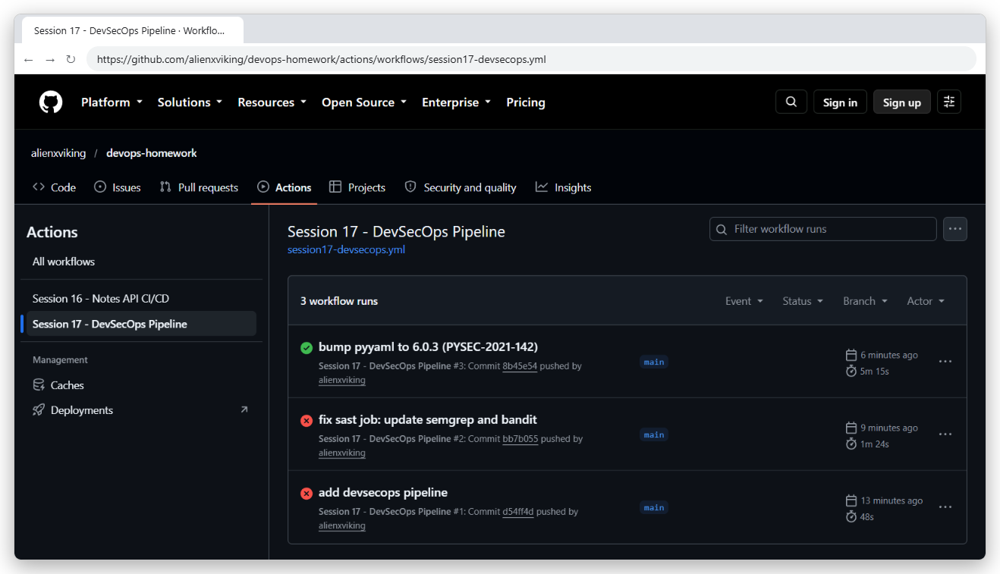
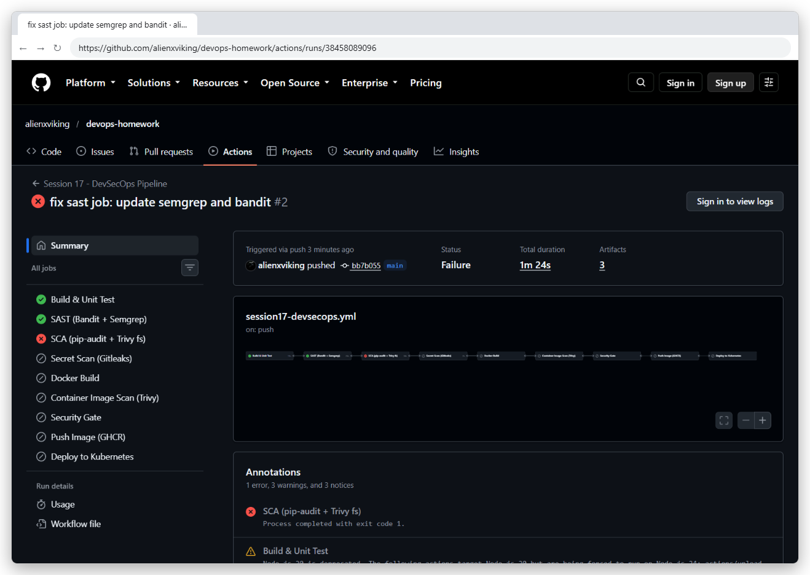
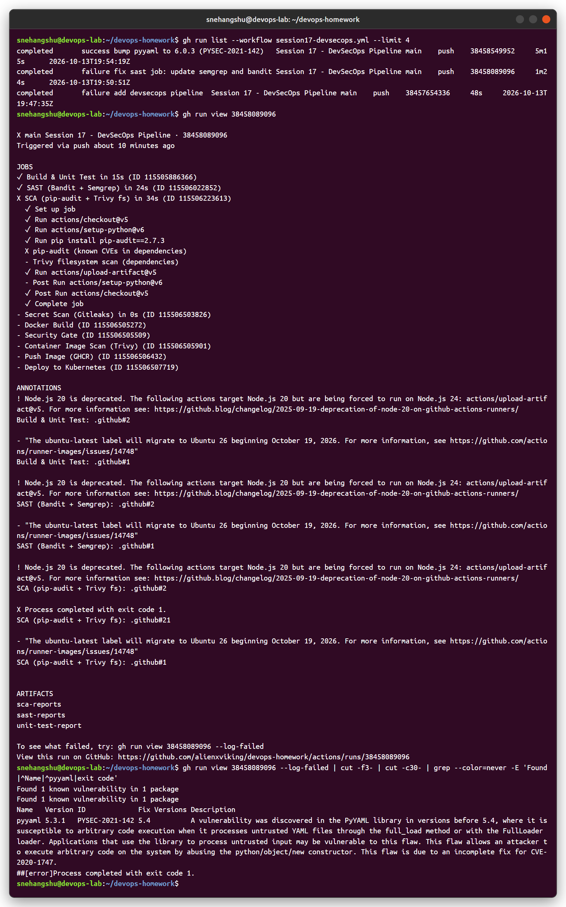
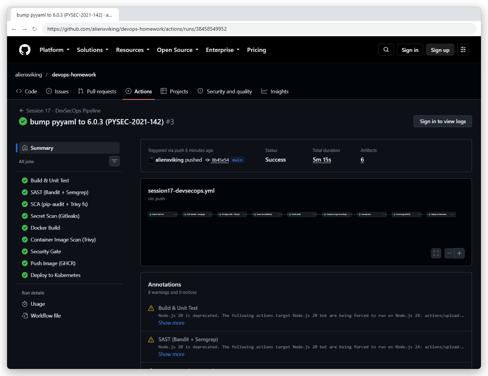
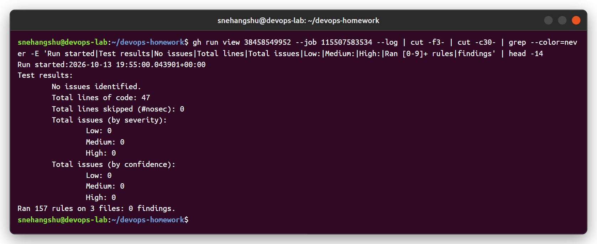
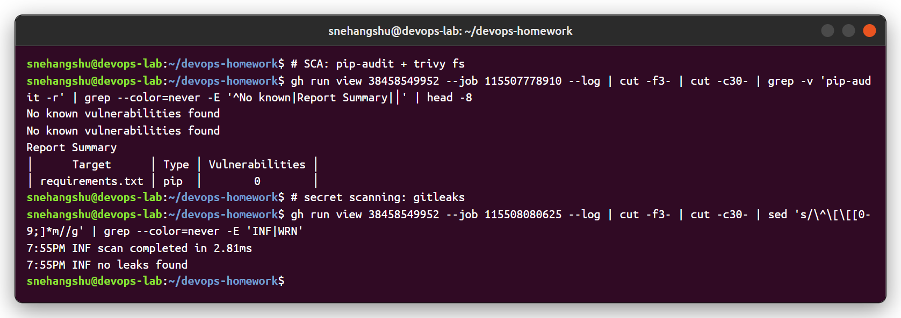
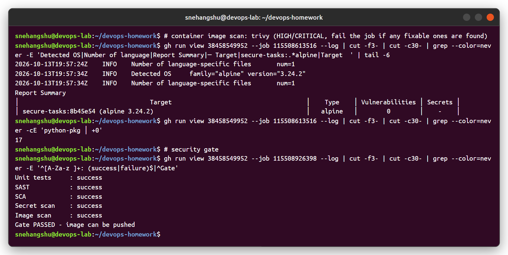
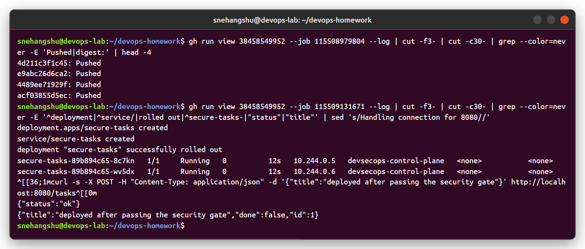

# Session 17 - Complete CI/CD & DevSecOps

Demo project: **Secure Tasks API** (FastAPI) with a DevSecOps pipeline where security checks run on every push, and a **security gate** decides if the image is allowed to be pushed and deployed.

- Workflow: [`.github/workflows/session17-devsecops.yml`](../.github/workflows/session17-devsecops.yml)
- Runs: https://github.com/alienxviking/devops-homework/actions/workflows/session17-devsecops.yml

```
session-17-devsecops/
├── app/main.py, app/config.py   # tasks CRUD API + YAML settings loader (yaml.safe_load)
├── tests/test_main.py           # 7 tests
├── requirements.txt             # fastapi, uvicorn, pyyaml
├── Dockerfile                   # multi-stage, python:3.12-alpine, apk upgrade, non-root uid 10001
├── k8s/deployment.yaml          # runAsNonRoot, readOnlyRootFilesystem, drop ALL capabilities, seccomp, limits
└── security/
    ├── bandit.yaml              # SAST config
    └── .gitleaks.toml           # secret scanning config
```

## Pipeline (same order as the expected flow)

```
Code → Build → Unit Test → SAST → SCA → Secret Scan → Docker Build → Image Scan → Security Gate → Push Image → Deploy to K8s
```

| Stage | Tool | Fails the pipeline when |
|---|---|---|
| Build | pip install + `compileall` | dependencies or syntax broken |
| Unit test | pytest | any test fails |
| **SAST** (static code analysis) | **Bandit** + **Semgrep** (`p/python`, `p/owasp-top-ten`) | medium+ issue / any Semgrep finding |
| **SCA** (dependency vulnerabilities) | **pip-audit** + **Trivy fs** | a dependency has a known CVE (HIGH/CRITICAL for Trivy) |
| **Secret scanning** | **Gitleaks** | a key/token/password is found in the code |
| Docker build | docker | build error |
| **Container image scan** | **Trivy image** | fixable HIGH/CRITICAL CVE in OS packages or python packages |
| **Security gate** | job that `needs:` all checks | any check above failed → gate and everything after it is skipped |
| Push | GHCR with `GITHUB_TOKEN` | only runs after the gate, never for PRs |
| Deploy | kind cluster on the runner | rollout / smoke test fails |

All reports (unit tests, bandit.json, semgrep.json, pip-audit.json, gitleaks report, trivy-image.json) are uploaded as artifacts.

---

## Run history



1. `add devsecops pipeline` - SAST job crashed: semgrep 1.101 needs `pkg_resources`, which the new setuptools no longer has. Pipeline problem, not a code problem.
2. `fix sast job: update semgrep and bandit` - SAST passed, but **SCA blocked the pipeline** (see below).
3. `bump pyyaml to 6.0.3 (PYSEC-2021-142)` - **every stage green**, image pushed and deployed.

## Security gate blocking a vulnerable dependency

`requirements.txt` had `pyyaml==5.3.1`. pip-audit found **PYSEC-2021-142** (CVE-2020-14343, arbitrary code execution through `full_load` / `FullLoader`, fixed in 5.4). The SCA job failed, so Secret Scan, Docker Build, Image Scan, **Security Gate, Push and Deploy were all skipped**, and the vulnerable image never reached the registry or the cluster.





Fix: `pyyaml==6.0.3`. (The code already used `yaml.safe_load`, but scanners can't know that, and the fix is cheap.)

## Passing run



### SAST - Bandit + Semgrep

Bandit: no issues in 47 lines. Semgrep: 157 rules on 3 files, 0 findings.



### SCA + secret scanning

pip-audit: no known vulnerabilities. Trivy fs: `requirements.txt` → 0. Gitleaks: no leaks found.



### Container image scan + security gate

Trivy on `secure-tasks:<sha>` (alpine 3.24.2): 0 vulnerabilities in OS packages and 0 in all 17 python packages. Gate: all checks `success` → image can be pushed.



### Push + deploy to Kubernetes



---

## Why each control matters

- **SAST** finds insecure code patterns (SQL injection, `eval`, weak crypto, `yaml.load`) before the code runs.
- **SCA** - most code in an app is third-party. Old libraries with public CVEs are the most common way in.
- **Secret scanning** - a leaked key in git history is public forever; catching it in CI is cheaper than rotating it later.
- **Image scanning** - the base image's OS packages can be vulnerable even if my code is fine (I use alpine + `apk upgrade` to keep this at 0).
- **Security gate** - turns "we ran a scanner" into "we don't ship if it finds something". Shift left: the earlier it's found, the cheaper it is to fix.
- **Kubernetes hardening** - non-root, read-only filesystem, no Linux capabilities, resource limits: if the app is ever compromised, the attacker can do much less.
