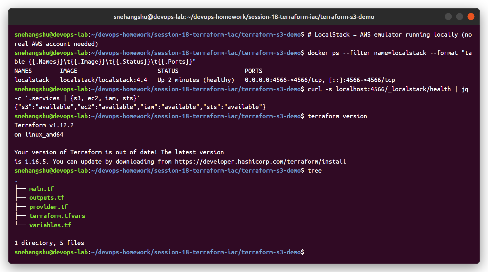
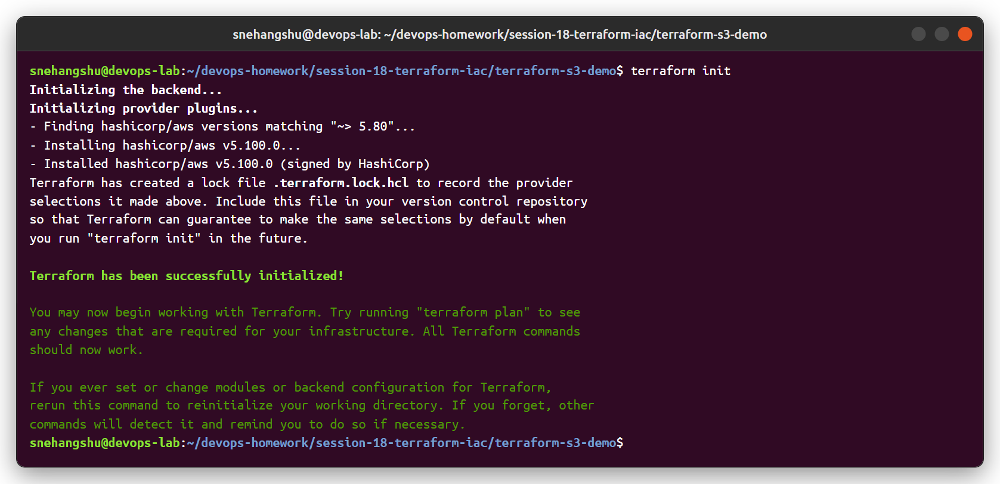
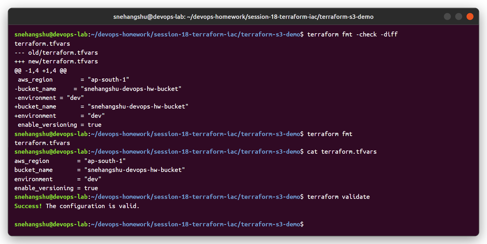
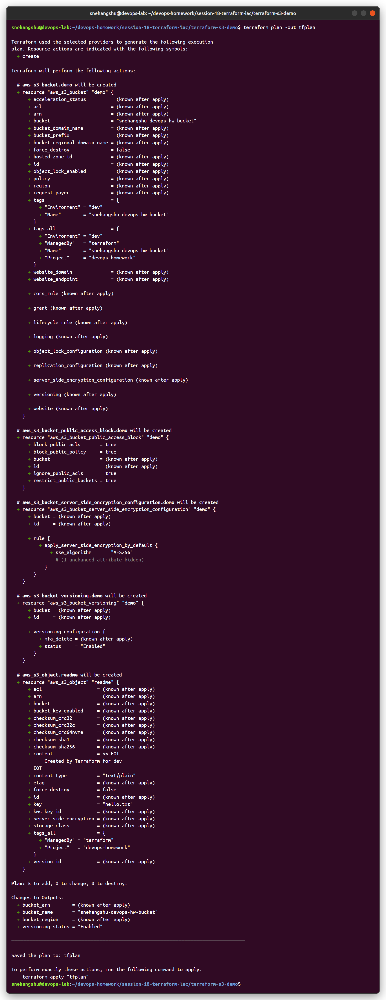
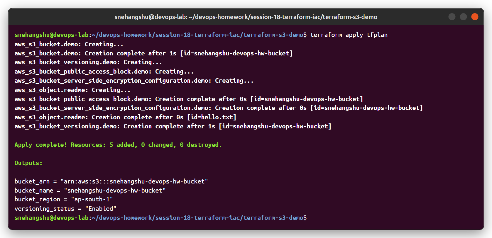
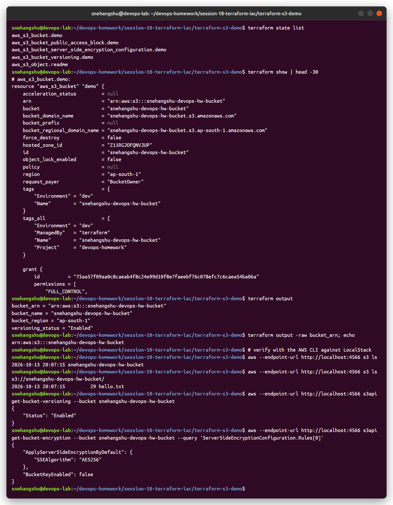
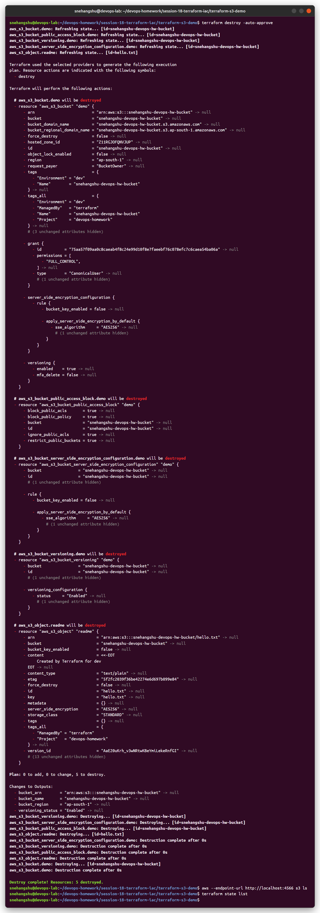

# Session 18 - Terraform & Infrastructure as Code

```
session-18-terraform-iac/
├── terraform-s3-demo/        # Task 1
│   ├── main.tf
│   ├── variables.tf
│   ├── outputs.tf
│   ├── provider.tf
│   ├── terraform.tfvars
│   └── README.md
└── aws-services/             # Task 2
    ├── 01-iam/README.md
    ├── 02-ec2/README.md
    ├── 03-s3/README.md
    ├── 04-vpc/README.md
    └── 05-dynamodb-rds/README.md
```

---

## Task 1: Terraform S3 demo

Terraform v1.12.2, AWS provider 5.x.

**Note about AWS:** I ran this against **LocalStack 4.4**, a local emulator of the AWS APIs, so no AWS account or cost was needed. Terraform talks to it exactly like it talks to AWS (same provider, same resources, same API calls), just with a different endpoint in [`provider.tf`](terraform-s3-demo/provider.tf). To use real AWS, remove the `endpoints`, `skip_*` and dummy key lines and run `aws configure`.

### Setup



### `terraform init`

Downloads the `hashicorp/aws` provider into `.terraform/` and creates `.terraform.lock.hcl` (pins the exact provider version).



### `terraform fmt` + `terraform validate`

`fmt -check -diff` showed that `terraform.tfvars` was not aligned, and `terraform fmt` fixed it. `validate` checks syntax and references without calling AWS.



### `terraform plan`

Shows what will change: **5 to add** (bucket, versioning, encryption, public access block, object). Saved with `-out=tfplan` so `apply` runs exactly this plan.



### `terraform apply`



### `terraform show` + `terraform output` + verification

`state list` / `show` read from `terraform.tfstate`. Checked with the AWS CLI: bucket exists, `hello.txt` is inside, versioning `Enabled`, encryption `AES256`.



### `terraform destroy`

All 5 resources removed. The bucket list and the state are now empty.



### Workflow summary

| Command | What it does |
|---|---|
| `terraform init` | Download providers/modules, set up the backend |
| `terraform fmt` | Format `.tf` files to the standard style |
| `terraform validate` | Check the configuration is valid |
| `terraform plan` | Compare code with state/real infra and show the changes |
| `terraform apply` | Make the changes, update the state |
| `terraform show` | Show the current state in a readable form |
| `terraform output` | Print output values |
| `terraform destroy` | Delete everything managed by this configuration |

Things I learned:
- **State** (`terraform.tfstate`) is how Terraform knows what it created. It must not be committed (it can contain secrets) - in a team it goes in a remote backend (S3 + DynamoDB lock / Terraform Cloud).
- `aws_s3_bucket_versioning`, `..._encryption_configuration` etc. are separate resources in provider v4+, not blocks inside `aws_s3_bucket`.
- Dependencies are automatic: because the versioning resource uses `aws_s3_bucket.demo.id`, Terraform creates the bucket first and destroys it last.

---

## Task 2: AWS services research

| # | Service | Category | Notes |
|---|---|---|---|
| 01 | IAM | Governance | [aws-services/01-iam](aws-services/01-iam/README.md) |
| 02 | EC2 | Compute | [aws-services/02-ec2](aws-services/02-ec2/README.md) |
| 03 | S3 | Storage | [aws-services/03-s3](aws-services/03-s3/README.md) |
| 04 | VPC | Networking | [aws-services/04-vpc](aws-services/04-vpc/README.md) |
| 05 | DynamoDB & RDS | Database | [aws-services/05-dynamodb-rds](aws-services/05-dynamodb-rds/README.md) |
