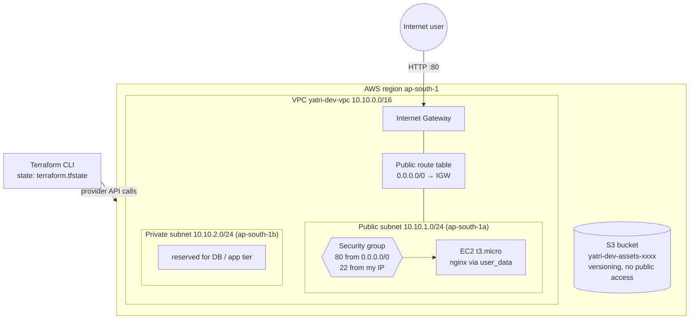
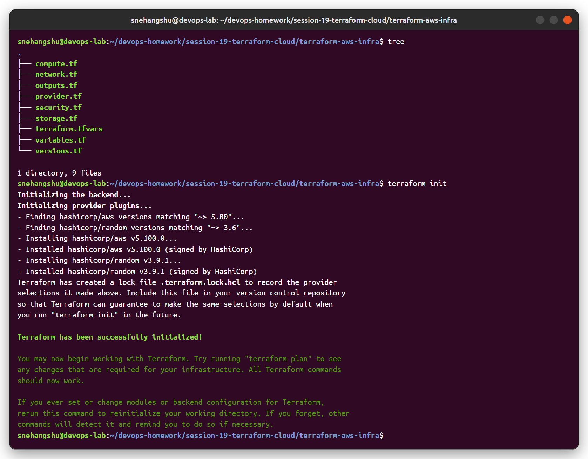
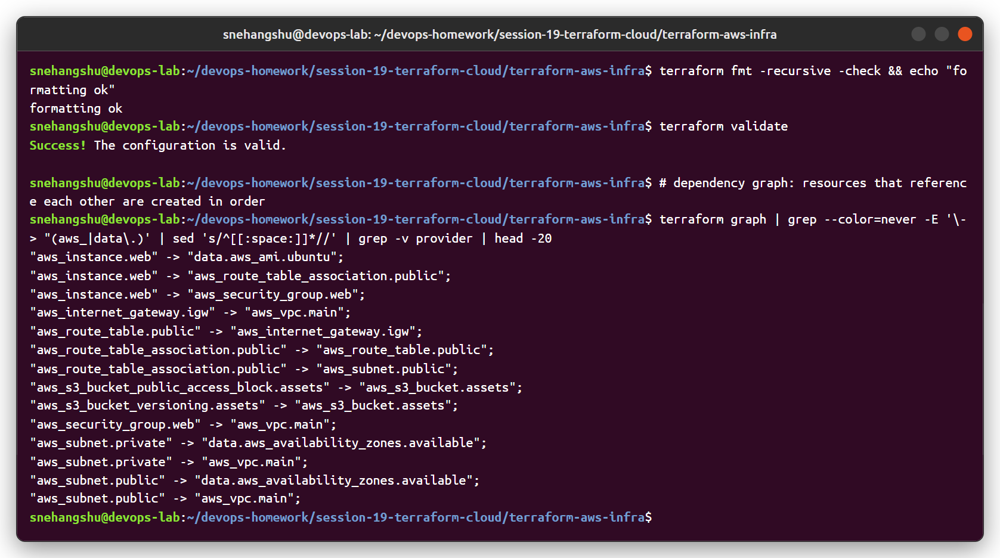
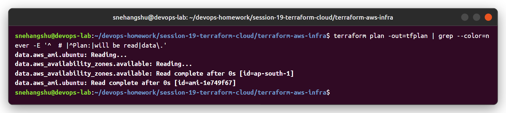
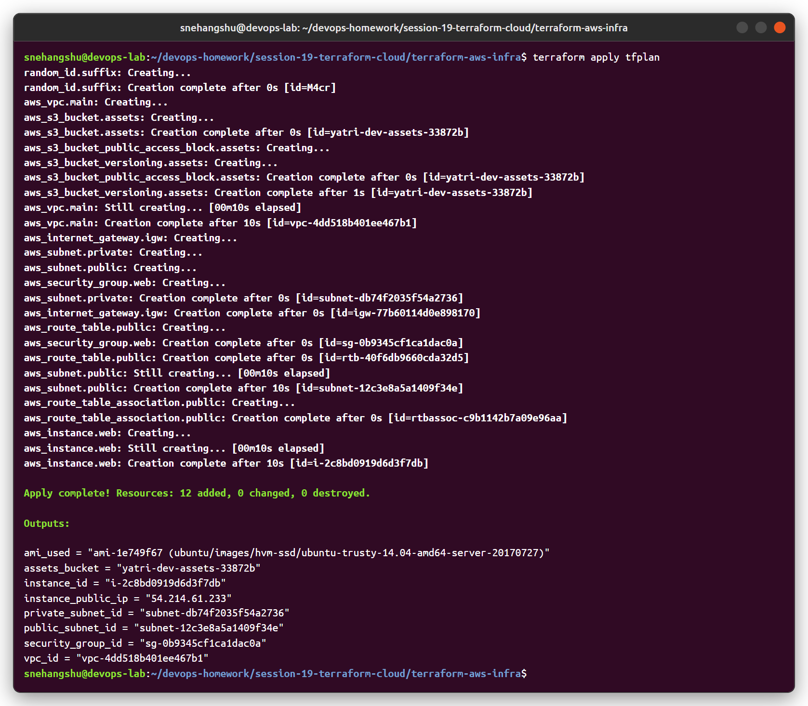
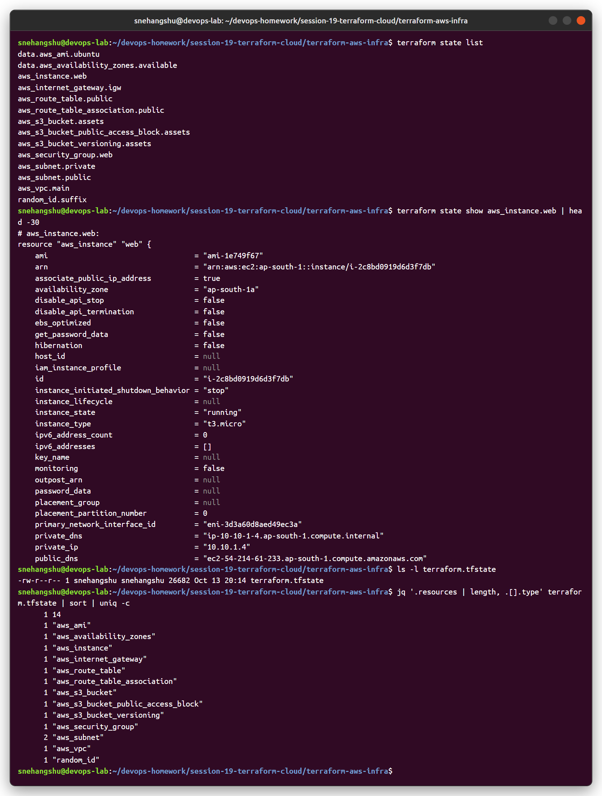
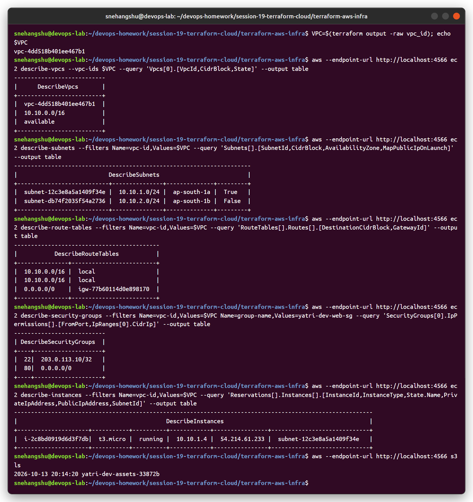
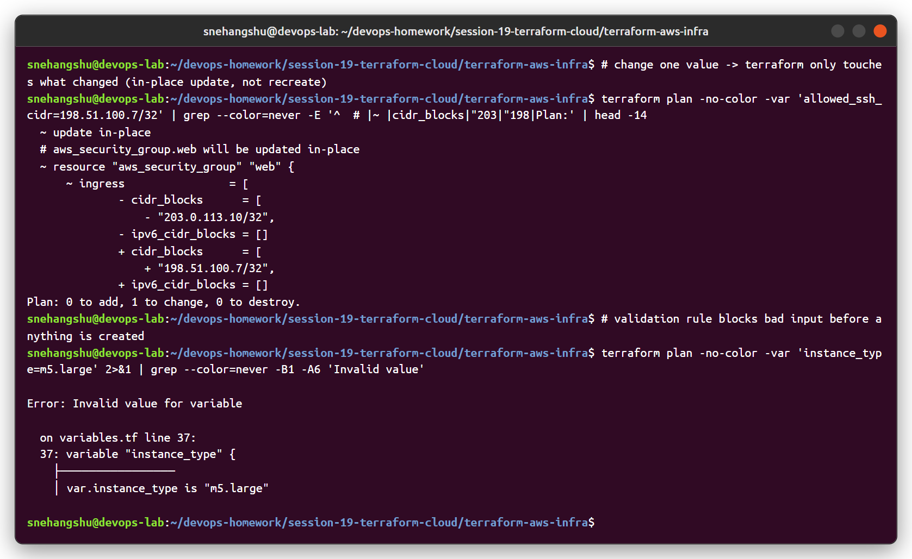
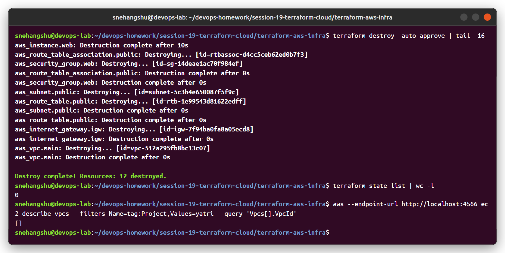

# Session 19 - Cloud & Terraform in Action

End-to-end AWS infrastructure with Terraform: **VPC → subnets → internet gateway + route table → security group → EC2 → S3**.

Project: [`terraform-aws-infra/`](terraform-aws-infra)

| File | Content |
|---|---|
| [versions.tf](terraform-aws-infra/versions.tf) | Terraform version + **providers** (`hashicorp/aws ~> 5.80`, `hashicorp/random`) |
| [provider.tf](terraform-aws-infra/provider.tf) | AWS provider config, default tags |
| [variables.tf](terraform-aws-infra/variables.tf) | **Variables** with types, defaults and a validation rule |
| [terraform.tfvars](terraform-aws-infra/terraform.tfvars) | Variable values for `dev` |
| [network.tf](terraform-aws-infra/network.tf) | VPC, public + private subnet, IGW, route table, association, AZ data source |
| [security.tf](terraform-aws-infra/security.tf) | Security group: HTTP from anywhere, SSH from one IP |
| [compute.tf](terraform-aws-infra/compute.tf) | AMI data source + EC2 instance with user_data (nginx) |
| [storage.tf](terraform-aws-infra/storage.tf) | S3 bucket (random suffix), versioning, public access block |
| [outputs.tf](terraform-aws-infra/outputs.tf) | **Outputs**: IDs, public IP, AMI, bucket name |

> Same as session 18, the AWS provider points to **LocalStack** (local AWS emulator), so this ran without an AWS account. EC2 in LocalStack is emulated (the API works and returns real-looking IDs and IPs, but no VM actually boots). Removing the endpoint/dummy-key lines in `provider.tf` makes the same code deploy to a real AWS account.

## Architecture



```
Terraform
   ├── VPC  10.10.0.0/16
   │     ├── Internet Gateway
   │     ├── Public subnet  10.10.1.0/24  ── route table (0.0.0.0/0 → IGW)
   │     │       └── Security Group (80, 22) ── EC2 t3.micro (nginx)
   │     └── Private subnet 10.10.2.0/24
   └── S3 bucket (versioned, private)
```

---

## 1. Project + `terraform init`

Two **providers** are downloaded (aws, random) and pinned in `.terraform.lock.hcl`.



## 2. fmt, validate and **dependencies**

Terraform works out the order from references. For example `aws_subnet.public` uses `aws_vpc.main.id`, so the VPC is created first. The EC2 instance also has an **explicit** `depends_on = [aws_route_table_association.public]`, because the internet route must exist before user_data runs `apt-get`.



## 3. `terraform plan`

12 resources to add. The 3 data sources (availability zones, AMI) are read first.



## 4. `terraform apply`

Resources are created in dependency order (VPC → IGW/subnets/SG → route table → association → EC2). Independent things like the S3 bucket are created in parallel.



## 5. Terraform **state**

`terraform.tfstate` maps every resource in the code to the real object ID. 14 entries = 12 managed resources + 2 data sources.



## 6. Verify the infrastructure with the AWS CLI

VPC, both subnets, the route `0.0.0.0/0 → igw-...`, the security group rules, the running EC2 instance (private IP from 10.10.1.0/24 and a public IP) and the S3 bucket:



## 7. Changing infrastructure

Changing only `allowed_ssh_cidr` → plan shows **1 to change** (security group updated in place, nothing recreated). An invalid `instance_type` is rejected by the variable validation before any API call.



## 8. `terraform destroy`

Everything is deleted in reverse dependency order and the state is empty.



---

## Concepts used

| Concept | Where |
|---|---|
| Providers | `aws` and `random` in `versions.tf` |
| Variables | `variables.tf` + `terraform.tfvars` + `-var` on the CLI, `validation` block |
| Locals | `local.name = "${var.project}-${var.environment}"` |
| Resources | 12 resources across network/security/compute/storage |
| Data sources | `aws_availability_zones`, `aws_ami` (look up existing things) |
| Outputs | `outputs.tf` |
| Implicit dependency | attribute references (`aws_vpc.main.id`) |
| Explicit dependency | `depends_on` on the EC2 instance |
| State | `terraform.tfstate` (kept out of git, see `.gitignore`) |
| plan / apply / destroy | screenshots 3, 4, 8 |
