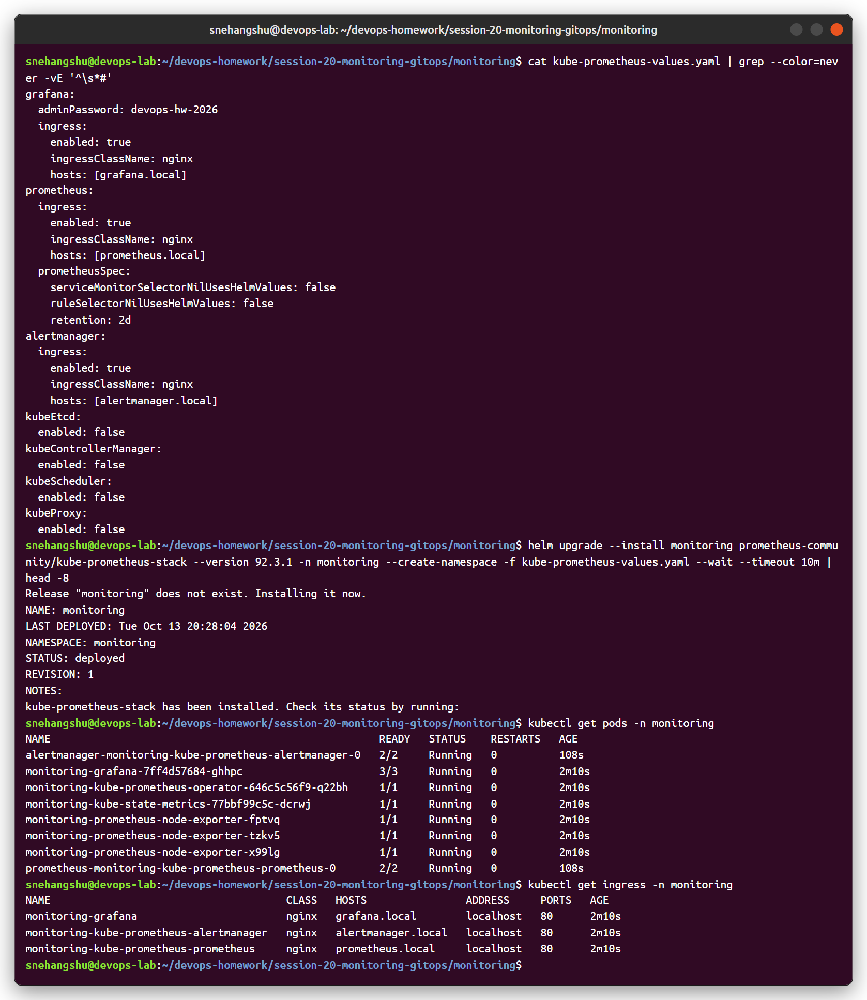
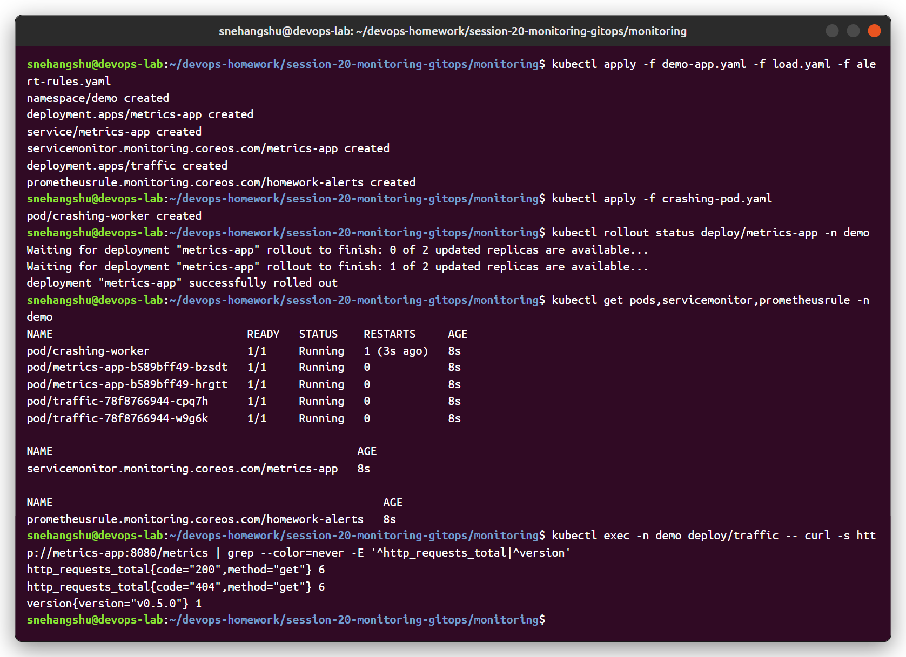
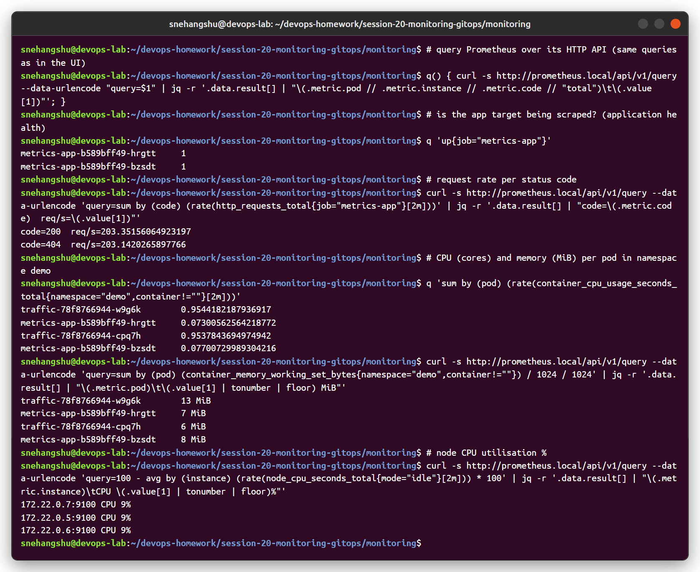
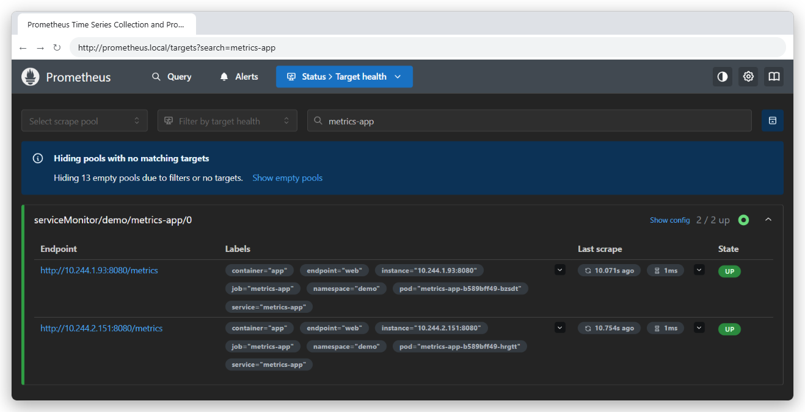
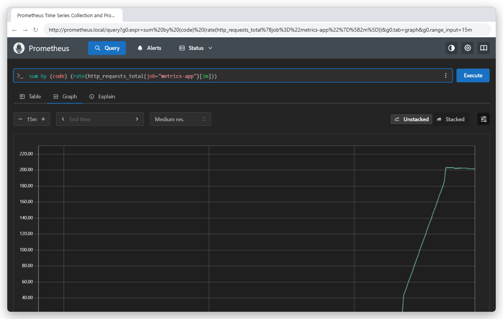
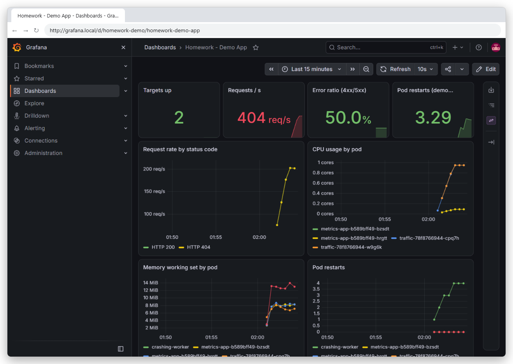
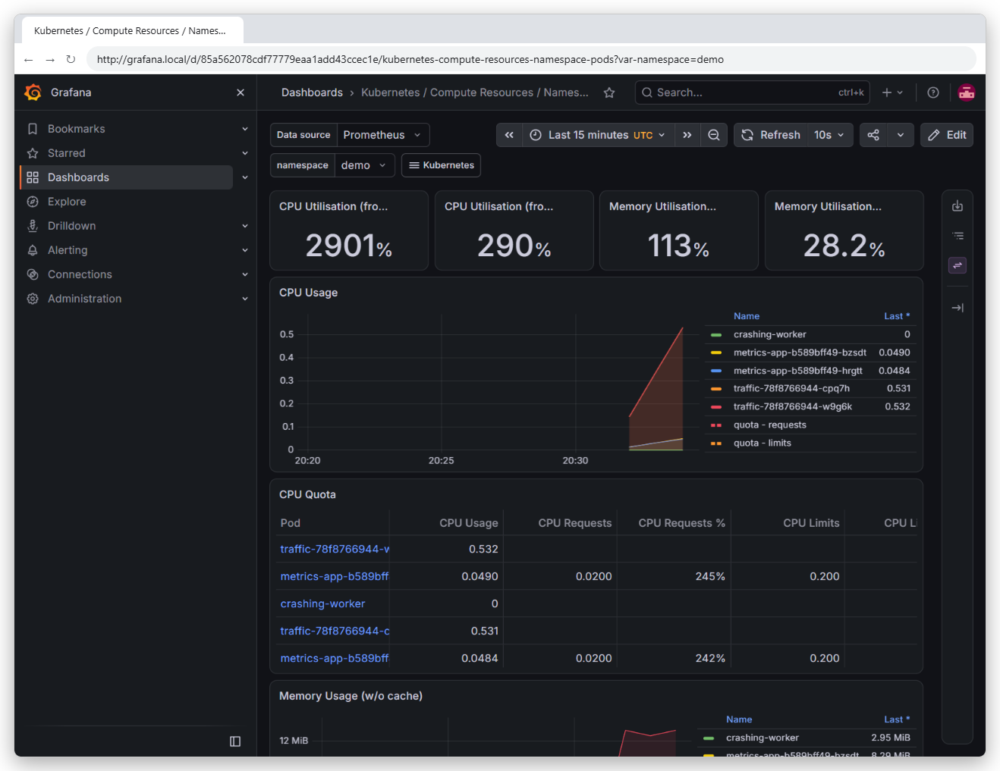
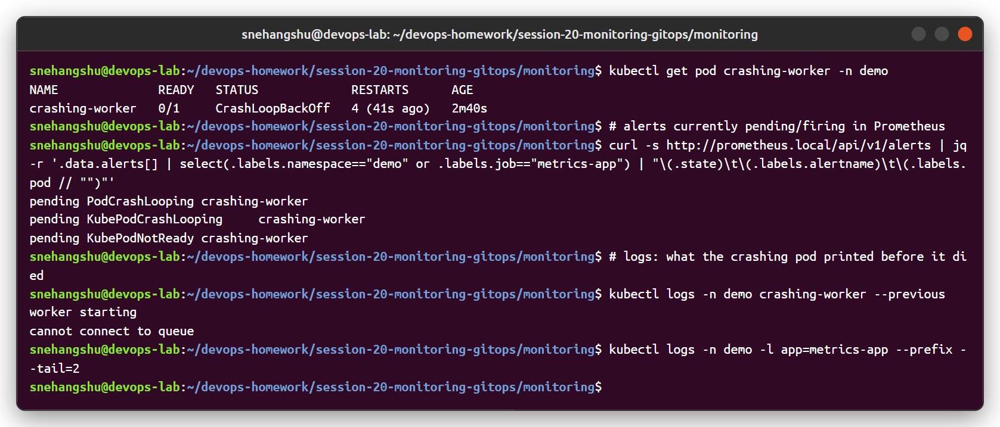
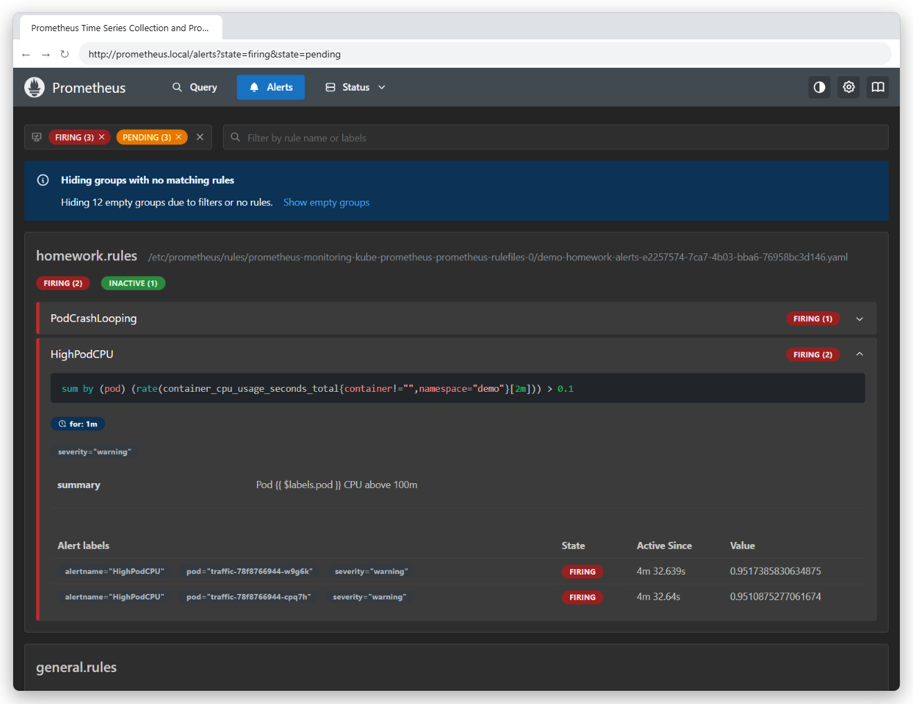
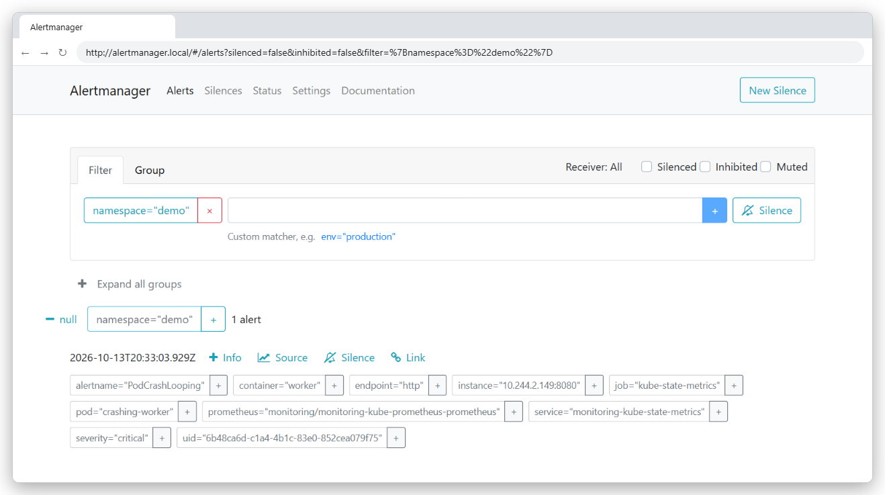

# Session 20 - Monitoring, Observability & GitOps

Cluster: kind (3 nodes) with ingress-nginx. UIs exposed as `grafana.local`, `prometheus.local`, `alertmanager.local`, `argocd.local`.

| Folder | Content |
|---|---|
| [monitoring/](monitoring) | kube-prometheus-stack values, demo app + ServiceMonitor, alert rules, Grafana dashboard, load generator, crashing pod |
| [observability/README.md](observability/README.md) | Task 2 - metrics, logs, traces, tools, Kubernetes observability |
| [gitops/](gitops) | Task 3 - notes + Argo CD values, `Application`, app manifests synced from this repo |

---

## Task 1: Monitoring demo

### Stack

`kube-prometheus-stack` (Helm chart 92.3.1) installs Prometheus Operator, Prometheus, Alertmanager, Grafana, node-exporter (node metrics) and kube-state-metrics (object state metrics). Values: [kube-prometheus-values.yaml](monitoring/kube-prometheus-values.yaml).

### App to monitor

[demo-app.yaml](monitoring/demo-app.yaml): `prometheus-example-app` (exposes `http_requests_total` on `/metrics`) + a **ServiceMonitor** so Prometheus scrapes it every 15s. [load.yaml](monitoring/load.yaml) sends traffic (half of it to a 404 path), [alert-rules.yaml](monitoring/alert-rules.yaml) is a **PrometheusRule**, and [crashing-pod.yaml](monitoring/crashing-pod.yaml) is broken on purpose.

### Metrics, CPU, memory, application health (PromQL)

| What | PromQL |
|---|---|
| App health (target up) | `up{job="metrics-app"}` |
| Request rate by status | `sum by (code) (rate(http_requests_total{job="metrics-app"}[2m]))` |
| Pod CPU (cores) | `sum by (pod) (rate(container_cpu_usage_seconds_total{namespace="demo",container!=""}[2m]))` |
| Pod memory | `sum by (pod) (container_memory_working_set_bytes{namespace="demo",container!=""})` |
| Node CPU % | `100 - avg by (instance) (rate(node_cpu_seconds_total{mode="idle"}[2m])) * 100` |

Prometheus UI - the app pods are discovered through the ServiceMonitor and are `UP`, and the request rate graph:

### Dashboards (Grafana)

My dashboard ([grafana-dashboard.json](monitoring/grafana-dashboard.json), loaded by the Grafana sidecar from a ConfigMap): targets up, requests/s, error ratio (50%, because the load generator calls `/err` which returns 404), restarts, request rate by code, CPU and memory per pod.

Built-in dashboard *Kubernetes / Compute Resources / Namespace (Pods)* for the `demo` namespace (CPU usage vs requests/limits, memory):

### Alerts

| Rule | Condition | Result |
|---|---|---|
| `PodCrashLooping` | > 2 restarts in 5 min | **firing** for `crashing-worker` |
| `HighPodCPU` | pod CPU > 100m for 1 min | **firing** for the 2 `traffic` pods (~0.95 cores) |
| `AppDown` | `up == 0` for 1 min | inactive (app healthy) |

Prometheus sends firing alerts to **Alertmanager**, which groups, silences and routes them (Slack/email/PagerDuty receivers would be configured here):

### Logs

Metrics told me *that* `crashing-worker` restarts. The logs tell me *why*: `kubectl logs --previous` → "cannot connect to queue" (screenshot above). In a real setup logs are shipped centrally (Fluent Bit / Promtail / Grafana Alloy → Loki or Elasticsearch) so they survive pod restarts and can be searched next to the metrics in Grafana. See [observability/README.md](observability/README.md).

---

## Task 2: Observability

→ [observability/README.md](observability/README.md) - the three pillars (metrics, logs, traces), why observability is needed, common tools, Kubernetes observability, golden signals / RED / USE.

---

## Task 3: GitOps

→ [gitops/README.md](gitops/README.md) - concepts **and the Argo CD demo**:

1. Argo CD installed with Helm, `Application` points at `session-20-monitoring-gitops/gitops/app` in this GitHub repo
2. Changed the YAML in git (v1 → v2, 2 → 3 replicas) and pushed → Argo CD synced the cluster by itself
3. Scaled the deployment by hand → Argo CD **self-healed** it back to 3
4. Sync history = git history

| Synced from git | Change pushed to git → auto sync |
|---|---|
|  |  |

