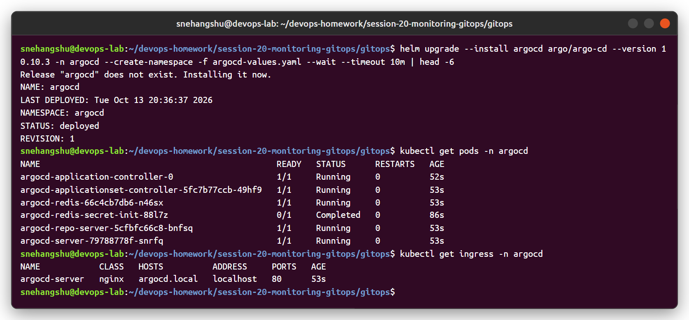
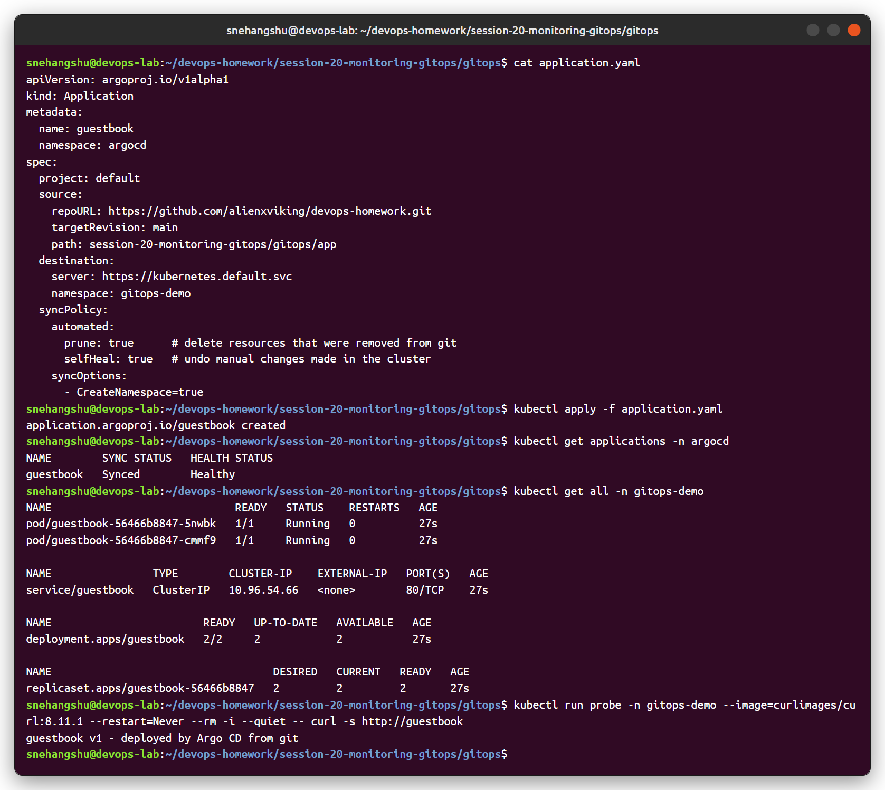
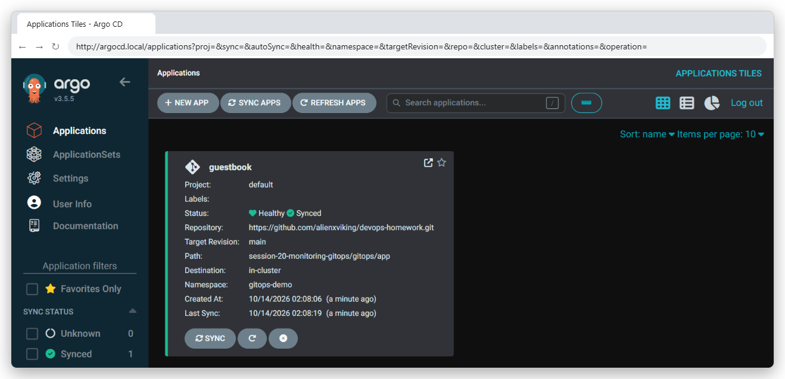
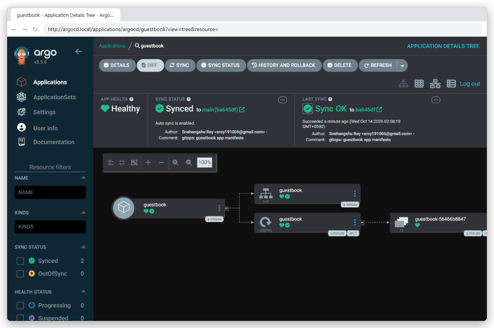
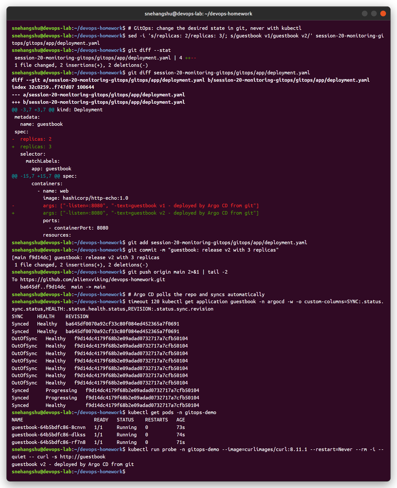
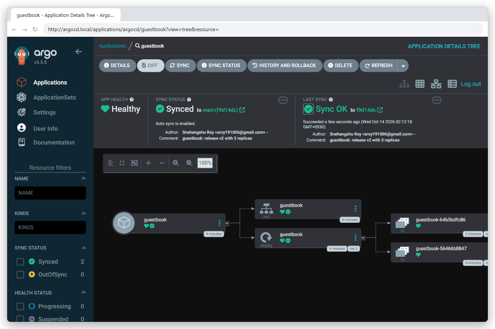
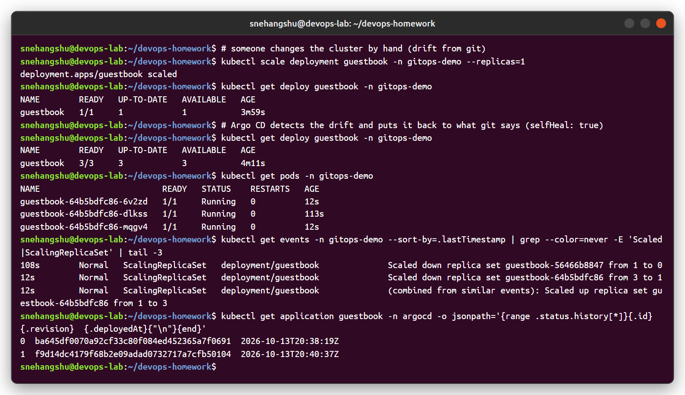
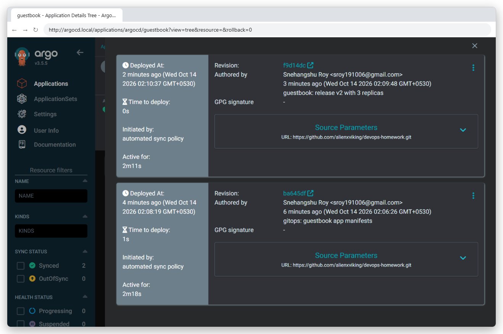

# GitOps - Task 3

## What is GitOps?

GitOps is a way of managing infrastructure and application deployments where **Git is the single source of truth** and an automated agent keeps the running system in sync with what is in Git.

Instead of running `kubectl apply` or deployment scripts by hand (or from CI), we change files in a Git repository. A GitOps controller running in the cluster notices the change and applies it.

The OpenGitOps project (CNCF) defines four principles:

1. **Declarative** - the desired state of the system is described declaratively.
2. **Versioned and immutable** - the desired state is stored in Git with full history.
3. **Pulled automatically** - software agents pull the desired state from the source.
4. **Continuously reconciled** - agents keep observing the actual state and correct any difference.

## Git as the Single Source of Truth

- All Kubernetes manifests, Helm values or Kustomize overlays live in Git.
- Every change goes through a commit and usually a pull request, so there is review and an audit trail (who changed what, when and why).
- Rollback is just `git revert` to a previous commit.
- The cluster can be rebuilt from the repo if it is lost (disaster recovery).
- Nobody needs direct `kubectl` write access to production.

It is common to keep **application code** and **deployment config** in separate repos, so that CI can update image tags in the config repo without triggering a loop of builds.

## Declarative Configuration

Declarative means describing **what** the end state should be, not the steps to get there.

| Imperative                               | Declarative                                   |
|------------------------------------------|-----------------------------------------------|
| `kubectl scale deploy web --replicas=3`  | `replicas: 3` in `deployment.yaml` in Git     |
| `kubectl set image deploy/web web=web:v2`| `image: web:v2` in the manifest               |
| Steps can be forgotten or run twice      | The file is the state, easy to diff and review |

Kubernetes is already declarative, which is why it fits GitOps so well.

## Continuous Reconciliation

The GitOps controller runs a control loop:

```
   +-------------------+        compare        +-------------------+
   |  Desired state    | <-------------------> |   Live state      |
   |  (Git repo)       |                       |   (cluster)       |
   +-------------------+                       +-------------------+
              \                                       ^
               \--- if different: apply changes -----/
```

- **Pull model**: the agent runs inside the cluster and pulls from Git. The CI system does not need cluster credentials.
- **Drift detection**: if someone changes something manually (for example edits a Deployment with `kubectl edit`), the controller sees the live state no longer matches Git and marks the app **OutOfSync**.
- **Self-heal**: when enabled, the controller automatically reverts the manual change back to what Git says.
- **Prune**: resources deleted from Git can be deleted from the cluster too.

## GitOps Workflow

```
 Developer
    |
    | 1. change manifest / image tag
    v
 Feature branch --2. open PR--> Code review + CI checks (lint, kubeconform, tests)
                                        |
                                        | 3. merge
                                        v
                               main branch (Git repo)
                                        |
                                        | 4. Argo CD detects new commit
                                        |    (polling ~3 min or webhook)
                                        v
                                    Argo CD
                                        |
                                        | 5. diff desired vs live, sync
                                        v
                               Kubernetes cluster
                                        |
                                        | 6. health check, status reported
                                        v
                         Synced + Healthy (or alert / rollback)
```

Combined with CI, the full pipeline looks like:

1. CI builds and tests the app, pushes image `web:1.4.2` to the registry.
2. CI (or a tool like Argo CD Image Updater) updates the image tag in the config repo.
3. Argo CD syncs the new tag to the cluster.

## Push vs Pull Based CD

| Aspect               | Push-based CD (traditional)                     | Pull-based CD (GitOps)                          |
|----------------------|-------------------------------------------------|-------------------------------------------------|
| Who deploys          | CI/CD pipeline runs `kubectl` / `helm` against the cluster | Agent inside the cluster pulls from Git  |
| Credentials          | Pipeline needs cluster admin credentials stored outside the cluster | Credentials stay inside the cluster; only read access to Git needed |
| Trigger              | Pipeline run (on commit)                        | Change in Git (poll or webhook)                 |
| Drift handling       | No detection; manual changes stay until next deploy | Detects drift continuously, can self-heal   |
| Source of truth      | Pipeline scripts + cluster state                | Git repository                                  |
| Rollback             | Re-run old pipeline or manual commands          | `git revert`                                    |
| Audit trail          | Pipeline logs                                   | Git history                                     |
| Examples             | Jenkins, GitHub Actions, GitLab CI with kubectl | Argo CD, Flux                                   |

## Kubernetes and GitOps Tools

### Argo CD

- CNCF graduated project, declarative GitOps CD for Kubernetes.
- Has a web UI showing the resource tree, sync status and health.
- Supports plain YAML, Helm, Kustomize and Jsonnet.
- Key concepts: **Application** (one app from a repo path to a cluster/namespace), **AppProject** (grouping and restrictions), **ApplicationSet** (generate many Applications, e.g. per cluster or per environment).
- Sync policies: manual or automated, with prune and self-heal options.

### Flux

- Also a CNCF graduated project.
- Built as a set of controllers (GitOps Toolkit): source-controller, kustomize-controller, helm-controller, notification-controller, image automation controllers.
- More CLI/CRD driven, no built-in UI by default.

| Feature       | Argo CD                     | Flux                                 |
|---------------|-----------------------------|--------------------------------------|
| UI            | Built-in web UI             | No built-in UI (third-party options) |
| Model         | Application CRD             | GitRepository + Kustomization / HelmRelease CRDs |
| Multi-cluster | Central Argo CD managing many clusters | Usually Flux installed per cluster |
| Image updates | Argo CD Image Updater (add-on) | Built-in image automation controllers |

## Argo CD Application Example

```yaml
apiVersion: argoproj.io/v1alpha1
kind: Application
metadata:
  name: web-app
  namespace: argocd
spec:
  project: default
  source:
    repoURL: https://github.com/alienxviking/devops-homework.git
    targetRevision: main
    path: session-20-monitoring-gitops/gitops/manifests
  destination:
    server: https://kubernetes.default.svc
    namespace: web
  syncPolicy:
    automated:
      prune: true      # delete resources removed from Git
      selfHeal: true   # revert manual changes in the cluster
    syncOptions:
      - CreateNamespace=true
```

Useful commands:

```bash
kubectl apply -f application.yaml
argocd app list
argocd app get web-app
argocd app sync web-app
argocd app history web-app
argocd app rollback web-app <history-id>
```

## Benefits and Challenges

**Benefits**

- Every change is reviewed, versioned and auditable.
- Easy rollback and disaster recovery.
- Better security: no cluster credentials in CI.
- Consistent environments, drift is detected automatically.

**Challenges**

- Secrets cannot be stored in Git as plain text; need Sealed Secrets, SOPS or External Secrets Operator.
- Repo structure for many environments and clusters needs planning.
- Some changes (DB migrations, imperative steps) do not fit the model cleanly.

## Demo

Argo CD (v3.5.5, Helm chart `argo/argo-cd` 10.10.3) on the kind cluster, watching this repo:

- [argocd-values.yaml](argocd-values.yaml) - install values (UI at `argocd.local`, git poll every 60s)
- [application.yaml](application.yaml) - the Argo CD `Application`: repo `alienxviking/devops-homework`, path `session-20-monitoring-gitops/gitops/app`, auto-sync with `prune` + `selfHeal`
- [app/](app) - the desired state (Deployment + Service) that Argo CD applies

**1. Install Argo CD and register the app** - Argo CD cloned the repo and created the Deployment/Service itself (no `kubectl apply` of the app).






**2. Change git → cluster follows.** Edited `app/deployment.yaml` (v1 → v2, 2 → 3 replicas), committed and pushed. Argo CD noticed the new commit `f9d14dc`, went `OutOfSync` → synced → `Healthy`, and the app now answers "guestbook v2".




**3. Drift → self-heal.** `kubectl scale --replicas=1` by hand. Within seconds Argo CD scaled it back to 3, because git says 3.



**4. History** - every sync is tied to a git commit, so a rollback is just `git revert` (or "Rollback" in the UI).


